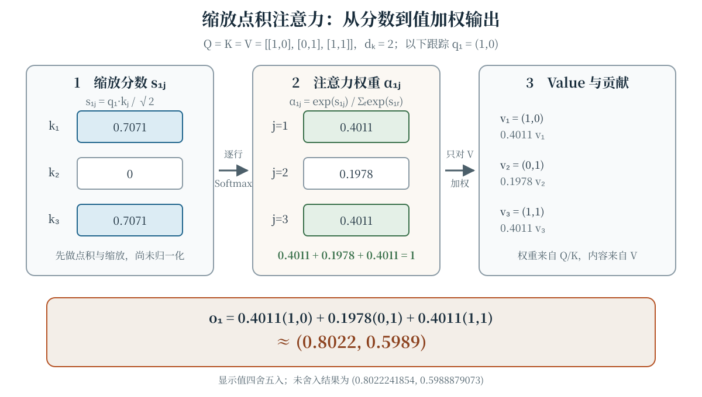
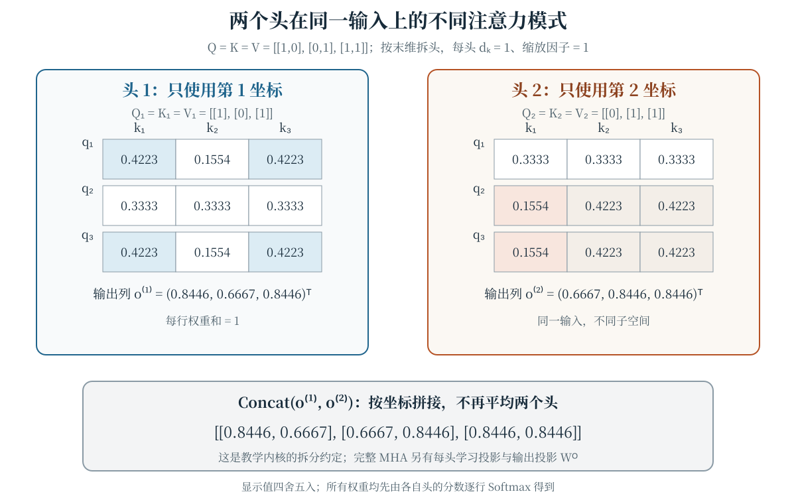
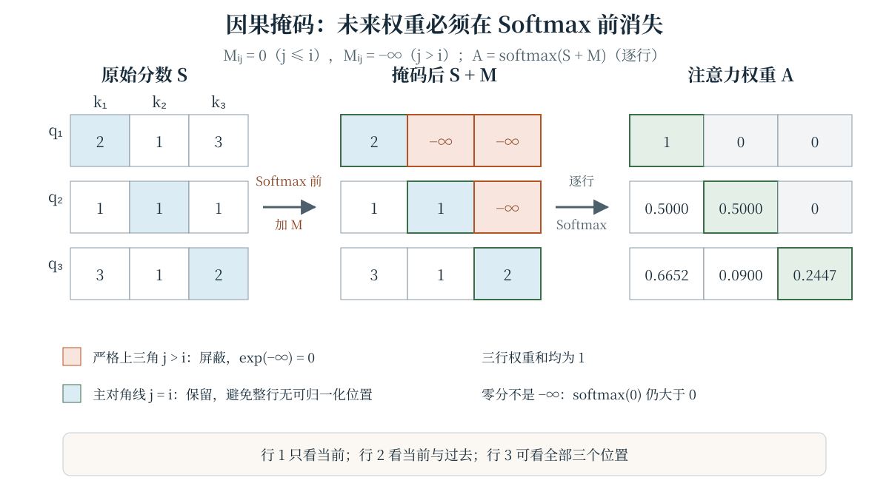
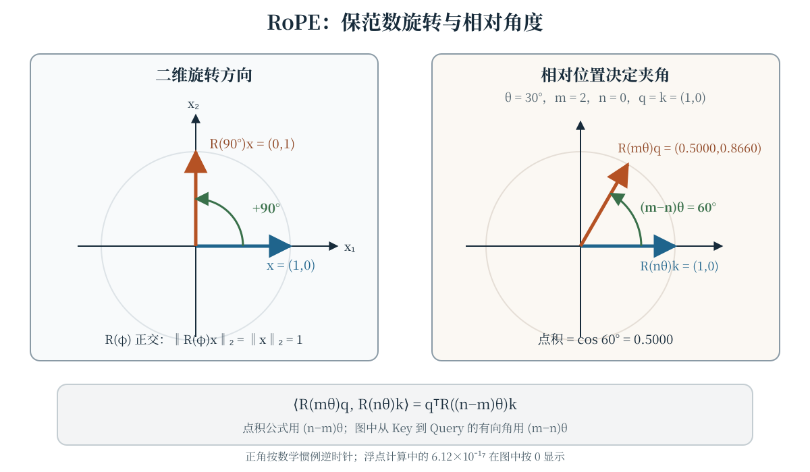

语言模型要处理的并不是一袋无序 Token，而是有顺序的序列：第 $t$ 个位置的表示应如何利用前文，直接决定模型能否并行训练、能否获取远处信息，以及自回归生成时会不会偷看未来。本章从循环神经网络（Recurrent Neural Network，RNN）的计算路径出发，依次建立注意力、缩放点积注意力、多头注意力、因果掩码与旋转位置编码（Rotary Position Embedding，RoPE）的数学定义。

## 学习目标

学完本章，你应当能够：

- 解释 RNN 的顺序计算与长依赖路径为何成为瓶颈，同时不把它误说成“完全无法建模长序列”；
- 从 Query、Key、Value 的角色写出值加权平均，并说明注意力权重为何随查询动态变化；
- 推导缩放点积注意力的形状、Softmax 行归一化及 $1/\sqrt{d_k}$ 的尺度动机；
- 区分多头注意力的通用投影形式与配套教学内核的按维拆分形式；
- 在 Softmax 之前正确施加因果掩码，并解释它如何防止自回归训练中的未来信息泄漏；
- 计算二维 RoPE 旋转，验证范数保持与点积中的相对位置关系。

## 序列建模与 RNN 的瓶颈 {#sec-rnn-limits}

序列建模包括语言建模、机器翻译、语音识别和时间序列预测等任务。对输入 $x_1,\ldots,x_n$，经典 RNN 依次维护隐藏状态：

$$
h_t=f_\theta(x_t,h_{t-1}),\qquad t=1,\ldots,n.
$$

读取 $x_t$ 时，$h_{t-1}$ 将此前信息压缩到固定维度的状态中。这个递推带来两个相互关联但并不相同的限制。

1. **时间维难以并行。** $h_t$ 依赖 $h_{t-1}$，同一条序列的前向计算不能先把所有时间步独立算完再拼接。批样本、层内矩阵运算仍可并行，限制针对的是单序列的递归依赖。
2. **长依赖要经过长路径。** 位置 $j$ 的信息影响很远位置 $i$ 时，需要沿多个隐藏状态传播；路径越长，表示保留与梯度传播越困难。门控 RNN 能缓解部分问题，却不等于消除了递归路径，也不能把“长依赖难学”夸大成“任何 RNN 都无法记住任何远程信息”。

编码器—解码器模型若只用一个固定长度向量概括整个源序列，还会形成信息瓶颈。神经机器翻译中的软对齐工作让解码器在生成每个目标词时按当前状态寻找相关源位置，而不是只读取同一个静态摘要 [@bahdanau2014neural; @luong2015effective]。这条线索促成了后来的注意力机制，但早期加性对齐、Luong 等人的对齐方式与 Transformer 的缩放点积自注意力并不是同一个公式。

自注意力把任意两个位置之间的信息路径缩短为一次直接交互，并允许训练时并行计算所有查询。代价是标准全注意力需要形成 $n\times n$ 的分数矩阵，计算与朴素实现的显存随序列长度呈二次增长；“路径更短”不等于“任何长度下都更快”。

## 注意力是动态的值加权平均 {#sec-attention}

先看一个查询向量 $q$ 与 $n$ 个键值对 $(k_j,v_j)$。用相容性函数 $s(q,k_j)$ 给每个位置打分，再沿 $j$ 归一化：

$$
\begin{aligned}
\alpha_j&=\frac{\exp(s(q,k_j))}{\sum_{r=1}^{n}\exp(s(q,k_r))},\\
o&=\sum_{j=1}^{n}\alpha_jv_j.
\end{aligned}
$$

由于 $\alpha_j\geq0$ 且 $\sum_j\alpha_j=1$，输出 $o$ 是 Value 向量的凸组合。分数只决定“读取多少”，真正被混合的内容来自 $V$；把分数或权重误当成最终表示，会丢掉 Value 这一条路径。

在自注意力中，同一输入序列的表示 $X$ 经不同的学习投影产生

$$
\begin{aligned}
Q&=XW_Q,\\
K&=XW_K,\\
V&=XW_V.
\end{aligned}
$$

Query 表示当前位置要寻找什么，Key 提供供查询匹配的索引，Value 承载被读取的内容。三者来自同一输入并不意味着三个矩阵相同，因为投影参数不同。交叉注意力则通常让 Query 来自一个序列、Key 和 Value 来自另一个序列。

**注意力不是“给每个 Token 一个固定标签”。** 权重 $\alpha_{ij}$ 同时依赖当前查询 $q_i$ 和各位置 Key；同一个 Key 面对不同查询可以得到不同权重，输入或投影变化后整张注意力矩阵也会变化。每行权重是在当前上下文中即时计算的分布，而不是脱离查询、预先贴在 Token 上的常数。

## 缩放点积注意力 {#sec-scaled-attention}

设 $Q\in\mathbb{R}^{n_q\times d_k}$、$K\in\mathbb{R}^{n_k\times d_k}$、$V\in\mathbb{R}^{n_k\times d_v}$。Vaswani 等人的 Transformer 使用缩放点积注意力 [@vaswani2017attention]：

$$
\begin{aligned}
S&=\frac{QK^{\mathsf T}}{\sqrt{d_k}},\\
A&=\operatorname{softmax}_{\mathrm{row}}(S),\\
O&=AV.
\end{aligned}
$$

这里 $S$ 的形状是 $n_q\times n_k$，第 $i$ 行对应第 $i$ 个查询；Softmax 独立归一化每一行，所以 $\sum_jA_{ij}=1$。输出 $O$ 的形状为 $n_q\times d_v$，并不要求 $d_v=d_k$。用矩阵写法的优势是同一批查询和键可以一起计算，而不是改变单行注意力的定义。

### 为什么除以 $\sqrt{d_k}$

做一个仅用于尺度分析的简化假设：$q$ 与 $k$ 的各分量均值为零、方差为一，且跨分量近似独立。此时

$$
\mathbb{E}[q\cdot k]=0,\qquad
\operatorname{Var}(q\cdot k)\approx d_k,
$$

所以未缩放内积的典型量级随 $\sqrt{d_k}$ 增长，而 $(q\cdot k)/\sqrt{d_k}$ 的方差约为一。较大的 Logit 会把 Softmax 推向饱和区，使权重更尖锐并压缩部分梯度。缩放的目的在于控制进入 Softmax 的分数尺度，**不是**为了让行和变成一——不缩放时 Softmax 也会归一化。实际表示存在相关性且方差由学习决定，因此上述推导是设计动机，不是对任意训练状态的严格保证。

@fig-attention-scores 使用与配套内核相同的固定输入 $Q=K=V=[[1,0],[0,1],[1,1]]$，并取 $d_k=2$。对第一个查询 $q_1=(1,0)$，缩放分数为 $(1/\sqrt2,0,1/\sqrt2)$，Softmax 权重约为 $(0.4011,0.1978,0.4011)$，最终读取的是三个 Value 的加权和，而不是 Key 或分数的加权和。HTML 交互可切换查询与缩放系数；无脚本和 PDF 保留同一静态数值图。

::: {.content-visible when-format="html"}
```{=html}
<div class="interactive-mount">
<llm-attention-matrix data-figure-id="fig-attention-scores" query-index="0" scale="0.707106781"></llm-attention-matrix>
</div>
```

<noscript markdown="1">

{data-external="1" #fig-attention-scores fig-alt="缩放点积注意力数值图。固定 Q、K、V 均为三行矩阵 (1,0)、(0,1)、(1,1)，缩放因子为 1/√2。第一个查询 (1,0) 对三个 Key 的分数依次为 0.7071、0、0.7071；Softmax 权重依次为 0.4011、0.1978、0.4011，行和为 1。用这些权重分别乘以 Value (1,0)、(0,1)、(1,1)，输出为 (0.8022,0.5989)。"}

</noscript>
:::

::: {.content-visible unless-format="html"}
{data-external="1" #fig-attention-scores fig-alt="缩放点积注意力数值图。固定 Q、K、V 均为三行矩阵 (1,0)、(0,1)、(1,1)，缩放因子为 1/√2。第一个查询 (1,0) 对三个 Key 的分数依次为 0.7071、0、0.7071；Softmax 权重依次为 0.4011、0.1978、0.4011，行和为 1。用这些权重分别乘以 Value (1,0)、(0,1)、(1,1)，输出为 (0.8022,0.5989)。"}
:::

## 多头注意力：并行表示子空间 {#sec-multi-head}

单个注意力分布只能按一组 Q/K 几何进行匹配。多头注意力使用 $H$ 组学习投影：

$$
\begin{aligned}
(Q_h,K_h,V_h)&=(XW_h^Q,XW_h^K,XW_h^V),\\
\operatorname{head}_h&=\operatorname{Attention}(Q_h,K_h,V_h),
\end{aligned}
$$

$$
\operatorname{MHA}(X)=
\operatorname{Concat}_{h=1}^{H}(\operatorname{head}_h)W^O.
$$

第 $h$ 个头可以有不同的 $d_k^{(h)}$ 与 $d_v^{(h)}$；常见实现取相同头维并令总维数与模型宽度匹配。各头的 Q/K/V 投影与注意力计算可以并行，拼接后再经 $W^O$ 混合。不同头**有机会**学习不同的位置、句法或特征关系，但“头数更多”不自动保证表示更丰富，也不保证每个头都具有稳定、可命名的语义职责。

为便于手算，本书配套数值内核省略可学习投影与 $W^O$，直接把输入末维均分给各头并拼接输出；它是通用定义的简化教学实例，不应误认为完整 Transformer Block。@fig-multi-head 在同一 $Q=K=V$ 上拆成两个一维头：第一个头只使用第一坐标，第二个头只使用第二坐标，因此同一查询在两行权重矩阵中呈现不同模式。

{data-external="1" #fig-multi-head fig-alt="多头注意力数值图，输入 Q、K、V 均为 (1,0)、(0,1)、(1,1)，按末维拆成两个头且每头缩放因子为 1。头一的权重行依次为 (0.4223,0.1554,0.4223)、(0.3333,0.3333,0.3333)、(0.4223,0.1554,0.4223)；头二为 (0.3333,0.3333,0.3333)、(0.1554,0.4223,0.4223)、(0.1554,0.4223,0.4223)。两头输出列分别为 (0.8446,0.6667,0.8446) 和 (0.6667,0.8446,0.8446)，拼接成三行二维输出。"}

## 因果掩码：隔离未来位置 {#sec-causal-mask}

自回归语言模型在位置 $i$ 只能利用不超过 $i$ 的已知前缀。训练时虽然可以把整段序列并行送入模型，但若不做限制，第 $i$ 个查询仍能直接读取后面的 Token，造成目标泄漏。因果掩码（causal mask）在 **Softmax 之前**向分数加入上三角屏蔽项：

$$
\begin{aligned}
M_{ij}&=\begin{cases}
0,&j\leq i,\\
-\infty,&j>i,
\end{cases}\\
A&=\operatorname{softmax}_{\mathrm{row}}(S+M).
\end{aligned}
$$

因为 $\exp(-\infty)=0$，未来位置的权重为零；主对角线 $j=i$ 被保留，所以每一行至少有一个可归一化位置。把已经算好的分数直接乘零并不等于施加 $-\infty$ 掩码：零分经过 Softmax 仍有正权重。若在 Softmax 之后才把未来权重置零，还必须重新归一化，而且信息计算路径已经与标准定义不同。

@fig-causal-mask 对固定分数矩阵施加掩码。第一行只保留当前位置，第二行在前两个位置均分，第三行可读取全部三个位置；右侧每行权重和仍为一。因果掩码约束的是位置可见性，padding 掩码处理的是补齐位置，两者可以组合但不能互相替代。

{data-external="1" #fig-causal-mask fig-alt="三乘三因果掩码数值图。原始分数矩阵为 [[2,1,3],[1,1,1],[3,1,2]]；严格上三角在 Softmax 前变为 −∞，得到 [[2,−∞,−∞],[1,1,−∞],[3,1,2]]。逐行 Softmax 后权重为 [[1,0,0],[0.5,0.5,0],[0.6652,0.0900,0.2447]]，每行和为一，主对角线保留。"}

## RoPE：用旋转注入位置 {#sec-rope}

注意力本身对输入行的排列没有位置先验，因此需要位置编码。RoPE 不把位置向量简单加到 Token 表示上，而是按位置旋转 Query 和 Key 的二维子空间 [@su2021roformer]。本书与配套内核采用相邻分量配对。对向量对 $x=(x_1,x_2)^{\mathsf T}$ 与角度 $\varphi$，定义

$$
\begin{aligned}
R(\varphi)&=
\begin{bmatrix}
\cos\varphi&-\sin\varphi\\
\sin\varphi&\cos\varphi
\end{bmatrix},\\
R(\varphi)x&=
\begin{bmatrix}
x_1\cos\varphi-x_2\sin\varphi\\
x_1\sin\varphi+x_2\cos\varphi
\end{bmatrix}.
\end{aligned}
$$

旋转矩阵正交，因此 $\|R(\varphi)x\|_2=\|x\|_2$。在位置 $m$，第 $i$ 个向量对使用角度 $m\theta_i$；常见频率写法为 $\theta_i=b^{-2i/d}$，但底数、维度编号和分量配对必须以实现为准。配套内核把相邻维度 $(0,1),(2,3),\ldots$ 成对旋转，不能把采用其他配对方式的代码结果直接逐坐标比较。

RoPE 的关键不只是“转了一个绝对位置角度”。对同一频率，位置 $m$ 的 Query 向量对 $q$ 与位置 $n$ 的 Key 向量对 $k$ 满足

$$
\begin{aligned}
\langle R(m\theta)q,R(n\theta)k\rangle
&=q^{\mathsf T}R(m\theta)^{\mathsf T}R(n\theta)k\\
&=q^{\mathsf T}R((n-m)\theta)k.
\end{aligned}
$$

所以这个二维点积只通过相对位移 $n-m$ 接收旋转角；图上从旋转后的 Key 到 Query 的有向角则是 $(m-n)\theta$。这是单个 Q/K 向量对的几何恒等式，不是对完整多层模型“只含相对位置、毫无绝对信息”的过度断言。

@fig-rope-rotation 左侧把 $x=(1,0)$ 逆时针旋转 $90^\circ$ 为 $(0,1)$，与内核的符号约定一致；右侧取 $\theta=30^\circ$、$m=2$、$n=0$，相对位移产生的夹角为 $60^\circ$，两个单位向量的点积为 $\cos60^\circ=0.5$。HTML 交互聚焦左侧向量并支持正负角度；无脚本和 PDF 保留同一完整静态图。

::: {.content-visible when-format="html"}
```{=html}
<div class="interactive-mount">
<llm-rope-rotation data-figure-id="fig-rope-rotation" angle="90"></llm-rope-rotation>
</div>
```

<noscript markdown="1">

{data-external="1" #fig-rope-rotation fig-alt="RoPE 几何图。左侧单位向量 x=(1,0) 经 R(90°) 逆时针旋转为 (0,1)，范数仍为 1。右侧 θ=30°、m=2、n=0，Key 保持 (1,0)，Query 旋转到 (0.5000,0.8660)，从 Key 到 Query 的有向角为 (m−n)θ=60°，点积为 cos60°=0.5000，展示相对位置关系。"}

</noscript>
:::

::: {.content-visible unless-format="html"}
{data-external="1" #fig-rope-rotation fig-alt="RoPE 几何图。左侧单位向量 x=(1,0) 经 R(90°) 逆时针旋转为 (0,1)，范数仍为 1。右侧 θ=30°、m=2、n=0，Key 保持 (1,0)，Query 旋转到 (0.5000,0.8660)，从 Key 到 Query 的有向角为 (m−n)θ=60°，点积为 cos60°=0.5000，展示相对位置关系。"}
:::

## 用代码核对基本定义

下面的 Python 内核与浏览器端实现共享同一数组约定：矩阵按行存储，缩放点积只计算 $q\cdot k$，输出只对 $V$ 加权；`causal_mask` 只负责屏蔽严格上三角，`masked_softmax` 过滤 $-\infty$ 位置后复用有限行 Softmax 并把这些位置的权重恢复为零，`multi_head_attention` 按末维拆头，`rotate_pair` 旋转相邻维度。它们是分解的教学函数，而不是包含投影、归一化、残差与前馈网络的完整模型。实际组合掩码与归一化时，必须保证被屏蔽位置最终权重为零；NaN、正无穷和全掩码行仍会被拒绝。

```python

```

## 常见误解

- **“注意力权重是 Token 的固定重要性标签。”** 权重以当前查询和全部候选 Key 为条件；换一个查询，同一 Token 的权重可以改变。
- **“Q、K、V 都来自 $X$，所以三者完全相等。”** 通用自注意力使用不同学习投影；只有在明确设置的玩具恒等投影例子中才可有 $Q=K=V$。
- **“除以 $\sqrt{d_k}$ 是为了让 Softmax 行和为一。”** Softmax 本身负责归一化；缩放控制的是点积随头维增长的尺度。
- **“每个注意力头都天然对应一种人类可解释关系。”** 多头提供独立子空间的容量，不保证头间语义分工，也不保证注意力图就是完整的因果解释。
- **“把未来分数设为零就完成了因果掩码。”** 零分仍会得到正 Softmax 权重；应在归一化前设为 $-\infty$ 或采用等价实现，使未来权重严格为零。
- **“RoPE 会改变向量长度，或角度方向可随意取反。”** 正交旋转保持范数；符号约定必须与旋转矩阵、相对位置推导和实现一致。
- **“自注意力总能比 RNN 更快。”** 它缩短依赖路径并提高时间维并行度，但标准全注意力的 $n^2$ 分数矩阵在长序列上可能成为主要成本。

## 总结

RNN 通过递归状态处理序列，带来时间维依赖与较长的信息传播路径。注意力把相容性分数归一化为动态权重，再对 Value 加权；缩放点积注意力以 $QK^{\mathsf T}/\sqrt{d_k}$ 控制分数尺度，Softmax 按查询所在行归一化。多头机制在多个学习子空间中并行执行这一过程，完整结构还包含输入与输出投影。因果掩码必须在 Softmax 前隔离严格未来位置，RoPE 则通过保范数旋转使 Q/K 点积呈现相对位置关系。掌握这些定义时，应同时核对张量形状、归一化轴、掩码时机与旋转方向。

## 练习

1. **分析递归路径。** 对长度 $n$ 的序列，说明单个 RNN 前向过程中哪些计算不能沿时间维并行。位置 1 的隐藏状态影响位置 $n$ 至少经过多少次状态转移？这与全自注意力的一次直接交互有何差别？
2. **手算值加权输出。** 取 $q=(1,0)$、$k_1=(1,0)$、$k_2=(0,1)$，$v_1=(10)$、$v_2=(20)$，缩放因子为 1。验证分数为 $(1,0)$，并计算 Softmax 权重与输出；说明为何不能把 $K$ 当作被加权的内容。
3. **推导缩放尺度。** 在 $q,k$ 各分量零均值、单位方差且近似独立的假设下，推导 $\operatorname{Var}(q\cdot k)$ 随 $d_k$ 的关系，并说明该结论在相关或已学习表示上为何不能直接当作保证。
4. **检查多头形状。** 设 $X$ 为 $8\times16$，有两个头，每头 $d_k=d_v=4$。写出每个 $W_h^Q,W_h^K,W_h^V$、单头输出、拼接结果以及 $W^O$ 可以采用的形状；若要输出仍为 $8\times16$，$W^O$ 应如何选取？
5. **执行因果掩码。** 对 $S=[[2,1,3],[1,1,1],[3,1,2]]$ 写出 $S+M$，再计算三行 masked Softmax。核对第一行为 $(1,0,0)$、第二行为 $(0.5,0.5,0)$，并说明主对角线为何不能屏蔽。
6. **区分两种掩码。** 一个 batch 中不同序列经过 padding 后送入 decoder-only 模型。分别说明因果掩码与 padding 掩码屏蔽什么；若某一行所有位置都被屏蔽，Softmax 会遇到什么问题？
7. **核对 RoPE 方向与范数。** 用本章矩阵计算 $R(90^\circ)(1,0)^{\mathsf T}$、$R(90^\circ)(1,2)^{\mathsf T}$，验证二者范数不变。若实现把正角度画成顺时针，公式中的哪一项必然不一致？
8. **推导相对位置。** 从 $R(\varphi)^{\mathsf T}=R(-\varphi)$ 出发，证明 $\langle R(m\theta)q,R(n\theta)k\rangle=q^{\mathsf T}R((n-m)\theta)k$。取 $q=k=(1,0)^{\mathsf T}$、$\theta=30^\circ$、$m=2$、$n=0$，计算点积并解释两个有向角 $(m-n)\theta$ 与 $(n-m)\theta$ 各出现在哪里。
9. **反驳固定标签解释。** 给出一个三位置例子，使同一个 Key 对两个不同 Query 的权重次序相反。为什么仅观察某一行的最大权重，不能推出该 Token 对所有上下文都“最重要”？

::: {.content-visible when-format="html"}
<script type="module">import './assets/js/book.js';</script>
:::
