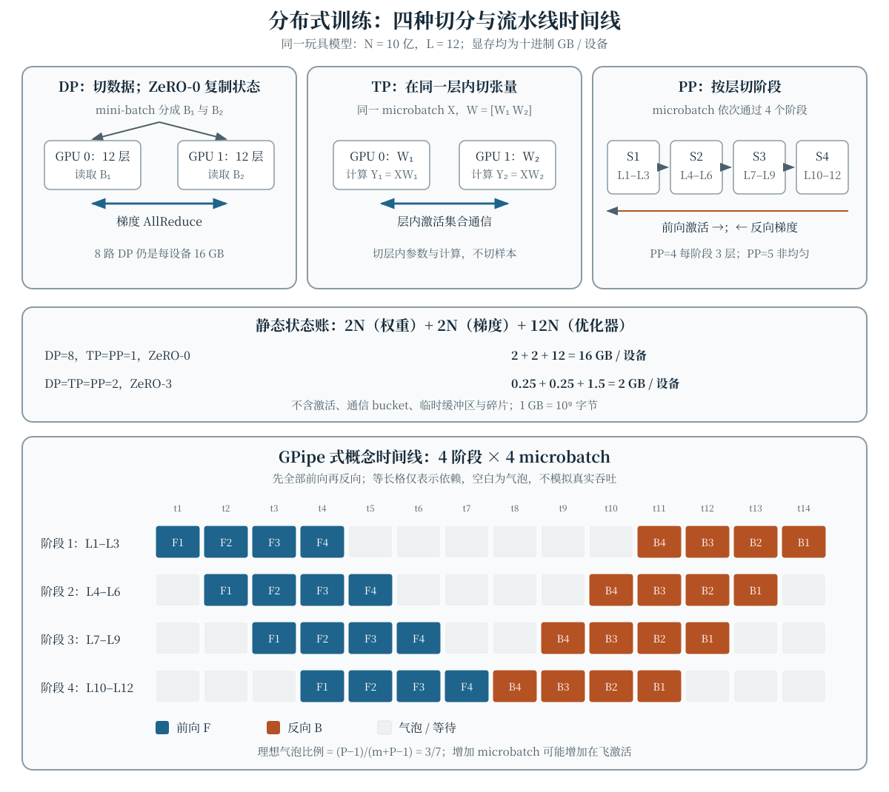

一个模型能否放进单张加速卡，不只取决于权重文件有多大。训练还要保存梯度、主权重、优化器状态和激活；把设备增多以后，又必须说明究竟切分了数据、张量、层，还是这些静态状态本身。本章沿用前章的混合精度字节口径和 Transformer Block 结构，用一个 12 层、10 亿参数的玩具模型逐项记账，并区分并行策略带来的显存收益、通信事件与额外计算。

## 学习目标

学完本章，你应当能够：

- 从 microbatch、累积步数和数据并行度计算全局 batch，并说明梯度累积不能解决哪类显存瓶颈；
- 区分数据并行（Data Parallelism，DP）、张量并行（Tensor Parallelism，TP）、流水线并行（Pipeline Parallelism，PP）切分的对象；
- 按统一的 16 字节/参数假设计算每设备权重、梯度与优化器状态，解释 ZeRO 各阶段和 FSDP 的切分语义；
- 读懂四阶段、四 microbatch 的流水线时间线，识别气泡、点对点通信与激活保存之间的权衡；
- 解释激活重计算为何用额外前向计算换取激活显存，而不把它混入静态状态账目；
- 组合 DP、TP、PP 与状态切分，列出三维并行配置中的主要通信事件和简化账目的边界。

## 同一玩具模型：先分清静态状态与激活 {#sec-distributed-toy}

固定一个只有教学意义的 dense decoder-only 模型：总参数量 $N=10^9$，包含 $L=12$ 个相同 Transformer Block。沿用前章的估算方式，一次乘加记为两次浮点运算时，处理 $D$ 个 Token 的理想 dense 训练量仍可近似写为 $C\approx6ND$；并行改变这些计算如何调度，不会自动改变这个总量口径，也不直接给出真实训练时间。

对静态状态作如下明确假设：

| 状态 | 每参数字节数 | 本章口径 |
|:---|---:|:---|
| 低精度权重 | 2 | FP16 或 BF16 权重副本 |
| 低精度梯度 | 2 | 与权重对应的梯度副本 |
| FP32 主权重 | 4 | 混合精度更新使用的 master weight |
| Adam 一阶、二阶状态 | 8 | 两个 FP32 状态，各 4 字节 |

因此，不切分时每个副本的**静态状态**为

$$
\begin{aligned}
M_{\mathrm{static}}&=N(2+2+4+8)\\
&=16N\ \text{字节}.
\end{aligned}
$$

本章把 FP32 主权重和 Adam 状态合计为 12 字节的“优化器状态”，故每份完整账目也可写成 $2N+2N+12N$。这沿用了混合精度训练需要维护高精度主权重与优化器状态的常见方案；原始混合精度训练工作可见 Micikevicius 等（2018）的论文 [@micikevicius2018mixed]。具体实现若使用 FP32 梯度、不同优化器或额外权重副本，必须重新记账。

这里的 GB 一律是十进制单位：$1\ \mathrm{GB}=10^9$ 字节，而不是 $2^{30}$ 字节的 GiB。静态状态不包括激活、反向临时缓冲区、通信 bucket、算子工作区、CUDA 上下文和显存碎片；“权重能放下”因此远不等于“训练能放下”。

## 梯度累积：推迟同步，不切分参数状态 {#sec-gradient-accumulation}

单卡一次只能容纳 $b$ 条序列时，可以连续处理 $K$ 个 microbatch，累积梯度后再做一次参数更新。若每个 microbatch 大小相同且损失已经按相同口径平均，则累积梯度为

$$
g=\frac1K\sum_{k=1}^{K}g_k.
$$

若每个 DP rank 的 microbatch 含 $b$ 条序列，数据并行度为 $D_{\mathrm{p}}$，一次优化器更新的全局 batch 为

$$
B_{\mathrm{global}}=D_{\mathrm{p}}Kb.
$$

例如 $D_{\mathrm{p}}=8$、$b=2$、$K=4$ 时，全局 batch 是 64 条序列。若 microbatch 的序列数或有效 Token 数不同，不能不加权地平均各次损失；应按任务定义使用样本数或有效 Token 数加权。

梯度累积让同一时刻只需保留当前 microbatch 的激活，并允许把 DP 梯度同步推迟到累积边界；但它**不会**切分权重、梯度或优化器状态。如果完整静态状态已经超过设备容量，仅增加 $K$ 仍无法开始训练。它也不等价于把单个大 batch 的所有中间激活同时保存下来。

## 数据并行：切数据，默认复制状态 {#sec-data-parallel}

DP 把不同样本分给 $D_{\mathrm{p}}$ 个 rank，每个 rank 都持有完整模型并对自己的 microbatch 做前向和反向。为了使同步更新所见的梯度一致，需要对各 rank 的梯度求和或平均：

$$
\bar g=\frac1{D_{\mathrm{p}}}\sum_{r=1}^{D_{\mathrm{p}}}g^{(r)}.
$$

这一同步通常由 AllReduce 或等价的 ReduceScatter/AllGather 序列完成；具体算法和是否重叠反向计算属于实现选择。梯度累积时，可以在第 $K$ 个 microbatch 再同步，而不是每个 microbatch 都同步。

在 ZeRO-0 的玩具账目中，DP 只切数据，**不切分任何静态状态**。所以 $D_{\mathrm{p}}=8$、TP=PP=1 时，每设备仍为

$$
\begin{aligned}
2N+2N+12N&=16\times10^9\ \text{字节}\\
&=16\ \mathrm{GB}.
\end{aligned}
$$

八个设备各自都有 16 GB，而不是把 16 GB 自动除以八。DP 的收益是并行处理样本；其默认显存语义是复制，通信代价则随同步频率、消息量和互连而变。

## 张量并行：在 Block 内切矩阵 {#sec-tensor-parallel}

TP 不切分不同样本，也不按完整层划分设备，而是把同一层的矩阵运算切到多个 rank。对一个简化投影 $Y=XW$，可以按列写为

$$
W=[W_1\ W_2],\qquad Y=[XW_1\ XW_2].
$$

两个 rank 各保存一部分 $W$ 并计算部分输出；在后续按行切分的投影或残差汇合处，再通过 AllReduce 或等价的集合通信得到所需结果。注意力头、Q/K/V 投影和 FFN 都可以设计不同的切分方式，但必须保持与前章 Block 相同的数学形状和依赖关系。Megatron-LM [@shoeybi2019megatron] 给出了 Transformer 层内模型并行的代表性实现思路。

本章玩具账目假设参数总量可被 TP 度均匀整分，因此 TP=$t$ 时，权重、梯度和优化器状态都先除以 $t$。真实模型还要处理 Embedding、归一化参数、不能整除的维度以及激活通信；TP 减少的是层内参数份额，不会消除跨 rank 的激活交换。

## 流水线并行：按层切阶段，用 microbatch 填流水线 {#sec-pipeline-parallel}

PP 把 12 个 Block 按层分到 $P$ 个阶段。本章要求均匀切分，所以 $P$ 必须整除 12：PP=2 时每阶段 6 层，PP=4 时每阶段 3 层，PP=5 在这个玩具模型中没有定义，不能静默给出每层小数或负数显存。相邻阶段通过 Send/Recv 传递前向激活和反向梯度。

若只把一个大 batch 依次交给各阶段，任一时刻大部分设备仍在等待。把 batch 再分成 $m$ 个 microbatch 后，各阶段可以依次处理不同 microbatch。GPipe [@huang2019gpipe] 是这种流水线训练的代表性工作。下图采用“先完成所有前向，再完成所有反向”的 GPipe 式概念调度，并让每段前向或反向都占一个等长格子，只用于展示依赖顺序。

在忽略通信、假设各阶段前向与反向成本相同的理想模型中，$P$ 个阶段、$m$ 个 microbatch 的气泡时间比例可估为

$$
\mathrm{bubble}\approx\frac{P-1}{m+P-1}.
$$

$P=m=4$ 时比例为 $3/7$：时间线共 14 个等长格子，每个阶段忙碌 8 格、空白 6 格。增加 microbatch 能降低这一理想气泡比例，却可能增加同时在飞、需要保存激活的 microbatch 数；真实时间还取决于各阶段负载、前反向成本、通信与调度，不能用这张等长图声称模拟了吞吐。

## ZeRO 与 FSDP：切的是训练状态 {#sec-zero-fsdp}

DP、TP 和 PP 并没有穷尽切分维度。ZeRO [@rajbhandari2020zero] 在 DP 组内进一步分区训练状态。令 $D$、$T$、$P$ 分别表示 DP、TP、PP 度，模型并行切分度为 $M=T\cdot P$。本章使用以下均匀切分规则；参数总量还必须能被当前使用的最大状态切分度整除，否则接口显式报错：

| 状态 | TP/PP 后的基础除数 | 额外的 DP 除数 |
|:---|---:|:---|
| 权重 $M_w$ | $M$ | ZeRO-3 为 $D$，否则为 1 |
| 梯度 $M_g$ | $M$ | ZeRO-2/3 为 $D$，否则为 1 |
| 优化器状态 $M_o$ | $M$ | ZeRO-1/2/3 为 $D$，否则为 1 |

于是

$$
M_{\mathrm{static}}=M_w+M_g+M_o,
$$

其中三项分别使用 $2N$、$2N$、$12N$ 作为未切分分子。ZeRO-1 切优化器状态，ZeRO-2 再切梯度，ZeRO-3 再切权重。Fully Sharded Data Parallel（FSDP）采用参数、梯度与优化器状态全切分的思路，并在计算前按需收集参数；其 bucket、预取、混合精度和持久化策略以实现为准，不能把“与 ZeRO-3 同属全切分思路”误读为所有细节完全相同。PyTorch FSDP 的系统经验见 Zhao 等（2023）的论文 [@zhao2023pytorch]。

对 $D=T=P=2$、ZeRO-3 的配置，总切分度为 $D\cdot T\cdot P=8$，每设备账目为

$$
\begin{aligned}
M_w&=2N/8=0.25\ \mathrm{GB},\\
M_g&=2N/8=0.25\ \mathrm{GB},\\
M_o&=12N/8=1.50\ \mathrm{GB},\\
M_{\mathrm{static}}&=2.00\ \mathrm{GB}.
\end{aligned}
$$

状态切分不是免费删除显存。ZeRO-1 仍要同步梯度并收集更新后的权重；ZeRO-2 常用梯度 ReduceScatter 与权重 AllGather；ZeRO-3/FSDP 还要在 forward/backward 需要完整参数时进行权重 AllGather，并可与预取和释放重叠。显存峰值还受 bucket 大小和在飞通信影响。

下面这段可读 Python 与交互使用同一账目；它只接受本章允许均匀切分的输入，返回十进制 GB/设备：

```python
N = 1_000_000_000

def static_gb(dp, tp, pp, zero):
    if any(type(value) is not int or value <= 0 for value in (dp, tp, pp)):
        raise ValueError("dp, tp, and pp must be positive integers")
    if zero not in (0, 1, 2, 3):
        raise ValueError("zero must be 0, 1, 2, or 3")
    model = tp * pp
    state = model * (dp if zero > 0 else 1)
    if 12 % pp != 0 or N % state != 0:
        raise ValueError("partitions must be uniform")
    weight = 2 * N / (model * (dp if zero == 3 else 1))
    gradient = 2 * N / (model * (dp if zero >= 2 else 1))
    optimizer = 12 * N / (model * (dp if zero >= 1 else 1))
    return (weight + gradient + optimizer) / 1e9

print(static_gb(8, 1, 1, 0))  # 16.0
print(static_gb(2, 2, 2, 3))  # 2.0
```

## 激活重计算：另一本账 {#sec-activation-recomputation}

反向传播需要前向产生的部分中间张量。激活重计算（activation recomputation，也称 activation checkpointing）只保存选定边界的激活，在反向需要时重新执行这一段前向，从而用额外计算减少激活保存量。Chen 等（2016）的论文 [@chen2016training] 是亚线性显存训练的代表性早期工作。

对一个 Block 进行重计算时，可以保存 Block 输入，而在反向前重算其注意力或 FFN 内部结果。它减少的是**激活账**，不会自动减少上文的 $16N$ 静态状态；反过来，ZeRO-3 也不会自动消除长序列、大 microbatch 带来的激活峰值。重计算还增加前向工作，因此前章的 $6ND$ 是忽略重计算的理想基础口径，而不是包含额外前向后的总成本承诺。

调度方式同样影响激活峰值。梯度累积通常让当前 microbatch 的激活在使用后释放；GPipe 式“先全部前向”则会让多个在飞 microbatch 的激活同时存在。选择性重计算、microbatch 数和流水线调度必须一起评估，不能分别只报最优显存数字。

## 三维并行：组合切分与通信，而不是互相替代 {#sec-3d-parallelism}

把 DP、TP、PP 组合起来通常称为三维并行，所需设备数为

$$
G=DTP.
$$

PP 决定每台设备负责哪些层，TP 决定层内张量如何再切，DP 决定这个模型并行实例有多少个数据副本；ZeRO/FSDP 再决定 DP 组内的状态是否分区。Narayanan 等（2021）的论文 [@narayanan2021efficient] 讨论了大模型训练中组合这些维度及流水线调度的系统方法。

对同一个 12 层玩具模型，四种说法必须分开：

- **数据切分**：DP=8 让八个完整模型副本各读不同样本；ZeRO-0 下每个副本仍有 16 GB 静态状态。
- **张量切分**：TP=2 让同一层的参数与计算由两个 rank 分担，并引入层内激活集合通信。
- **层切分**：PP=2 把 12 层分为两个 6 层阶段，相邻阶段传递激活与梯度。
- **状态切分**：ZeRO-3 在 DP=2 组内再切权重、梯度和优化器状态，使 $D=T=P=2$ 时每设备总量降为 2 GB。

这两个例子都使用 8 台设备：$8\times1\times1=8$，$2\times2\times2=8$。设备数相同并不意味着显存或通信相同。工程上常依据带宽把通信频繁的 TP 放在高速互连域内，再安排 PP 和 DP，但这不是脱离拓扑、模型和实现仍成立的固定配方。

## 教学交互：状态账目、通信事件与流水线气泡 {#sec-distributed-demo}

@fig-distributed-training 把上述账目和概念时间线放在一起。交互默认是 DP=8、TP=PP=1、ZeRO-0，因此每设备合计 16 GB；切换为 DP=TP=PP=2、ZeRO-3 后合计 2 GB。堆叠条固定使用 0–16 GB 刻度，通信列表随配置改变。下方流水线图始终固定为四阶段、四 microbatch，用来讨论气泡，不与 PP 控件联动，也不模拟真实吞吐。

::: {.content-visible when-format="html"}
```{=html}
<div class="interactive-mount">
<llm-distributed-training data-figure-id="fig-distributed-training" data-parallel="8" tensor-parallel="1" pipeline-parallel="1" zero-stage="0"></llm-distributed-training>
</div>
```

<noscript markdown="1">

{data-external="1" #fig-distributed-training fig-alt="分布式训练静态教学图。顶部说明 DP 切样本但 ZeRO-0 复制状态，TP 在同一层内切矩阵并通信，PP 把 12 层切成阶段并传递激活。中部给出玩具模型每参数 2 字节权重、2 字节梯度、12 字节优化器状态：DP=8、TP=PP=1、ZeRO-0 时权重 2 GB、梯度 2 GB、优化器 12 GB、合计 16 GB/设备；DP=TP=PP=2、ZeRO-3 时分别为 0.25、0.25、1.5、合计 2 GB/设备。底部为四阶段、四 microbatch 的 GPipe 式等长概念时间线：阶段 1 前向 F1 至 F4 在 t1 至 t4、反向 B4 至 B1 在 t11 至 t14；阶段 2 对应 t2 至 t5 与 t10 至 t13；阶段 3 为 t3 至 t6 与 t9 至 t12；阶段 4 为 t4 至 t7 与 t8 至 t11。空白是气泡；该图不表示真实吞吐。"}

| 配置 | 权重 | 梯度 | 优化器状态 | 总静态状态 |
|:---|---:|---:|---:|---:|
| DP=8，TP=PP=1，ZeRO-0 | 2 GB | 2 GB | 12 GB | **16 GB/设备** |
| DP=TP=PP=2，ZeRO-3 | 0.25 GB | 0.25 GB | 1.5 GB | **2 GB/设备** |

静态通信等价说明：第一种配置有 DP 梯度 AllReduce；第二种配置有 DP 梯度 ReduceScatter、按需权重 AllGather、TP 层内激活集合通信，以及 PP 相邻阶段 Send/Recv。时间线的逐阶段文字等价已写入图像替代文本；所有数值均为每设备十进制 GB，不含激活和临时缓冲区。

</noscript>
:::

::: {.content-visible unless-format="html"}
{data-external="1" #fig-distributed-training fig-alt="分布式训练静态教学图。顶部说明 DP 切样本但 ZeRO-0 复制状态，TP 在同一层内切矩阵并通信，PP 把 12 层切成阶段并传递激活。中部给出玩具模型每参数 2 字节权重、2 字节梯度、12 字节优化器状态：DP=8、TP=PP=1、ZeRO-0 时权重 2 GB、梯度 2 GB、优化器 12 GB、合计 16 GB/设备；DP=TP=PP=2、ZeRO-3 时分别为 0.25、0.25、1.5、合计 2 GB/设备。底部为四阶段、四 microbatch 的 GPipe 式等长概念时间线：阶段 1 前向 F1 至 F4 在 t1 至 t4、反向 B4 至 B1 在 t11 至 t14；阶段 2 对应 t2 至 t5 与 t10 至 t13；阶段 3 为 t3 至 t6 与 t9 至 t12；阶段 4 为 t4 至 t7 与 t8 至 t11。空白是气泡；该图不表示真实吞吐。"}

| 配置 | 权重 | 梯度 | 优化器状态 | 总静态状态 |
|:---|---:|---:|---:|---:|
| DP=8，TP=PP=1，ZeRO-0 | 2 GB | 2 GB | 12 GB | **16 GB/设备** |
| DP=TP=PP=2，ZeRO-3 | 0.25 GB | 0.25 GB | 1.5 GB | **2 GB/设备** |

静态通信等价说明：第一种配置有 DP 梯度 AllReduce；第二种配置有 DP 梯度 ReduceScatter、按需权重 AllGather、TP 层内激活集合通信，以及 PP 相邻阶段 Send/Recv。时间线的逐阶段文字等价已写入图像替代文本；所有数值均为每设备十进制 GB，不含激活和临时缓冲区。
:::

## 常见误解

- **“梯度累积能把大模型切到小卡里。”** 它主要减少同时保存的 microbatch 激活并推迟同步，不切分权重、梯度和优化器状态。
- **“有 8 路 DP，每设备静态显存就除以 8。”** ZeRO-0 的 DP 复制完整状态；只有应用相应状态切分规则后才除以 DP。
- **“TP 和 PP 都是把不同层放到不同设备。”** TP 在层内切张量，PP 才按层划分阶段，两者的数学依赖与通信事件不同。
- **“PP=5 会自动均匀处理 12 层。”** 本章明确拒绝非均匀玩具切分；真实系统的非均匀负载必须另行记账，不能静默平均。
- **“ZeRO 的所有阶段都切权重。”** ZeRO-1 切优化器状态，ZeRO-2 再切梯度，ZeRO-3 才进一步切权重。
- **“状态切分后通信也消失。”** ReduceScatter、AllGather 和预取正是全切分方案的重要成本，bucket 还会影响峰值显存。
- **“激活重计算会减少 Adam 状态。”** 重计算针对激活，并增加额外前向；优化器状态仍由参数与状态切分策略决定。
- **“流水线气泡图就是真实吞吐曲线。”** 等长概念格只表达调度依赖，真实吞吐还受负载、通信、kernel 和在飞 microbatch 影响。
- **“设备总数相同，三维并行配置就等价。”** $8\times1\times1$ 与 $2\times2\times2$ 的状态副本、切分位置和通信拓扑都不同。

## 总结

分布式训练首先要回答“切分什么”。梯度累积划分优化器更新前的 microbatch，DP 切样本，TP 切层内张量，PP 切层，ZeRO/FSDP 切训练状态；它们可以组合，但不能互相冒充。按本章的混合精度假设，完整静态状态为 16 字节/参数：DP=8、ZeRO-0 仍为 16 GB/设备，而 DP=TP=PP=2、ZeRO-3 为 2 GB/设备。显存收益伴随 AllReduce、ReduceScatter、AllGather 或点对点通信；激活重计算再用额外前向换取激活空间。最后，流水线气泡、激活峰值和真实吞吐必须分别分析，任何账目都应写明单位、均匀切分和未计入项。

## 练习 {#sec-exercises}

1. **梯度累积与 batch 口径。** 设 DP=8，每个 rank 的 microbatch 含 2 条序列，累积 4 次后更新。计算全局 batch；若四个 microbatch 的有效 Token 数分别为 100、200、100、200，且目标是按 Token 平均损失，说明为什么不能简单取四个 microbatch 损失的算术平均，并写出正确加权方式。指出梯度同步最早可以推迟到哪个边界。
2. **区分 DP 与状态切分。** 对 10 亿参数玩具模型，手算 DP=8、TP=PP=1、ZeRO-0 时每设备权重、梯度、优化器状态与总字节数，并用十进制 GB 表示。随后把策略改为 ZeRO-1、ZeRO-2、ZeRO-3，分别计算总量，并解释哪一种切分在哪一步生效。
3. **核对 TP/PP 的均匀切分。** 对同一 12 层模型，先取 TP=2、PP=2、DP=1、ZeRO-0，计算每设备总静态状态和每阶段层数；再说明 PP=5 为何被本章接口拒绝。用 $Y=XW$ 的列切分解释 TP 与 PP 的切分对象有何不同，并各写一种必要通信。
4. **推导 ZeRO 阶段账。** 固定 DP=4、TP=PP=1，利用正文表格分别验证 ZeRO-0/1/2/3 的总静态状态为 16、7、5.5、4 GB/设备。列出 ZeRO-2 与 ZeRO-3 各自的梯度、权重通信事件，并说明为何这些数字仍不是完整显存峰值。
5. **分析流水线气泡。** 在正文的等长、忽略通信模型中，计算 $P=4$ 且 $m=4$、$m=12$ 时的理想气泡比例。对照四阶段时间线指出阶段 1 的前向和反向区间，并讨论增加 microbatch 为何可能同时降低气泡比例与提高激活显存压力；指出两项真实系统中破坏该理想比例的因素。
6. **设计三维并行并检查遗漏。** 对 DP=TP=PP=2、ZeRO-3，计算设备总数、每阶段层数及每设备四类静态状态字节数。列出 DP、TP、PP 各自至少一种通信事件；随后说明激活重计算会改变哪本账、增加什么成本，以及通信 bucket、临时缓冲区和阶段参数不均衡为何要另行测量。

:::: {.content-visible when-format="html"}
```{=html}
<script type="module">
import { defineDistributedTrainingElement } from './assets/js/components/distributed-training.js';
defineDistributedTrainingElement();
</script>
```
::::
