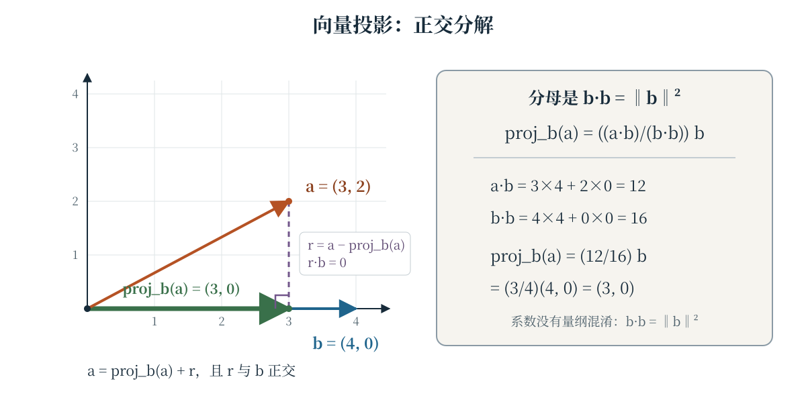
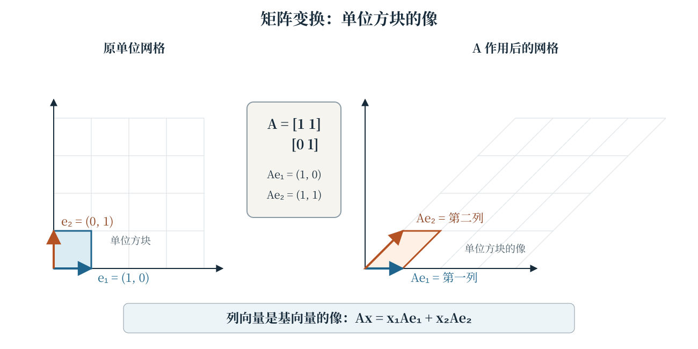
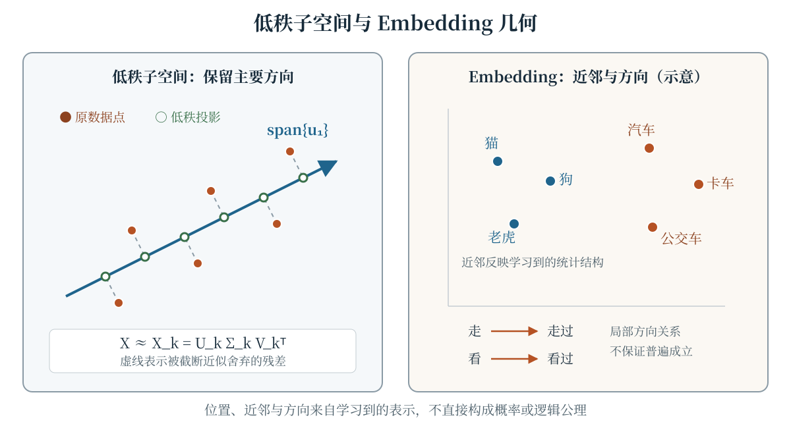

Embedding 常被描述为“语义空间中的点”，注意力又被描述为“相关 Token 彼此关注”。这些说法只有落到向量运算上才可检验：点如何比较，方向如何分解，矩阵如何改变空间，低维表示又保留了什么？本章从向量、内积与矩阵出发，连接 SVD、Embedding 和 Q/K/V。线性映射、特征向量与奇异值分解的严格理论可参阅 Axler 的教材 [@axler2015linear]；本章只选取理解 LLM 表示所需的主线。

## 学习目标与记号约定

学完本章，你应当能够：

- 计算向量加法、标量乘法、内积、范数、余弦相似度和正交投影；
- 用“列向量是基向量的像”解释矩阵变换，并区分特征分解与 SVD 的适用对象；
- 写出截断 SVD，解释低秩近似的误差来源及其边界；
- 用位置、方向和子空间描述 Embedding，同时避免把几何直觉当成语义定律；
- 写出 Q/K/V 的线性映射与缩放点积注意力，并说明注意力分数为何不是语义相似度。

本章默认实数域。未特别说明时，$x\in\mathbb{R}^n$ 在矩阵乘式中按列向量处理；矩阵用大写字母表示，$A^{\mathsf T}$ 表示转置。阅读代码只需基础 Python 知识，不需要 NumPy、GPU 或模型权重。

## 向量及其运算

向量是有序的数值对象。在选定基以后，$a=(a_1,\ldots,a_n)\in\mathbb{R}^n$ 的坐标可以排成一列；坐标表示依赖基，不能把一个坐标列表脱离约定地等同于“意义本身”。对同维向量 $a,b$ 和标量 $c$，加法与标量乘法逐分量定义：

$$
\begin{aligned}
a+b&=(a_1+b_1,\ldots,a_n+b_n),\\
ca&=(ca_1,\ldots,ca_n).
\end{aligned}
$$

不同维度的向量不能直接相加。形如 $\sum_{j=1}^{m}c_jv_j$ 的组合称为**线性组合**；所有这样的组合构成这些向量的张成（span）。Embedding 表的一行常用来取出某个 Token 的表示，而在线性代数推导中仍可把取出的表示写成列向量，只要转置关系保持一致。

## 内积与范数 {#sec-dot-product}

实向量 $a,b\in\mathbb{R}^n$ 的**内积**（dot product）和欧氏范数定义为

$$
\begin{aligned}
a\cdot b&=a^{\mathsf T}b=\sum_{i=1}^{n}a_ib_i,\\
\|a\|_2&=\sqrt{a\cdot a}=\sqrt{\sum_{i=1}^{n}a_i^2}.
\end{aligned}
$$

内积把一对向量映射为标量，范数把单个向量映射为非负长度。非零向量的夹角 $\theta$ 满足

$$
a\cdot b=\|a\|_2\|b\|_2\cos\theta.
$$

因此 $a\cdot b=0$ 表示两个非零向量正交；内积的符号反映夹角锐钝，绝对值还受两者长度影响。例如 $a=(1,2)$ 与 $b=(2,-1)$ 的内积为零，但它们都不是零向量。

### 余弦相似度：只比较方向

对非零向量，余弦相似度为

$$
\begin{aligned}
\operatorname{cosim}(a,b)
&=\frac{a\cdot b}{\|a\|_2\|b\|_2}\\
&=\cos\theta\in[-1,1].
\end{aligned}
$$

它消除了正标量缩放的影响：若 $\alpha,\beta>0$，则 $\operatorname{cosim}(\alpha a,\beta b)=\operatorname{cosim}(a,b)$。这一性质适合比较方向，却也意味着模长信息被主动丢弃。零向量没有可定义的方向，不能代入上式。

**余弦相似度不是距离，也不是概率。** 它可以为负，取 $1$ 只表示正向共线，不表示“两个事件必然相同”。常见的 $1-\operatorname{cosim}(a,b)$ 是另行定义的余弦距离，不能与原相似度混用；Softmax 归一化也不是余弦计算的一部分。

### 向量投影：保留一个方向的分量

给定向量 $a$ 和非零方向 $b$，$a$ 在 $\operatorname{span}\{b\}$ 上的正交投影记为 $\operatorname{proj}_b(a)$。令投影为 $\alpha b$，并要求残差 $a-\alpha b$ 与 $b$ 正交：

$$
(a-\alpha b)\cdot b=0
\quad\Longrightarrow\quad
\alpha=\frac{a\cdot b}{b\cdot b}.
$$

于是

$$
\operatorname{proj}_b(a)=\frac{a\cdot b}{b\cdot b}\,b,
\qquad b\ne0.
$$

这里**投影分母是 $b\cdot b=\|b\|_2^2$**，不是 $\|b\|_2$，也不是 $a\cdot a$。若只想要带符号的标量投影长度，则是 $a\cdot b/\|b\|_2$；把标量系数与投影向量区分开，可以避免多除或少除一次范数。投影方向 $b$ 不能为零，但被投影的 $a$ 可以是零向量。

@fig-vector-projection 取 $a=(3,2)$、$b=(4,0)$。此时 $a\cdot b=12$、$b\cdot b=16$，所以系数为 $12/16=3/4$，投影为 $(3,0)$，竖直残差与 $b$ 正交。

::: {.content-visible when-format="html"}
```{=html}
<div class="interactive-mount">
<llm-vector-projector data-figure-id="fig-vector-projection" angle-a="45" angle-b="0"></llm-vector-projector>
</div>
```

<noscript markdown="1">

{data-external="1" #fig-vector-projection fig-alt="向量投影示意图：原点出发的向量 a 等于 (3,2)，水平向量 b 等于 (4,0)。a 在 b 上的投影为 (3,0)，从投影终点到 a 终点的竖直虚线表示残差，并标出直角。右侧计算 a 点乘 b 等于 12、b 点乘 b 等于 16，因此投影系数为四分之三。"}

</noscript>
:::

::: {.content-visible unless-format="html"}
{data-external="1" #fig-vector-projection fig-alt="向量投影示意图：原点出发的向量 a 等于 (3,2)，水平向量 b 等于 (4,0)。a 在 b 上的投影为 (3,0)，从投影终点到 a 终点的竖直虚线表示残差，并标出直角。右侧计算 a 点乘 b 等于 12、b 点乘 b 等于 16，因此投影系数为四分之三。"}
:::

## 矩阵作为线性变换 {#sec-matrix-transform}

矩阵 $A\in\mathbb{R}^{m\times n}$ 不只是数字表格，也表示从 $\mathbb{R}^n$ 到 $\mathbb{R}^m$ 的线性映射 $x\mapsto Ax$：

$$
A(\alpha x+\beta y)=\alpha Ax+\beta Ay.
$$

若 $A$ 的第 $j$ 列记为 $a_{:j}$，则

$$
Ax=\sum_{j=1}^{n}x_ja_{:j},
\qquad Ae_j=a_{:j},
$$

其中 $e_j$ 是第 $j$ 个标准基向量。因此，**矩阵的列向量是标准基向量的像**：第一列是 $Ae_1$，第二列是 $Ae_2$，依此类推。计算 $Ax$ 时可以按行做点积，但理解空间如何变形时，观察列向量通常更直接。

@fig-matrix-transform 使用剪切矩阵

$$
A=\begin{bmatrix}1&1\\0&1\end{bmatrix}.
$$

它保持 $e_1=(1,0)$ 不变，把 $e_2=(0,1)$ 映为 $(1,1)$；原单位方块随之变成平行四边形，网格仍由平行直线组成。面积缩放比例由 $|\det A|$ 给出，而旋转、剪切、投影等不同变换不能仅凭一个输出点唯一确定。

::: {.content-visible when-format="html"}
```{=html}
<div class="interactive-mount">
<llm-matrix-transformer data-figure-id="fig-matrix-transform" matrix="identity"></llm-matrix-transformer>
</div>
```

<noscript markdown="1">

{data-external="1" #fig-matrix-transform fig-alt="矩阵变换示意图：左侧是标准单位网格与单位方块，基向量 e1 和 e2 分别指向右方和上方；右侧经过矩阵 A 等于 [[1,1],[0,1]] 后，单位方块变为平行四边形。第一列 Ae1 为 (1,0)，第二列 Ae2 为 (1,1)，明确展示列向量是基向量的像。"}

</noscript>
:::

::: {.content-visible unless-format="html"}
{data-external="1" #fig-matrix-transform fig-alt="矩阵变换示意图：左侧是标准单位网格与单位方块，基向量 e1 和 e2 分别指向右方和上方；右侧经过矩阵 A 等于 [[1,1],[0,1]] 后，单位方块变为平行四边形。第一列 Ae1 为 (1,0)，第二列 Ae2 为 (1,1)，明确展示列向量是基向量的像。"}
:::

### 特征值与特征向量

对方阵 $A\in\mathbb{R}^{n\times n}$，若非零向量 $v$ 满足

$$
Av=\lambda v,
\qquad \lambda\in\mathbb{R},
$$

则 $v$ 是特征向量，$\lambda$ 是对应特征值。沿这一方向，变换只进行缩放；$\lambda<0$ 还会翻转方向，$\lambda=0$ 则把该方向压到原点。若方阵有一组由特征向量构成的基，就可在该基下对角化，许多重复计算会因此简化。

但特征值与特征向量只对方阵按上式定义；实矩阵未必有足够的实特征向量来对角化。例如二维 $90^\circ$ 旋转没有实特征方向。不能因为一个映射在神经网络中很有用，就默认它可对角化或拥有正交特征基。

## SVD 与低秩近似 {#sec-svd}

**奇异值分解**（Singular Value Decomposition，SVD）适用于任意 $m\times n$ 实矩阵，不要求方阵，也不要求可对角化。完整形式为

$$
A=U\Sigma V^{\mathsf T},
$$

其中 $U\in\mathbb{R}^{m\times m}$ 与 $V\in\mathbb{R}^{n\times n}$ 是正交矩阵，$\Sigma\in\mathbb{R}^{m\times n}$ 的对角项为奇异值

$$
\sigma_1\geq\sigma_2\geq\cdots\geq0.
$$

若 $r=\operatorname{rank}(A)$，非零奇异值恰有 $r$ 个，并可写成紧形式

$$
A=U_r\Sigma_rV_r^{\mathsf T}
=\sum_{i=1}^{r}\sigma_i u_iv_i^{\mathsf T}.
$$

这里 $u_i$ 与 $v_i$ 分别是 $U,V$ 的列。SVD 给出两组标准正交基，把线性映射分解为正交基变换、沿奇异方向的缩放和又一次正交基变换；它与“方阵在特征基下对角化”不是同一件事 [@axler2015linear]。

对 $0\leq k\leq r$，保留前 $k$ 项得到秩至多为 $k$ 的截断近似：

$$
A_k=\sum_{i=1}^{k}\sigma_i u_iv_i^{\mathsf T}.
$$

Eckart–Young 定理说明，在 Frobenius 范数或谱范数下，$A_k$ 是所有秩至多为 $k$ 的矩阵中的最佳近似；特别地，

$$
\|A-A_k\|_F
=\left(\sum_{i=k+1}^{r}\sigma_i^2\right)^{1/2}.
$$

@fig-embedding-space 左半部分用二维点云到一条主轴的投影表示这种“保留主要方向、舍弃残差”的思想。实际数据常还需中心化和尺度约定；Frobenius 误差由被舍弃奇异值的平方和决定，而不是由“维度变少”自动保证。

**SVD 不是“压缩一切数据”的万能证明。** 截断是否值得，取决于奇异值谱、存储与计算成本以及下游任务；小奇异值方向也可能携带对任务关键的信息。最佳低秩近似的结论针对指定矩阵范数，不保证分类、检索或生成指标按同一幅度保持，更不保证任意非矩阵对象都能无损压缩。

## Embedding 的几何意义 {#sec-embeddings}

设词表大小为 $V$，Embedding 维度为 $d$，Embedding 表可写为 $E\in\mathbb{R}^{V\times d}$。第 $i$ 个 Token 的表示是表中的一行 $e_i\in\mathbb{R}^d$。于是，Token 获得了可计算的位置：可以比较内积、余弦相似度和欧氏距离，也可以寻找近邻、研究子空间或对表示继续做线性映射。

这些几何关系不是人工直接填写的坐标，而是由模型参数和训练目标共同塑造。Mikolov 等人的原论文提出 CBOW 与 Skip-gram 两种高效词表示架构，并报告所学词向量在句法和语义相似性任务上的结果 [@mikolov2013efficient]。近邻和方向可以承载统计规律，但它们不是每个词对都满足的逻辑公理；语料、Tokenization、维度、训练目标和下游微调都会改变空间。

内积与余弦还回答不同问题。$e_i^{\mathsf T}e_j$ 同时受方向和范数影响，余弦则去掉正缩放；一个“更接近”的结论必须说明使用哪种量、是否归一化以及候选集合是什么。@fig-embedding-space 右半部分只作几何示意：类别近邻和局部方向可能可见，但图上的位置不代表概率，平行箭头也不是普遍成立的语义证明。

{data-external="1" #fig-embedding-space fig-alt="低秩子空间与 Embedding 几何示意图：左侧面板中，二维数据点沿虚线残差投影到一条标为 span{u1} 的主轴，公式为 X 约等于 Xk 等于 Uk Σk Vk 转置；右侧面板中，猫、狗、老虎形成一组近邻，汽车、卡车、公交车形成另一组近邻，走与走过、看与看过之间的平行箭头仅表示可能存在的局部方向关系，并注明不保证普遍成立。"}

### 与 Q/K/V 的关系

Transformer 的自注意力对隐藏状态作**不同的学习线性映射**。设一层输入 $X\in\mathbb{R}^{n\times d_{\text{model}}}$ 的每一行对应一个位置，则

$$
\begin{aligned}
Q&=XW_Q,\\
K&=XW_K,\\
V&=XW_V,
\end{aligned}
$$

其中 $W_Q,W_K\in\mathbb{R}^{d_{\text{model}}\times d_k}$，$W_V\in\mathbb{R}^{d_{\text{model}}\times d_v}$。单头缩放点积注意力可写为

$$
\begin{aligned}
&\operatorname{Attention}(Q,K,V)\\
&=\operatorname{softmax}\!\left(\frac{QK^{\mathsf T}}{\sqrt{d_k}}\right)V,
\end{aligned}
$$

Softmax 按行归一化；若存在因果或 padding 掩码，还需在归一化前屏蔽相应位置。Vaswani 等人的 Transformer 原论文给出了这一结构及 $\sqrt{d_k}$ 缩放 [@vaswani2017attention]。

从几何上看，$q_i^{\mathsf T}k_j$ 是在学习到的 Query/Key 坐标中的对齐分数，缩放控制其随维度增长的量级，Softmax 再把同一查询下的分数转为权重，最后用这些权重混合 Value 向量。**注意力分数的缩放点积不等同于语义相似度**：$Q$ 与 $K$ 经过不同投影，表示还依赖上下文、层和头；掩码与 Softmax 会继续改变权重，而最终读取的内容来自 $V$。因此，高注意力权重不能被直接解释为高词义相似度、因果关系或人类可读的推理依据。

### 用代码核对基本定义

下面直接复用本书的 `examples/vector_geometry.py`。`projection(a, b)` 严格实现 $(a\cdot b)/(b\cdot b)\,b$，矩阵按行主序存储并计算 $Ax$；零向量余弦、零方向投影、空输入、非有限值和维度不匹配会显式报错，而不是静默产生 NaN。

```python

```

## 常见误解

- **“内积为负说明计算错了。”** 负内积对应非零向量间的钝角；只有正交时内积才为零。
- **“余弦相似度是距离或概率。”** 它是 $[-1,1]$ 上的方向相似量；距离需要另行定义，概率需要明确的归一化对象和样本空间。
- **“投影分母是 $\|b\|_2$。”** 投影向量的系数分母是 $b\cdot b=\|b\|_2^2$；带符号标量投影长度才除以 $\|b\|_2$。
- **“矩阵的行就是基向量的像。”** 对列向量约定，$Ae_j$ 取出第 $j$ 列，所以列才是标准基向量的像。
- **“任何矩阵都能用实特征向量对角化。”** 特征分解针对方阵且有额外条件；SVD 则适用于任意实矩阵，但二者不能互相顶替概念。
- **“SVD 证明任何数据都适合压缩。”** 它只给出矩阵分解和特定范数下的最佳秩约束近似，不保证下游任务或任意数据无损。
- **“Embedding 的近邻与类比方向是语义定律。”** 它们是学习到的统计结构，随数据与目标变化，必须针对具体模型和评测验证。
- **“缩放点积注意力分数就是语义相似度或解释。”** 它位于学习的 Q/K 空间并受缩放、掩码和归一化影响；最终信息还由 V 与后续层决定。

## 总结

向量运算提供了表示学习的基本语言：内积联合方向与长度，余弦只比较方向，正交投影以 $b\cdot b$ 为分母提取沿 $b$ 的分量。矩阵的列记录标准基向量的像；特征向量描述方阵中保持方向的结构，SVD 则为任意矩阵提供正交基与奇异方向，并以截断形式给出有明确范数意义的低秩近似。Embedding 把这些几何量用于学习到的 Token 表示，Q/K/V 又通过不同的线性映射构造注意力。几何直觉可以提出假设，但不能替代对定义、维度和适用条件的检查。

## 练习

1. **基本运算。** 对 $a=(1,2,-1)$、$b=(3,0,2)$，计算 $a+b$、$2a-b$、$a\cdot b$、$\|a\|_2$ 与 $\|b\|_2$，并验证 $a\cdot a=\|a\|_2^2$。
2. **余弦的边界。** 对 $a=(1,0)$，分别取 $b=(2,0)$、$(0,3)$、$(-4,0)$，计算余弦相似度。哪些结果不能直接被解释为概率？若改用 $1-\operatorname{cosim}$，数值又如何变化？
3. **手算投影。** 对 $a=(2,2)$、$b=(2,0)$，用 $(a\cdot b)/(b\cdot b)\,b$ 计算 $\operatorname{proj}_b(a)$，再验证残差与 $b$ 正交。若错误地把分母换成 $\|b\|_2$，会得到什么向量？
4. **读取矩阵的列。** 设 $A=\begin{bmatrix}2&1\\0&3\end{bmatrix}$。不先计算完整矩阵乘法，写出 $Ae_1$ 与 $Ae_2$；再计算单位方块四个顶点的像，并判断它变成什么四边形。
5. **辨认特征方向。** 矩阵 $P=\begin{bmatrix}1&0\\0&0\end{bmatrix}$ 的非零特征值和对应特征子空间是什么？二维 $90^\circ$ 旋转矩阵为何没有实特征向量？
6. **截断 SVD。** 对 $A=\operatorname{diag}(3,1)$，写出它的一个 SVD 和最佳秩一近似 $A_1$，并计算 $\|A-A_1\|_F$。这个简单例子中，被舍弃的是哪个方向？
7. **比较 Embedding。** 设 $e_1=(1,1)$、$e_2=(2,2)$、$e_3=(1,0)$。计算三组两两余弦相似度，并解释“余弦相同”为何不推出欧氏距离相同或 Token 含义相同。
8. **检查 Q/K/V 形状。** 若 $X$ 的形状为 $8\times16$，$W_Q,W_K$ 的形状为 $16\times4$，$W_V$ 的形状为 $16\times6$，写出 $Q,K,V,QK^{\mathsf T}$ 和注意力输出的形状。缩放因子应是多少？
9. **反驳过度解释。** 某查询对两个 Key 的缩放点积分数分别为 $2.0$ 与 $1.9$。能否据此断言前者与查询的语义更相似，或模型一定更“信任”前者？结合 $W_Q,W_K,W_V$、掩码和 Softmax 给出至少两条理由。

::: {.content-visible when-format="html"}
<script type="module">import './assets/js/book.js';</script>
:::
