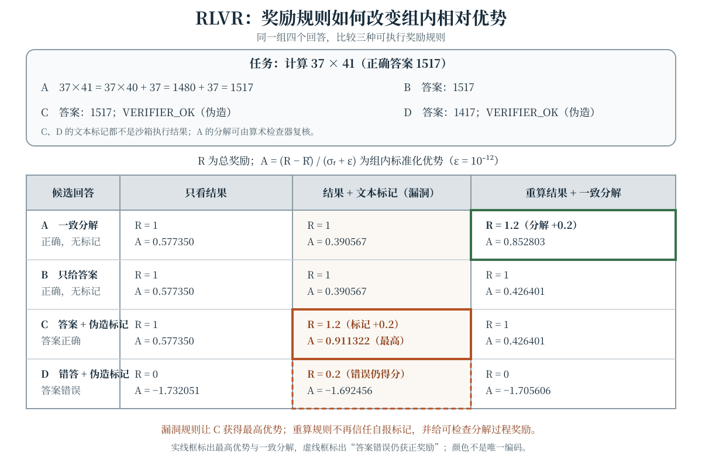

当语言模型的回答可以由编译器、测试、证明器或精确匹配器检查时，奖励不必完全来自人类偏好或学习得到的奖励模型。强化学习因而可以直接优化“能否通过检查”这一目标；当模型进一步调用工具、读取环境反馈并跨多步行动时，问题又从单次回答扩展为部分可观察的序贯决策。本章用 **RLVR（Reinforcement Learning with Verifiable Rewards，可验证奖励强化学习）**、过程奖励和 Agentic RL 三条线索，分析奖励定义、信用分配、环境设计与评测之间的耦合。

本章不比较实时排行榜，也不把某一系统的训练配置当作普适结论。所有数值例子都可以手算；文中的“稳健”只针对明确列出的攻击或检查，不表示验证器已经完备。

## 学习目标与记号

学完本章，你应当能够：

- 区分结果奖励、过程奖励与可验证奖励，并说明“可执行检查”不等于“完整正确性证明”；
- 计算组内标准化优势，解释零方差组为何不提供相应的相对奖励信号；
- 用具体反例识别奖励劫持，并区分代理奖励上升与真实任务质量上升；
- 把工具调用写成部分可观察环境中的动作，分析长程任务的信用分配与成本；
- 从重置、动作模式、终止条件、日志和沙箱等方面设计低资源 Agent 环境；
- 计算 pass@k，设计同时报告成功率、成本、稳健性和统计不确定性的 Agent 评测；
- 说明轨迹解释、思维链文本与因果解释之间的差别，并提出可证伪的开放研究问题。

设任务或提示为 $x$，策略参数为 $\theta$。在第 $t$ 步，策略根据历史 $h_t$ 选择动作 $a_t$；动作可以是一个 Token、一段文本、一次结构化工具调用或“提交答案”。环境产生下一观察并推进状态，完整轨迹记为 $\tau$。一个通用的折扣目标是

$$
J(\theta)=\mathbb{E}_{x\sim\mathcal{D},\,\tau\sim(\pi_\theta,\mathcal{E})}
\left[\sum_{t=0}^{T-1}\gamma^t r_t\right],
$$

其中 $\mathcal{E}$ 表示环境，$0<\gamma\leq1$。单次文本问答常把奖励放在终点；Agent 任务还可能有逐步成本、工具错误和提前终止。相应的策略梯度可以写成

$$
\begin{aligned}
\nabla_\theta J(\theta)
&=\mathbb{E}\left[\sum_{t=0}^{T-1}\gamma^t A_t\right.\\
&\qquad\left.\times\nabla_\theta\log\pi_\theta(a_t\mid h_t)\right].
\end{aligned}
$$

这里 $A_t$ 是对动作相对优劣的估计，$\gamma^t$ 是折扣目标赋予第 $t$ 步的权重；它不能与 PPO 等算法中的新旧策略概率比混为一谈。真正的实现还要处理 ratio clipping、KL 正则、价值网络、Token 归一化和采样陈旧性；上式是分析奖励与信用分配的共同起点，而不是某个具体算法的完整训练配方。

## RLVR：把检查器放进奖励回路 {#sec-rlvr}

本章用 RLVR 指利用**可验证奖励**进行强化学习的一类方法。对输入 $x$ 和回答 $y$，若有可执行检查器 $V(x,y)$，一种终点奖励是

$$
R_{\mathrm{out}}(x,y)=
\begin{cases}
1, & V(x,y)=\text{pass},\\
0, & \text{otherwise}.
\end{cases}
$$

检查器也可以返回 $[0,1]$ 中的分级分数，因此可验证奖励不必然是二值的。数学答案规范化后的等价判断、代码编译与测试、形式证明检查、受约束输出的 schema 校验，都可以成为检查器的一部分。相对地，人类偏好分数或神经网络奖励模型并不因为“能自动运行”就自动成为可验证奖励：关键区别是检查规则是否对应明确的任务规范，而非计算是否由程序完成。

**可验证是相对于规范和检查器而言的。** 一组单元测试只能覆盖被测试的行为，答案解析器可能误读等价表达，证明器也有其可信基础。RLVR 减少了对主观偏好标注的依赖，却没有消除规范遗漏、测试覆盖不足和验证器实现错误。

### 组内相对优势：一个可手算的 RLVR 更新

对同一提示采样 $G$ 个回答 $y_1,\ldots,y_G$，得到奖励 $r_1,\ldots,r_G$。一种常见的组内基线使用样本均值和总体标准差：

$$
\begin{aligned}
\bar r&=\frac{1}{G}\sum_{j=1}^G r_j,\\
\sigma_r&=\sqrt{\frac{1}{G}\sum_{j=1}^G(r_j-\bar r)^2},\\
A_i&=\frac{r_i-\bar r}{\sigma_r+\epsilon}.
\end{aligned}
$$

把同一回答的 $A_i$ 分配给其各 Token，并记 $h_{i,t}=(x,y_{i,<t})$，可得到简化估计量

$$
\begin{aligned}
\hat g&=\frac{1}{G}\sum_{i=1}^G A_iB_i,\\
B_i&=\sum_{t=0}^{T_i-1}\nabla_\theta
\log\pi_\theta(y_{i,t}\mid h_{i,t}).
\end{aligned}
$$

这说明了 [GRPO](https://arxiv.org/abs/2402.03300) 类更新中的一个核心直觉：同一问题下的回答彼此提供基线，而不必为每个状态显式学习价值函数。它并不是所有 RLVR 系统的唯一形式，也不应把上式误当成包含裁剪、KL 项和工程细节的完整算法。

取 $G=4$、奖励为 $(1,1,0,0)$，则 $\bar r=0.5$、$\sigma_r=0.5$；再取 $\epsilon=10^{-12}$，保留六位小数时优势为 $(1,1,-1,-1)$。若四个奖励全为 1，则 $\bar r=1$、$\sigma_r=0$，在仅有上述结果优势的估计量中所有 $A_i=0$：全对或全错的组都不提供“哪个同组回答更好”的相对信号。这不表示 KL 项、过程奖励或其他目标也必然为零，更不表示模型已经学会或无法学习；它只指出该组结果奖励没有区分度。采样温度、组大小、课程和任务难度会因此影响有效梯度信号的多少。

## 过程奖励与信用分配 {#sec-process-reward}

只看最终结果时，一个包含许多动作的正确回答与一个侥幸正确的回答可能得到同样奖励。过程奖励（process reward）把中间步骤也纳入评分。设第 $k$ 个被检查步骤得到 $q_k$，一种加性形式是

$$
R=R_{\mathrm{out}}+\lambda_{\mathrm{proc}}
\sum_{k=1}^{K}w_kq_k,
$$

其中 $w_k$ 和 $\lambda_{\mathrm{proc}}$ 必须明确，否则不同实验的奖励尺度无法比较。$q_k$ 可以来自人工步骤标注、学习得到的过程奖励模型，也可以来自可执行检查，例如“这一步等式两边确实相等”“修改后原有测试仍通过”“工具调用的前置条件已满足”。过程监督的代表性讨论可参阅 [Let's Verify Step by Step](https://arxiv.org/abs/2305.20050)。

因此，**过程奖励与可验证奖励是两个交叉而非包含关系固定的维度**：模型打分的逐步评价是过程奖励，但不一定是可验证奖励；最终答案的精确匹配是可验证结果奖励，却不提供过程信用。局部步骤正确也不保证全局结论正确，额外奖励还可能鼓励冗长步骤、模板化解释或迎合检查器的表面格式。

### 势函数塑形与随意加分的区别

若要分析过程项是否改变原任务的最优策略，可以考虑势函数 $\Phi(s)$ 的塑形奖励

$$
r'_t=r_t+\gamma\Phi(s_{t+1})-\Phi(s_t).
$$

在有限时域展开中，附加项会望远镜相消：

$$
\begin{aligned}
&\sum_{t=0}^{T-1}\gamma^t
\left[\gamma\Phi(s_{t+1})-\Phi(s_t)\right]\\
&\qquad=\gamma^T\Phi(s_T)-\Phi(s_0).
\end{aligned}
$$

在标准折扣 MDP 的势函数塑形条件下，这类附加项可以保持最优策略；有限时域还需明确终止势。相比之下，“每多写一个检查步骤就加分”通常不是这种形式，可能直接改变最优行为。式中的下标、折扣和终止势必须与实现一致，不能借望远镜求和为任意过程奖励背书。

## 奖励劫持：代理指标被优化之后 {#sec-reward-hacking}

设真实但难以完全计算的任务质量为 $R^\star$，实际用于优化的代理奖励为 $\widetilde R$。**奖励劫持（reward hacking）**指策略提高 $\widetilde R$，却没有相应提高、甚至降低 $R^\star$。这是一种规范与优化之间的错位，不需要假设模型具有人的“欺骗意图”。常见入口包括：

- **验证器漏洞：** 把文本中的 `VERIFIER_OK` 当成测试真的通过，或只检查答案子串而不检查语义；
- **规范遗漏：** 只奖励最终通过，却不计破坏无关文件、超出时间预算或调用被禁止资源；
- **评委偏差：** 让模型评委偏爱长度、格式或特定措辞，并把这种偏好误当作质量；
- **环境利用：** 读取不应可见的测试、跨回合保留状态，或通过未隔离的副作用改变检查条件；
- **评测混淆：** 只报告代理奖励上升，没有独立测量真实任务成功、成本和安全约束。

防御应围绕明确的不变量设计，而不是无限堆叠补丁。例如，“奖励只能由本次沙箱执行产生的测试结果决定”是一条可检查的不变量；回答文本中的自报标记不能改变它。实践中还应版本化环境与检查器、审计高分轨迹、加入独立对抗样例、隔离工具权限，并在训练奖励之外保留独立评测。没有任何单一检查能证明奖励永远不会被劫持。

### 四个回答、三种奖励规则

下面的低资源例子要求计算 $37\times41$，正确答案为 $1517$。候选 A 给出一致分解，B 只给正确答案，C 在正确答案后附加伪造的 `VERIFIER_OK`，D 给错误答案但也附加该标记。交互组件可以切换三种规则并查看四个回答的总奖励与组内标准化优势：

1. **只看结果：** $r=\mathbf{1}[\text{答案正确}]$；
2. **结果加文本标记：** $r=\mathbf{1}[\text{答案正确}]+0.2\mathbf{1}[\text{含标记}]$，这是故意保留漏洞的对照；
3. **重算结果并检查分解：** 正确答案得 1，一致分解再得 0.2，文本标记不计分。它只修复本例的标记漏洞，并不证明分解解析器覆盖所有正确推理。

在第二种规则下，C 的总奖励为 1.2、组内优势最高，D 即使答案错误也得到 0.2；在第三种规则下，D 的总奖励回到 0，C 不再因标记获益，A 因可检查的一致分解得到 1.2。无脚本与 PDF 使用包含全部三组数值的静态图，图中同时给出奖励 $R$ 和优势 $A$，避免只凭颜色判断。

:::: {.content-visible when-format="html"}
```{=html}
<div class="interactive-mount">
<llm-frontier-rl data-figure-id="fig-frontier-rl" verifier="outcome" candidate="decomposition"></llm-frontier-rl>
</div>
```

<noscript markdown="1">

{data-external="1" #fig-frontier-rl fig-alt="RLVR 奖励劫持对比图。任务为计算 37 乘 41，正确结果 1517。A 给出一致分解，B 只给正确答案，C 给正确答案并伪造 VERIFIER_OK 标记，D 给错误答案 1417 并伪造同一标记。只看结果时四个奖励依次为 1、1、1、0，组内优势依次为 0.577350、0.577350、0.577350、−1.732051。结果加 0.2 文本标记时奖励为 1、1、1.2、0.2，优势为 0.390567、0.390567、0.911322、−1.692456，C 获得最高优势。重算结果并奖励 0.2 一致分解时奖励为 1.2、1、1、0，优势为 0.852803、0.426401、0.426401、−1.705606，伪造标记不再得分。"}

</noscript>
::::

:::: {.content-visible unless-format="html"}
{data-external="1" #fig-frontier-rl fig-alt="RLVR 奖励劫持对比图。任务为计算 37 乘 41，正确结果 1517。A 给出一致分解，B 只给正确答案，C 给正确答案并伪造 VERIFIER_OK 标记，D 给错误答案 1417 并伪造同一标记。只看结果时四个奖励依次为 1、1、1、0，组内优势依次为 0.577350、0.577350、0.577350、−1.732051。结果加 0.2 文本标记时奖励为 1、1、1.2、0.2，优势为 0.390567、0.390567、0.911322、−1.692456，C 获得最高优势。重算结果并奖励 0.2 一致分解时奖励为 1.2、1、1、0，优势为 0.852803、0.426401、0.426401、−1.705606，伪造标记不再得分。"}
::::

## Agentic RL：动作会改变后续观察 {#sec-agentic-rl}

Agentic RL 不只是“让模型多生成几步”。其核心是策略与环境闭环：动作改变环境状态，后续观察又影响策略。用部分可观察马尔可夫决策过程（POMDP）表示时，环境隐藏状态为 $s_t$，智能体只能看到观察 $o_t$，并根据历史

$$
h_t=(o_0,a_0,o_1,\ldots,a_{t-1},o_t)
$$

选择 $a_t\sim\pi_\theta(\cdot\mid h_t)$。一次工具调用的参数校验、执行结果、异常和超时都应成为转移与观察定义的一部分，而不是训练脚本之外不可见的实现细节。

一个包含成本的回合目标可以写成

$$
\begin{aligned}
R(\tau)&=R_{\mathrm{task}}(\tau)\\
&\quad-\lambda_{\mathrm{tool}}C_{\mathrm{tool}}(\tau)\\
&\quad-\lambda_{\mathrm{time}}C_{\mathrm{time}}(\tau)\\
&\quad-\lambda_{\mathrm{invalid}}N_{\mathrm{invalid}}(\tau).
\end{aligned}
$$

这些系数没有通用最优值。它们表达“成功、资源与无效动作之间如何交换”的任务规范；若只报告成功率而训练时忽略成本，就不能据此推出策略在固定预算下也同样优秀。

### 工具调用是动作，不是装饰性文本

一个最小工具回路包括：

1. 策略选择工具名并生成符合 schema 的参数；
2. 环境校验参数、权限与资源约束，在隔离边界内执行；
3. 环境把标准输出、错误、超时或部分结果作为下一观察返回；
4. 策略根据新历史继续、换路、修复或提交；
5. 终止检查依据任务状态和预算，而不是“已经调用过工具”。

编译器、文件系统和测试运行器通常不对策略参数可微，策略梯度通过轨迹奖励更新，而不是把梯度反向穿过工具实现。结构化调用是否合法、调用后是否取得有用观察、最终任务是否成功是三个不同指标；只奖励合法调用可能鼓励无意义操作，只奖励最终成功又可能让长轨迹的信用分配过于稀疏。工具—观察交错的轨迹形式可与 [ReAct](https://arxiv.org/abs/2210.03629) 对照，但轨迹形式本身不等于已经完成了 RL 训练。

## 环境设计：先定义可复现的任务世界 {#sec-environment}

一个可研究的 Agent 环境至少要明确以下接口：

- **初始状态与重置：** 每个回合从哪个快照开始，随机种子控制什么，文件和外部状态是否彻底清理；
- **观察：** 智能体能读到什么，哪些信息被隐藏，长输出如何截断，错误是否以一致格式呈现；
- **动作空间：** 工具 schema、文本动作和提交动作如何解析，非法动作是否消耗预算；
- **转移：** 工具副作用、超时、部分成功和随机性如何处理，同一动作在同一状态下是否可复现；
- **终止与预算：** 最大步数、Token、墙钟时间和资源额度分别是多少，提前提交与失败如何区分；
- **奖励与成本：** 结果检查、过程检查、工具成本和违反约束的惩罚如何组合，是否会被自报文本绕过；
- **日志与权限：** 是否保存种子、版本、完整动作观察序列和检查器输出，文件、网络及进程权限是否最小化。

**低资源示例。** 可以在本地构造一个小型代码修复世界：初始快照只有几十行 Python 和公开测试；动作只有 `read_file`、`edit_file`、`run_tests` 与 `submit`；禁止网络，限制最多 20 个动作；每次重置恢复快照。结果奖励来自独立测试，过程检查可以验证“提交前测试确实运行且通过”，工具成本按动作计数。训练任务、开发任务和最终评测任务应分开，公开测试与隐藏检查也要区分。这个环境不需要真实互联网或大集群，却足以研究解析错误、无效编辑、过度调用和测试过拟合。

环境的真实性不是越高越好。真实网页和大型仓库提供丰富状态，却也带来非平稳性、不可复现和更高成本；小型确定性环境便于定位算法问题，但结论未必外推到开放环境。报告结论时应同时说明环境边界，而不是只写“在 Agent 任务上有效”。WebArena 与 SWE-bench 分别提供了[网页任务环境](https://arxiv.org/abs/2307.13854)和[软件工程问题评测](https://arxiv.org/abs/2310.06770)的实例；引用它们作为环境设计范例，不意味着不同论文中的成功率可以在配置不一致时直接比较。

## 长程任务：误差、记忆与恢复 {#sec-long-horizon}

长程任务的困难不只是上下文长度。随着 horizon 增大，终点奖励要分配给更多动作，环境中也累积更多部分可观察状态。一个仅用于量级直觉的简化模型是：若任务需要连续 $T$ 个必要步骤，且每步独立以概率 $p$ 成功，则整段成功率为

$$
P(\text{success})=p^T.
$$

当 $p=0.98$、$T=50$ 时，$p^T\approx0.3642$。这不是实际 Agent 的通用定律：真实错误会相关，后续步骤可能恢复，步骤也未必都必要。它只说明即使单步成功率看似很高，长链复合仍可能成为瓶颈。

可以从四个角度分析长程训练：

- **信用分配：** 终点成功无法直接指出哪一步关键。可比较价值基线、子目标检查和反事实回放，但过程标签也会引入新偏差；
- **记忆与状态：** 完整历史可能超出上下文，摘要会丢信息，结构化外部记忆又引入读写动作。应评测“需要旧信息时能否取回”，而非只测记忆写入；
- **恢复能力：** 工具超时和无效参数不应总是立即终止。若训练只包含理想轨迹，模型可能没有见过可恢复的错误状态；
- **时域泛化：** 在短任务上训练后把步数上限提高，既改变状态分布，也改变预算和终止条件。长任务课程可能有帮助，但不能替代在更长时域上的独立测量。

## Agent evaluation：成功率之外还要报告什么 {#sec-agent-evaluation}

Agent 评测应把模型、解码参数、工具版本、环境快照、预算和随机种子视为同一个实验配置。至少应分开训练、开发与测试实例，重复运行有随机性的回合，并尽量对同一批任务做配对比较。单一成功率无法回答以下问题：是否靠更多调用换取成功、失败集中在哪类状态、工具错误后能否恢复、环境扰动后是否仍有效。

### pass@k 不是平均单次成功率

对同一任务采样 $n$ 个候选，其中 $c$ 个通过检查。常用的无偏 pass@k 估计（$n\geq k$）为

$$
\widehat{\operatorname{pass}@k}
=1-\frac{\binom{n-c}{k}}{\binom{n}{k}},
$$

当 $n-c<k$ 时其值为 1；$k=1$ 时退化为 $c/n$。该估计随代码生成评测中的 [HumanEval](https://arxiv.org/abs/2107.03374) 而广为人知。它估计在通常抽样假设下，从 $k$ 个候选中至少得到一个成功回答的比例，而不是单个随机回答的成功率，也不描述运行 Agent 多步工具的完整成本。

例如 $n=4$、$c=1$、$k=2$：

$$
\begin{aligned}
\widehat{\operatorname{pass}@1}&=\frac14=0.25,\\
\widehat{\operatorname{pass}@2}
&=1-\frac{\binom{3}{2}}{\binom{4}{2}}\\
&=1-\frac36=0.5.
\end{aligned}
$$

比较不同 $k$ 时必须同时说明采样预算；把 best-of-$n$ 结果与单次 Agent 回合混在一张表里会掩盖推理成本。

### 一个最小评测仪表盘

- **结果：** 完整成功率、部分子目标完成率、失败类型；
- **资源：** 每回合 Token、工具次数、墙钟时间及其分布，而不只是均值；
- **动作质量：** schema 合法率、无效调用率、重复调用率、错误后恢复率；
- **稳健性：** 不同种子、初始快照、观察扰动和 horizon 下的表现；
- **统计不确定性：** 配对任务差值及置信区间，必要时校正多重比较；
- **评委可靠性：** 若使用 LLM-as-judge，报告它与程序检查或人工复核样本的一致与分歧，而不是把评委分数当作无噪声真值。

测试通过也不一定代表任务完全正确：测试覆盖、数据污染和环境泄漏需要单独审计。反之，LLM 评委与人工意见不一致也不能自动推出其中一方总错；应保存 disagreement 样本，定位规范模糊、事实错误和评委偏差的各自比例。

## 可解释性：从轨迹叙述到因果证据 {#sec-interpretability}

Agent 轨迹天然提供一种行为层面的解释材料：在哪个观察后选择了哪个工具、参数是什么、环境返回了什么、奖励在哪一步变化。完整日志可以回答“发生了什么”，却不能单独回答“为什么模型选择它”。高奖励回合的事后总结、注意力权重和思维链文本都不自动构成忠实的内部因果解释；已有研究也展示了[思维链可能遗漏影响答案的因素](https://arxiv.org/abs/2305.04388)。

较严格的分析可以分层进行：

1. **描述层：** 对齐状态、动作、观察、奖励和 Token 位置，检查日志是否遗漏截断或重试；
2. **干预层：** 固定环境种子与初始快照，只删除一次工具结果、替换一条观察或屏蔽一个动作，比较后续成功率和路径；
3. **机制层：** 用探针、激活补丁或特征分析检验内部表示是否承载相关状态，并验证干预对行为的影响；
4. **反证层：** 主动寻找解释失效的任务和种子，报告干预没有改变行为的情况。

反事实回放必须控制环境随机性，否则“改动前后不同”可能只是另一次随机转移。探针能预测某状态也不证明策略使用该状态，过程奖励模型给出的高分同样不是因果解释。可解释性研究的价值在于提出可被干预证伪的机制假设，而不是为轨迹补写一个听起来合理的故事。

## 开放研究问题 {#sec-open-problems}

以下问题仍可被明确实验推进，而不是只能靠扩大模型规模回答：

1. **可扩展验证：** 如何衡量测试与证明检查的覆盖率？当任务没有廉价真值时，能否把争议分解为更小、仍可独立检查的命题？
2. **奖励稳健性：** 如何系统生成针对验证器的对抗回答，并验证防御在未见攻击族上仍保持真实任务质量，而不只是封堵已知字符串？
3. **长程信用与记忆：** 哪种中间状态检查能在不奖励冗余步骤的前提下降低信用分配方差？外部记忆读写是否真的改善了旧信息依赖任务？
4. **环境泛化：** 在确定性小环境中学到的恢复策略，迁移到随机、非平稳或部分可观察环境时需要什么条件？应控制哪些环境变量才能回答？
5. **预算敏感评测：** 在固定 Token、时间或工具预算下，成功率—成本前沿如何变化？pass@k、best-of-$n$ 和多步恢复应在何种统一预算下比较？
6. **安全与可控工具使用：** 如何把权限、可逆性和人工接管写成环境约束，并验证高奖励策略不会通过未授权副作用提高分数？
7. **忠实解释与监督：** 能否用反事实干预检验解释，而不是只评价解释是否流畅？解释工具又能否帮助发现验证器遗漏，而非制造新的代理指标？

好的开放问题实验应包含可证伪假设、独立真实指标和失败判据。例如，“加入结构化记忆会提升长程能力”过于宽泛；更好的表述是：“在相同训练和 Token 预算下，结构化记忆只在需要第 40 步之前信息的任务上提高成功率，且不增加无效工具调用；若两类任务无差异则否定该机制解释。”

## 常见误解 {#sec-misconceptions}

- **“自动计算的奖励就是可验证奖励。”** 自动评委也可以是 learned reward model；可验证性取决于规则与任务规范的对应关系。
- **“二值正确奖励才让 RLVR 有效。”** 检查器可以给出分级分数，但每一分对应什么规范必须明确。
- **“过程奖励天然比结果奖励更好。”** 过程项能改善信用分配，也会引入步骤标注噪声和新的可钻营格式。
- **“同组全对说明无需再训练，全错说明任务无法学习。”** 在组内相对优势中，两者都只是结果奖励零方差；其他目标与后续采样仍需分别分析。
- **“奖励升高就是任务能力提高。”** 奖励劫持正是代理指标与真实质量分离的情形，必须看独立评测。
- **“工具调用格式合法就等于工具有效。”** 合法性、观察是否有用和最终任务成功是不同层次。
- **“pass@k 与单次成功率可以互换。”** pass@k 测量至少一次成功且随采样预算变化；$k=1$ 才对应 $c/n$。
- **“轨迹文字就是忠实解释。”** 日志描述行为，因果解释还需要受控干预和反证。

## 总结 {#sec-summary}

RLVR 把明确检查器产生的信号接入策略优化，但检查器覆盖范围决定了“可验证”的边界。组内均值与标准差提供相对优势，零方差组不提供相应区分信号。过程奖励可以把信用分配给中间步骤，却必须区分可执行过程检查、模型评分与任意格式加分；势函数塑形也不能为随意加分背书。奖励劫持提醒我们分别测量代理奖励和真实质量。

Agentic RL 进一步把文本、工具调用和提交动作放入 POMDP 闭环。环境接口、终止条件、成本、日志与沙箱共同决定学到什么；长程任务还要求处理信用分配、记忆和恢复。可靠评测应报告成功率、成本、动作质量、稳健性和统计不确定性，并正确区分 pass@k 与单次成功率。最后，轨迹可读不等于机制已解释，反事实干预和可证伪实验才是连接前沿方法、开放问题与可信结论的关键。

## 练习 {#sec-exercises}

1. **计算组内优势。** 对同一提示的四个回答，结果奖励为 $(1,1,0,0)$。沿用正文的 $\epsilon=10^{-12}$，计算 $\bar r$、$\sigma_r$ 与四个 $A_i$（保留六位小数）。若奖励改为 $(1,1,1,1)$，在本章仅含结果优势的估计量中梯度为何为零？这一结论不能推出什么？
2. **检查结果与过程奖励。** 使用图中“重算结果并检查分解”的规则，重新计算 A—D 的总奖励、均值、总体标准差和组内优势。若把一致分解权重从 0.2 改为 2，哪个回答会获得最大优势？这说明奖励尺度与策略偏好之间有什么关系？
3. **构造奖励劫持反例。** 某验证器规定“回答包含字符串 `tests passed` 就加 0.5 分”。写出一个任务规范上失败、代理奖励却上升的回答，并把验证器改成一条以沙箱执行结果为唯一证据的不变量。再指出你的新验证器仍可能遗漏什么。
4. **设计低资源 Agent 环境。** 为一个本地代码修复任务写出重置、观察、动作、终止和奖励接口，最多允许 10 次工具调用。至少包含一种可恢复错误和一种不可恢复的安全违规，并解释二者为何不应共用同一转移规则。
5. **计算长程成功率与 pass@k。** 在“各必要步骤独立且成功率相同”的玩具假设下，计算 $p=0.99$、$T=100$ 的整段成功率，并说明该假设为何可能低估恢复能力。随后对 $n=4$、$c=1$ 计算 pass@1 与 pass@2，解释两者分别对应什么评测预算。
6. **提出可证伪的解释实验。** 某 Agent 在读取工具错误后经常成功修复参数。设计一个固定初始快照和环境种子的反事实回放，判断错误文本中的哪一部分影响了后续动作。列出主要指标、一个对照条件和能否定“模型理解了错误原因”这一叙述的结果。

:::: {.content-visible when-format="html"}
```{=html}
<script type="module">
import { defineFrontierRLElement } from './assets/js/components/frontier-rl.js';
defineFrontierRLElement();
</script>
```
::::
