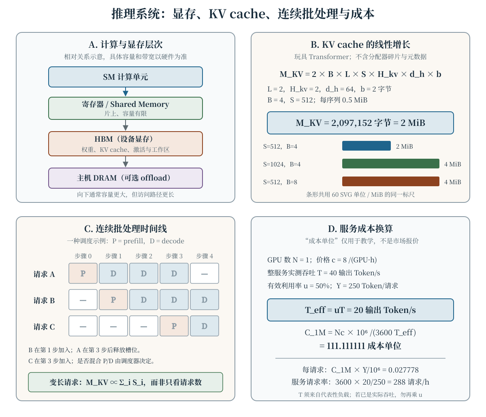

训练完成后，推理系统要在有限显存、时延目标和成本预算内，把模型权重、输入 Token 与调度状态组织成可持续的服务。只比较“模型每秒生成多少 Token”不足以回答这些问题：首个 Token 何时返回、长上下文占用多少 KV cache、量化是否改变质量、batch 中谁在等待，以及报价对应的是峰值还是实际负载，都必须纳入同一套分析。本章用可手算的低资源算例连接 GPU 层次、解码算法与服务化指标；所有硬件吞吐和价格数字均为教学输入，不代表特定设备或市场报价。

## 学习目标

学完本章，你应当能够：

- 区分 prefill 与自回归 decode，并分别定义 TTFT、Token 间时延、端到端时延和吞吐；
- 用计算强度与 roofline 上界分析 GPU kernel 可能受计算还是显存带宽限制；
- 写出权重、激活、工作区与 KV cache 的显存预算，正确处理 GQA/MQA 的 KV 头数；
- 解释仿射量化、知识蒸馏和投机解码的目标、代价与适用边界；
- 比较静态批处理与连续批处理，并用变长序列而非仅请求数估算调度占用；
- 从整服务实测吞吐、利用率和 GPU 小时价格推算单位 Token 与单请求成本；
- 为推理服务设计以时延分位数、显存水位、队列和质量回归为核心的观测与验收方案。

## 推理的两阶段与服务目标 {#sec-inference-pipeline}

对 decoder-only 语言模型，给定前缀 $x_{\leq t}$，下一 Token 分布写作

$$
p_\theta(x_{t+1}\mid x_{\leq t}).
$$

**Prefill** 阶段处理输入提示：在因果掩码约束下，多个输入位置可以一起经过各层，并为后续 decode 建立 K/V 状态。**Decode** 阶段则有顺序依赖：采样或选择一个新 Token，把它追加到上下文，再计算下一步。标准全注意力的 KV cache 让后续步骤不必重新计算整段前缀的 K/V；它并没有消除当前步的权重读取、注意力计算和采样。

一个请求的总时延可拆成

$$
T_{\mathrm{req}}
=T_{\mathrm{queue}}+T_{\mathrm{prefill}}
+T_{\mathrm{decode}}+T_{\mathrm{post}}.
$$

若 decode 各步实际耗时为 $t_1,\ldots,t_{N_{\mathrm{out}}}$，则

$$
\begin{aligned}
T_{\mathrm{decode}}&=\sum_{j=1}^{N_{\mathrm{out}}}t_j,\\
\mathrm{TTFT}&\approx T_{\mathrm{queue}}+T_{\mathrm{prefill}}+t_1.
\end{aligned}
$$

TTFT（time to first token）应从约定的请求计时起点量到首个输出 Token 对调用方可见；是否包含网络与排队必须在接口文档中说明。Token 间时延通常考察后续步骤，例如 $N_{\mathrm{out}}>1$ 时

$$
\overline{\mathrm{TPOT}}
=\frac{T_{\mathrm{decode}}-t_1}{N_{\mathrm{out}}-1}.
$$

平均 TPOT 不能替代 p95 或 p99 等尾部分位数。吞吐则应明确统计对象与时间窗，例如

$$
G_{\mathrm{out}}
=\frac{N_{\mathrm{out}}^{\mathrm{done}}}{\Delta t},
$$

其中 $N_{\mathrm{out}}^{\mathrm{done}}$ 是时间窗 $\Delta t$ 内已完成请求的输出 Token 总数。输入 Token 吞吐、输出 Token 吞吐、单请求解码速率和整服务聚合吞吐不是同一个量。把单序列速率直接乘以最大 batch，通常会把排队、资源竞争与短请求的影响全部忽略。

@fig-inference-systems 给出本章的四条主线：片上计算与显存层次、KV cache 的线性增长、连续批处理的动态成员变化，以及从吞吐到成本的单位换算。图中数值都可由正文公式复算。

{data-external="1" #fig-inference-systems fig-alt="四面板推理系统教学图。面板 A 从 SM 计算单元依次连接片上寄存器与 Shared Memory、HBM 和主机 DRAM，表示容量与访问路径的相对层次。面板 B 使用两层、两个 KV 头、头维 64、序列长 512、batch 4、每元素 2 字节的玩具模型，KV cache 总计 2097152 字节即 2 MiB，每序列 0.5 MiB；序列长或 batch 翻倍后均为 4 MiB。面板 C 是一种五步连续批处理示例：请求 A 第 0 步 prefill 后 decode 并在第 3 步后结束，B 第 1 步加入，C 第 3 步加入；P 和 D 用文字标出。面板 D 使用 1 张 GPU、每 GPU 小时 8 成本单位、整服务吞吐 40 输出 Token 每秒、利用率 50% 和每请求 250 输出 Token，得到有效吞吐 20、每百万输出 Token 成本 111.111111、每请求成本 0.027778、每小时 288 请求。所有数字均为教学算例。"}

## GPU 计算与显存层次 {#sec-gpu-memory}

GPU 的 SM 执行计算，寄存器和 Shared Memory 等片上存储靠近计算单元，HBM 是设备侧全局显存，主机 DRAM 则位于另一存储层次并通过互连访问。不同架构对片上缓存的名称、容量和软件可见性不同，因此这里只使用相对关系：**越靠近计算单元的存储通常容量越有限，跨层次传输则需要显式纳入数据移动成本。**“数据在 GPU 上”也不等于数据始终留在片上；权重、KV cache 和较大的中间张量通常要占用 HBM。

一次推理的显存预算可写成

$$
\begin{aligned}
M_{\mathrm{total}}={}&M_{\mathrm{weights}}+M_{\mathrm{KV}}\\
&+M_{\mathrm{activation}}+M_{\mathrm{workspace}}\\
&+M_{\mathrm{reserve}}.
\end{aligned}
$$

$M_{\mathrm{weights}}$ 不仅由参数量决定，还受权重 dtype、量化 scale/zero-point、张量并行分片和运行时副本影响。$M_{\mathrm{activation}}$ 与 prefill 长度、batch、kernel 的融合方式有关；$M_{\mathrm{workspace}}$ 包含临时缓冲与通信空间；$M_{\mathrm{reserve}}$ 是明确留给分配器和峰值的预算。推理不需要训练优化器状态，但不能据此把显存估算成“权重加 KV cache”两项。

### 计算强度与 roofline 上界

设某 kernel 完成 $W$ FLOP，并从相应存储层移动 $Q$ 字节，计算强度为

$$
I=\frac{W}{Q}\qquad (\mathrm{FLOP/byte}).
$$

若该层带宽为 $B_{\mathrm{mem}}$、设备峰值计算能力为 $P_{\mathrm{peak}}$，理想化 roofline 上界为

$$
P_{\mathrm{attainable}}
\leq \min\left(P_{\mathrm{peak}},B_{\mathrm{mem}}I\right).
$$

当 $B_{\mathrm{mem}}I<P_{\mathrm{peak}}$ 时，这个上界由数据移动决定；反之由计算峰值决定。实际性能还受 kernel 启动、占用率、算子融合、缓存命中和调度影响，所以等式右侧不是必然达到的性能。Decode 每步常要读取大量权重和增长的 KV 状态，而每个 Token 可并行的工作较少，因而经常呈现带宽敏感性；prefill 往往能形成更大的矩阵运算。不过“prefill 必定计算 bound、decode 必定显存 bound”不是跨模型与硬件都成立的结论，仍须用实测 $W,Q$ 和 profiler 数据判断。

## 延迟、吞吐与并发 {#sec-latency-throughput}

低延迟与高吞吐相关但不等价。增大 batch 可以提高矩阵运算的并行度和单位时间完成的 Token 数，却可能延长排队时间、增加单步耗时，并挤占 KV cache。评估时至少应同时报告：

- TTFT、TPOT 和端到端时延的分布，而非只报均值；
- 输入/输出长度分布、到达率与请求并发度；
- 整服务输入/输出 Token 吞吐，以及测量时的 batch 和硬件配置；
- 超时、取消、抢占和失败请求是否计入统计。

在到达率与完成率长期相等、系统稳定的简化条件下，Little 定律给出平均并发量 $C$、请求到达率 $\lambda$ 与平均驻留时间 $\overline{T}$ 的关系：

$$
C\approx\lambda\overline{T}.
$$

它不能用来绕过容量规划：当队列持续增长时，系统不满足该稳态前提；平均值相同也不意味着尾时延相同。反过来，若 SLO 给出 p95 TTFT，仅凭 Little 定律也无法推出需要多少 GPU，还需要代表性负载下的容量实验。

## KV cache：用显存换重复计算 {#sec-kv-cache}

设模型有 $L$ 层，每层有 $H_{\mathrm{kv}}$ 个 KV 头，每头维度为 $d_h$；batch 中有 $B$ 条等长序列，每条已缓存 $S$ 个 Token，每个 K/V 元素占 $b$ 字节。K 和 V 各存一份，因此逻辑 KV cache 字节数为

$$
M_{\mathrm{KV}}
=2BLSH_{\mathrm{kv}}d_hb.
$$

这里必须用 **KV 头数**而不是 Query 头数。GQA 或 MQA 让多个 Query 头共享较少的 KV 头，因此不能把 MHA 的公式不加修改地套过去。标准 decode 主要缓存各层 K/V；当前 Query 用于当步注意力，不像 K/V 那样沿全部前缀累积。

取玩具参数 $L=2$、$H_{\mathrm{kv}}=2$、$d_h=64$、$S=512$、$B=4$、$b=2$ 字节，得到

$$
\begin{aligned}
M_{\mathrm{KV}}
&=2\times4\times2\times512\times2\times64\times2\\
&=2{,}097{,}152\ \text{字节}
=2\ \mathrm{MiB},
\end{aligned}
$$

其中 $1\ \mathrm{MiB}=2^{20}$ 字节。每序列占 $0.5\ \mathrm{MiB}$；若另有 $16\ \mathrm{MiB}$ 的专用 KV 预算，并忽略碎片、块元数据与其他占用，等长序列的容量上界为

$$
B_{\max}=\left\lfloor\frac{16}{0.5}\right\rfloor=32.
$$

真实系统还应说明块大小、共享前缀、beam 数、KV 量化元数据和未释放请求。分页管理改善的是分配与回收方式，不会把逻辑 K/V 元素数变成零。

下面的原生计算器使用同一公式；“可用 KV 预算”只用于估算 $B_{\max}$，不是整张 GPU 显存。无 JavaScript 时保留默认算例的静态结果。

::: {.content-visible when-format="html"}
```{=html}
<div class="interactive-mount">
<llm-kv-cache-calculator layers="2" kv-heads="2" head-dim="64" sequence-length="512" batch-size="4" bytes-per-element="2" budget-mib="16"></llm-kv-cache-calculator>
</div>
<noscript>
<table>
  <caption>KV cache 静态算例（与交互默认值相同）</caption>
  <tbody>
    <tr><th scope="row">总 KV cache</th><td>2,097,152 字节 = 2 MiB</td></tr>
    <tr><th scope="row">每序列 KV cache</th><td>0.5 MiB</td></tr>
    <tr><th scope="row">16 MiB 预算下的最大等长 batch</th><td>32</td></tr>
  </tbody>
</table>
<p>静态结果不含分配器碎片、块元数据、共享前缀或其他显存占用。</p>
</noscript>
```
:::

::: {.content-visible unless-format="html"}
| KV cache 静态算例 | 结果 |
|:--|--:|
| 总 KV cache | 2,097,152 字节 = 2 MiB |
| 每序列 KV cache | 0.5 MiB |
| 16 MiB 预算下的最大等长 batch | 32 |

静态结果不含分配器碎片、块元数据、共享前缀或其他显存占用。
:::

## 量化：降低表示位宽 {#sec-quantization}

一种常见的仿射量化把实数 $x$ 映射到整数格点，再近似还原为 $\hat x$：

$$
\begin{aligned}
q&=\operatorname{clip}\!\left(\operatorname{round}(x/s)+z,q_{\min},q_{\max}\right),\\
\hat x&=s(q-z),
\end{aligned}
$$

其中 $s>0$ 是 scale，$z$ 是 zero-point。若给定范围 $[x_{\min},x_{\max}]$，一个常用设置为

$$
s=\frac{x_{\max}-x_{\min}}{q_{\max}-q_{\min}}.
$$

$b$ bit 无符号量化可取 $q_{\min}=0$、$q_{\max}=2^b-1$。对称量化是另一种范围与零点约定，不能把两套公式混用。未截断且采用最近取整时，单个值的表示误差不超过 $s/2$；一旦发生 clip，或输入分布改变，这个局部误差界就不能直接当作模型输出质量界。

量化粒度可以是 per-tensor、per-channel 或 per-group。更细的粒度通常需要更多 scale/zero-point，却可能更好地适应不同通道的范围。权重大小可粗略写为

$$
M_{\mathrm{quant}}\approx \frac{N_{\mathrm{param}}b}{8}
+M_{\mathrm{scales/zeros}},
$$

但权重、激活与 KV cache 可以分别量化，不能由“模型采用某 bit 权重”推出所有中间张量也使用同一位宽。低位宽减少了存储与部分数据移动，却只有硬件和 kernel 支持相应计算路径时才可能转化为加速；反量化、打包与格式转换也有成本。验收应同时比较目标任务的输出质量、困惑度或其他任务指标、显存峰值与真实端到端时延。

例如 $s=0.1$、$z=0$ 时，$x=1.26$ 得到 $q=13$、$\hat x=1.3$，还原误差为 $0.04$。这个数值例子只说明格点舍入，不代表某种模型量化方案的质量。

## 蒸馏：把能力迁移到学生模型 {#sec-distillation}

知识蒸馏使用教师模型的输出分布、隐藏表示或生成结果指导学生模型。对 logit 向量 $z$，温度为 $\tau>0$ 的软分布为

$$
p_i^{(\tau)}(z)
=\frac{\exp(z_i/\tau)}{\sum_j\exp(z_j/\tau)}.
$$

一种结合硬标签与软目标的训练损失是

$$
\begin{aligned}
\mathcal{L}={}&(1-\alpha)\mathcal{L}_{\mathrm{hard}}\\
&+\alpha\tau^2
\operatorname{KL}\!\left(
p_{\mathrm{teacher}}^{(\tau)}
\;\|\;p_{\mathrm{student}}^{(\tau)}
\right),
\end{aligned}
$$

其中 $0\leq\alpha\leq1$，$\tau^2$ 是常见的梯度尺度约定而不是数学上不可更改的常数。温度升高通常会让非最大类别的相对概率更容易被学生拟合；$\tau=1$ 时就是普通 Softmax 分布。KL 的方向是教师分布在先，不能随意交换。

蒸馏发生在训练或离线适配阶段，推理时只部署学生模型，因此可以减少每请求的模型规模或计算量；教师训练、数据生成和质量评测成本应单独核算。学生并不保证保留教师的全部能力，尤其在训练数据未覆盖的任务上。蒸馏改变模型参数，量化改变数值表示，投机解码则保留目标模型并改变执行路径，三者的质量与系统风险不同。

## 投机解码：草稿与目标模型验证 {#sec-speculative-decoding}

投机解码让较小的草稿模型一次提出若干候选 Token，再由目标模型对这些位置进行验证。目标模型一次前向可以并行检查多个候选位置，从而减少严格串行的目标模型步数；若候选不被接受，就必须按算法修正，而不能把草稿输出直接当作目标模型输出。

单 Token 的核心接受规则可说明其分布保持思想。令目标分布为 $p$、草稿分布为 $q$，草稿样本 $x\sim q$ 的接受概率为

$$
a(x)=\min\left(1,\frac{p(x)}{q(x)}\right).
$$

拒绝时，从归一化残差分布

$$
r(x)=\frac{[p(x)-q(x)]_+}
{\sum_y[p(y)-q(y)]_+}
$$

重新采样。适当的接受—修正与多 Token 验证规则可以使最终分布与目标模型一致；只支持贪心或 Top-k 的实现则要另行说明输出等价条件。草稿模型的 tokenizer 与词表映射、验证位置、拒绝后的 bonus Token 都是正确性的一部分。

收益取决于接受率、每次接受的 Token 数、草稿成本和验证成本。定义 $\bar A$ 为每轮平均完成的目标等价 Token 数，$t_T$ 为基线目标模型每 Token 时延，$t_D+t_V$ 为一轮草稿加验证时延，则一个忽略排队和额外开销的估算为

$$
\mathrm{Speedup}\approx
\frac{\bar A\,t_T}{t_D+t_V}.
$$

这不是性能承诺：长输出、batch 增大或显存带宽竞争都可能改变 $t_D+t_V$，额外草稿权重和验证状态也占用资源。应使用真实请求的接受长度分布与端到端时延验证。

## 批处理与连续批处理 {#sec-batching}

**静态批处理**在批次开始前集齐一组请求，按相同步调执行，待整批结束后再处理下一批。它便于理解，但变长输入需要 padding，早结束的序列可能等待同批最长序列，新到请求也要等待批次边界。**连续批处理**则在 decode 步骤或更细的调度边界上增删请求：完成的请求释放 KV 槽位，新请求可在后续步骤加入，从而减少“整批齐步走”的空等。具体实现是否把 prefill 与 decode 合并、是否采用 chunked prefill、如何避免长 prefill 阻塞，都由调度策略决定。

变长请求的 KV 逻辑总量应按序列求和。若各请求共享模型层数、KV 头数、头维和字节宽度，则

$$
M_{\mathrm{KV}}
=2LH_{\mathrm{kv}}d_hb\sum_{i=1}^{B}S_i.
$$

因此“还能放几个请求”不是固定数字：它还取决于已缓存长度、后续最大生成长度和分配粒度。公平调度也要避免长请求持续挤占资源，使短请求的 TTFT 与尾时延恶化。@fig-inference-systems 的时间线中，B 和 C 在不同步骤加入，A 结束后释放位置；P/D 是否同批执行只是示例，不是连续批处理的必要定义。

## 推理成本评估 {#sec-inference-cost}

先统一口径，再谈价格。设整服务使用 $N$ 张 GPU，每张 GPU 每小时完全成本为 $c$（可包含或不含 CPU、网络和存储，必须注明），$T$ 是在代表性输入/输出长度与服务质量约束下测得的**整服务**输出吞吐，$0<u\leq1$ 是峰值到计划负载的有效利用比例，则计划有效吞吐为

$$
T_{\mathrm{eff}}=uT.
$$

以一百万输出 Token 为计价单位，忽略其他单独计费项时，

$$
C_{\mathrm{1M}}
=\frac{Nc}{3600}\times\frac{10^6}{T_{\mathrm{eff}}}
=\frac{Nc\,10^6}{3600uT}.
$$

若平均每请求输出 $Y$ 个 Token，稳态服务请求率和单请求输出成本为

$$
\begin{aligned}
R&=\frac{uT}{Y},\\
C_{\mathrm{req}}
&=C_{\mathrm{1M}}\frac{Y}{10^6}
=\frac{Nc}{3600R}.
\end{aligned}
$$

@fig-inference-systems 的默认算例取 $N=1$、$c=8$、$T=40$、$u=0.5$、$Y=250$，所以 $T_{\mathrm{eff}}=20$ Token/s、$C_{\mathrm{1M}}=111.111111$ 成本单位、$C_{\mathrm{req}}\approx0.027778$ 成本单位、$R=0.08$ 请求/s，即 288 请求/h。这里的“成本单位”可替换成任何货币，公式不变。

吞吐若已在目标实际负载下测得，就令 $u=1$，不要再乘一次利用率。$T$ 也必须包含提示词长度、输出长度、batch、量化方式和时延约束等测量条件；否则长 prefill 的成本会被“输出 Token/s”掩盖。若输入与输出分别计价，应分别建立 $C_{\mathrm{in}}$ 与 $C_{\mathrm{out}}$，而不是强行套用一个平均费率。

::: {.content-visible when-format="html"}
```{=html}
<div class="interactive-mount">
<llm-inference-cost-calculator gpu-count="1" hourly-price="8" aggregate-throughput="40" utilization-percent="50" output-tokens-per-request="250"></llm-inference-cost-calculator>
</div>
<noscript>
<table>
  <caption>服务成本静态算例（与交互默认值相同）</caption>
  <tbody>
    <tr><th scope="row">有效输出吞吐</th><td>20 Token/s</td></tr>
    <tr><th scope="row">每百万输出 Token 成本</th><td>111.111111 成本单位</td></tr>
    <tr><th scope="row">每请求成本（250 输出 Token）</th><td>约 0.027778 成本单位</td></tr>
    <tr><th scope="row">稳态服务请求率</th><td>288 请求/小时</td></tr>
  </tbody>
</table>
<p>静态结果使用整服务峰值吞吐与 50% 计划利用率；实际负载下的实测吞吐不应再次折算利用率。</p>
</noscript>
```
:::

::: {.content-visible unless-format="html"}
| 服务成本静态算例 | 结果 |
|:--|--:|
| 有效输出吞吐 | 20 Token/s |
| 每百万输出 Token 成本 | 111.111111 成本单位 |
| 每请求成本（250 输出 Token） | 约 0.027778 成本单位 |
| 稳态服务请求率 | 288 请求/小时 |

静态结果使用整服务峰值吞吐与 50% 计划利用率；实际负载下的实测吞吐不应再次折算利用率。
:::

## 服务化：把一次前向变成可靠系统 {#sec-serving}

一个可运维的推理服务通常包含请求校验、tokenizer、队列与调度器、模型 worker、流式响应和计量日志。无状态 HTTP API 不代表后端没有状态：活跃请求的 KV cache、取消标记与流式连接仍有生命周期。请求完成、失败或取消后，调度器应确认对应 cache 与 batch 槽位已经释放；仅仅断开客户端连接并不能证明 worker 已停止计算。

容量控制应使用 token 预算和显存水位，而不只是并发请求数。入口可限制最大提示长度、最大输出长度与超时，队列接近容量时施加 backpressure，避免无限排队让所有请求都错过 SLO。长 prefill 的调度策略、短请求公平性、取消传播和流式背压都应纳入故障演练。

至少应观测以下指标，并保留模型版本与推理配置：

- p50/p95/p99 TTFT、TPOT、端到端时延和排队时长；
- 输入/输出 Token 吞吐、请求到达率、完成率、活跃 batch 与队列长度；
- 权重与 KV 显存占用、缓存块水位、抢占/重算次数和 OOM；
- 取消、超时、流式中断与按阶段分类的错误；
- 投机解码的接受长度分布，以及量化或蒸馏版本的质量回归结果。

上线变更应使用代表性的长度分布做容量测试，并用固定任务集比较质量。量化、蒸馏和投机解码不能只凭单次延迟 Benchmark 验收：需要同时固定硬件、并发、输入/输出长度和解码参数，检查输出质量或分布等价条件，再记录成本是否真正下降。

## 常见误解

- **“推理显存只等于模型权重。”** KV cache、prefill 激活、临时工作区、通信缓冲和分配器余量都可能占显存。
- **“batch 越大，每个请求都越快。”** 大 batch 可能提高聚合吞吐，却增加排队和单步时延，并受 KV 容量约束。
- **“KV cache 按 Query 头数计算。”** 应使用 KV 头数；GQA/MQA 中二者通常不同。
- **“分页 KV cache 消除了内存需求。”** 分页改善分配与回收，逻辑 K/V 元素仍需存储，另有块元数据。
- **“低 bit 量化必然同比例加速且无损。”** 内存下降不保证 kernel 加速，舍入与截断也可能影响任务质量。
- **“蒸馏只是压缩权重文件。”** 蒸馏是训练学生模型的过程，改变的是模型本身，不是简单改变 dtype。
- **“投机解码可以不做修正而保持目标分布。”** 草稿候选必须经过目标模型验证与规定的接受—修正流程。
- **“输出 Token/s 越高，TTFT 就一定越低。”** 聚合吞吐与首 Token 时延衡量不同阶段，排队和长 prefill 可造成相反趋势。
- **“成本公式中的吞吐可以随便引用峰值。”** 吞吐应对应整服务、代表性负载和 SLO；实际吞吐已含负载影响时不能重复乘利用率。
- **“流式返回减少了总计算量。”** 流式改善的是逐步可见性，模型仍需执行产生这些 Token 的计算。

## 总结

推理系统优化从明确口径开始：prefill 建立上下文状态，decode 逐步生成；TTFT、TPOT、端到端时延与聚合吞吐分别描述不同目标。GPU 计算强度与数据移动共同决定 roofline 上界，显存预算则同时包含权重、KV cache、激活、工作区和余量。KV cache 随 batch、层数、序列长、KV 头数、头维和元素字节数线性增长。量化改变数值格点，蒸馏训练新的学生模型，投机解码通过草稿与验证改变执行路径，三者需要不同的质量与性能验收。连续批处理按调度步骤增删请求，成本评估则必须把整服务吞吐、有效利用率、GPU 小时和请求长度换算到同一单位。最终上线依据应是代表性负载下的质量、尾时延、容量和成本联合结果。

## 练习

1. **计算 roofline 上界。** 某教学 kernel 完成 $W=2\times10^9$ FLOP，并移动 $Q=4\times10^9$ 字节。若 $B_{\mathrm{mem}}=200$ GB/s（按 $10^9$ 字节计）、$P_{\mathrm{peak}}=500$ GFLOP/s，求计算强度与两项上界，判断哪一项更小。为什么实测低于该上界并不矛盾？
2. **推算 KV cache 与容量。** 设 $L=3$、$H_{\mathrm{kv}}=4$、$d_h=64$、$S=768$、$B=2$、$b=2$ 字节，计算总 KV cache 的字节数和 MiB 数。若序列长翻倍，结果如何变化？若误用 $H_q=8$ 代替 KV 头数，会得到几倍的估计？
3. **量化并比较压缩路径。** 对 4 bit 无符号格点 $q\in[0,15]$，取 $x_{\min}=-2$、$x_{\max}=3$，求 $s$ 与使 $x=-2$ 映射到 $q=0$ 的 $z$。用正文公式量化 $x=0.8$ 并计算 $\hat x$ 与误差。随后说明：若要减少推理时的参数量，为什么蒸馏与这种量化不是同一种操作？
4. **分析投机解码。** 草稿样本 $x$ 在两种情况下分别有 $(p(x),q(x))=(0.5,0.4)$ 与 $(0.1,0.4)$，求接受概率。另取 $\bar A=1.8$、$t_T=20$ ms、$t_D+t_V=24$ ms，用简化公式估算 Speedup，并列出至少两个使真实收益偏离该值的因素。
5. **计算变长 batch 的显存。** 三条序列已缓存长度分别为 256、512、768，模型共用 $L=2$、$H_{\mathrm{kv}}=2$、$d_h=64$、$b=2$ 字节。用求和公式计算总 KV cache（MiB）。若其中一条完成而另一条新请求到达，连续批处理相比等待整批结束可能改变哪些时延指标，又为什么不能保证所有指标都改善？
6. **换算成本并检查口径。** 一个服务有 $N=2$ 张 GPU，$c=6$ 成本单位/(GPU·h)，代表性负载下峰值整服务输出吞吐 $T=80$ Token/s，计划利用率 $u=0.6$，平均每请求 $Y=400$ 输出 Token。求 $T_{\mathrm{eff}}$、$C_{\mathrm{1M}}$、每小时请求数和 $C_{\mathrm{req}}$。若 $T$ 已经是该负载下的实际吞吐而非峰值，公式应怎样调整？

::: {.content-visible when-format="html"}
<script type="module">
import { defineInferenceCalculatorElement } from './assets/js/components/inference-calculator.js';
defineInferenceCalculatorElement();
</script>
:::
