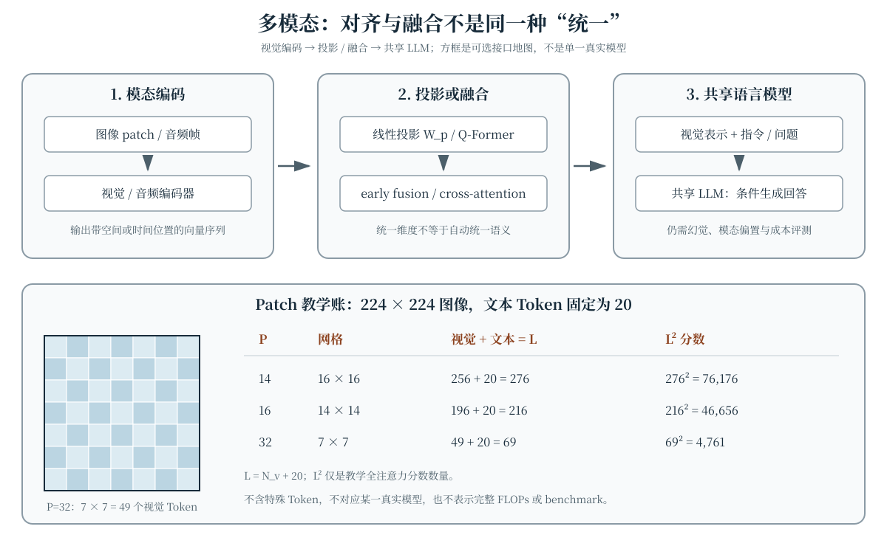

一张图片、一段语音和一句话都不是天然的同一种 Token。多模态模型需要先把连续信号变成可计算的表示，再决定这些表示如何对齐、如何进入语言模型，以及生成答案时怎样保持对输入模态的忠实。所谓“统一表示”可能指共享向量空间、共同序列接口或共享 LLM 计算路径，三者并不等价。本章围绕这条接口链展开，并用一个可复算的 patch 序列账连接注意力成本；不把任何一种教学简化冒充为某个真实模型的完整结构。

## 学习目标

学完本章，你应当能够：

- 将图像 patch 与音频帧转换为带位置信息的向量序列，并正确处理右、下边缘补零；
- 区分模态编码器、对比对齐、线性投影与 Q-Former 各自学习的接口；
- 比较 early fusion 与 cross-attention 的信息路径及注意力分数账；
- 解释视觉指令微调如何复用下一 Token 目标，以及数据与损失掩码为何仍然关键；
- 区分共享向量空间、共享维度和共享 LLM，说明统一表示的边界；
- 从幻觉、模态偏置、细粒度视觉能力和系统成本设计分层评测；
- 计算视觉与文本拼接后的序列长度及教学全注意力的 $L^2$ 分数数量。

本章沿用[缩放点积注意力](attention.qmd#sec-scaled-attention)、[因果掩码](attention.qmd#sec-causal-mask)与[推理两阶段](inference-systems.qmd#sec-inference-pipeline)的定义，不重复完整 ViT 或 Transformer Block。所有 patch 数字都是固定教学算例，不是模型结构声明或 benchmark 结果。

## 从图像 patch 与音频帧到序列 {#sec-multimodal-tokenization}

设图像为 $I\in\mathbb{R}^{H\times W\times C}$，每个不重叠 patch 的边长为 $P$。本章采用明确的边缘规则：不足一个 patch 时在**右侧和下侧补零**，因此行列数使用 ceil：

$$
\begin{aligned}
r&=\left\lceil\frac{H}{P}\right\rceil,\qquad
c=\left\lceil\frac{W}{P}\right\rceil,\\
N_v&=rc.
\end{aligned}
$$

补零后的宽度为 $cP$、高度为 $rP$；右补零量为 $cP-W$，下补零量为 $rP-H$。每个边缘部分 patch 仍计为一个位置。是否让后续注意力读取这些补零位置是另一项掩码决策，本章教学账把得到的 $N_v$ 个位置全部计入，不能悄悄把两种“padding”混为一谈。

将第 $i$ 个 patch 展平为 $x_i$，一种基本接口是

$$
z_i=\operatorname{vec}(x_i)W_e+b_e+p_i,
$$

其中 $W_e$ 把 patch 像素映射到编码器维度，$p_i$ 表示位置注入。ViT 原始论文 [@dosovitskiy2020image] 是把图像 patch 序列直接交给 Transformer 的代表性工作；这里只借用其输入切分直觉，不展开其分类头、预训练配方或完整 Block。

音频通常先按窗口与步长分帧，再计算波形特征或时频特征，最后形成带时间位置的帧表示。窗口更长会改变时间分辨率与单帧频率上下文，步长则影响帧数和相邻帧重叠。wav2vec 2.0 原始论文 [@baevski2020wav2vec] 在潜在语音表示上使用掩码与对比任务，说明语音表示学习不必先变成文本词表；它并不意味着所有音频模型都采用相同前端或目标。

这里的视觉或音频“Token”首先是**序列位置上的向量**，不一定是离散词表中的符号，也不天然与语言 Token 具有相同语义单位。

## 模态编码器：先保留各自结构 {#sec-modality-encoders}

可以分别用 $E_v,E_a,E_t$ 表示视觉、音频和文本编码器：

$$
\begin{aligned}
H_v&=E_v(I),\\
H_a&=E_a(A),\\
H_t&=E_t(T).
\end{aligned}
$$

它们的输出长度、维度和位置含义可以不同。视觉编码器需要保留空间关系，音频编码器需要保留时间与频率结构，文本编码器则处理离散符号序列。编码器可以预训练后冻结，也可以与后续模块共同训练；这是参数、数据和计算预算的选择，不是“多模态”一词自动规定的属性。

@fig-multimodal-models 上方把后续链路概括为“视觉编码 → 投影/融合 → 共享 LLM”。它是多种接口的地图，而不是声称所有系统都顺序经过每个方框。

## 对比对齐：CLIP 的共享度量空间 {#sec-contrastive-alignment}

对比学习先回答“哪些图像与文本应该靠近”，不必先生成一句话。设一个 batch 有 $N$ 对图文，归一化后的全局表示为 $v_i$ 与 $t_j$，温度为 $\tau>0$：

$$
s_{ij}=\frac{v_i^{\mathsf T}t_j}{\tau}.
$$

图像到文本方向的对比损失可写为

$$
\ell_{i2t}=-\frac{1}{N}\sum_{i=1}^{N}
\log\frac{\exp(s_{ii})}{\sum_{j=1}^{N}\exp(s_{ij})}.
$$

再对称地计算文本到图像方向，并取二者平均。CLIP 原始论文 [@radford2021clip] 以图文配对预测进行自然语言监督预训练，是这种对齐路线的代表性工作。相似度用于共享度量空间中的匹配，不是“这段描述为真的概率”；batch 内其他样本也可能其实匹配，形成假阴性。

CLIP 式对齐可以支持检索与零样本分类接口，但一个全局向量并不自动保留所有细粒度空间关系，也没有仅凭对比目标就获得自回归生成能力。把图像编码器和文本编码器接得很近，与把它们接入共享 LLM，是后续不同的系统工程。

## 投影与 Q-Former：连接到语言模型接口 {#sec-projection-qformer}

**线性投影**解决维度与接口适配。若视觉编码器输出 $H_v\in\mathbb{R}^{N_v\times d_v}$，则

$$
Z_v=H_vW_p,\qquad
W_p\in\mathbb{R}^{d_v\times d},
$$

得到 $N_v$ 个 $d$ 维向量，可与语言模型的隐藏宽度对齐。维度相同只是能够相加或拼接的必要条件之一；视觉位置是否对应语言可理解的语义，仍取决于对齐目标与训练数据。

**Q-Former** 使用一小组可学习查询读取视觉特征。若查询数为 $M$，输出可以形成 $M$ 个视觉接口 Token，$M$ 可小于原视觉长度 $N_v$。它不是把全部 patch 简单平均成一个向量：不同查询可以通过注意力选择不同的视觉信息。BLIP-2 原始论文 [@li2023blip2] 以 Querying Transformer 连接预训练视觉编码器与语言模型，并采用分阶段训练，是这种桥接方式的代表性方案。冻结哪些模块、查询数与输出宽度都必须随具体实现说明。

## Early fusion 与 cross-attention：两条信息路径 {#sec-fusion-paths}

**Early fusion** 在语言模型内部共享自注意力序列。把投影后的视觉表示与文本表示沿序列维拼接：

$$
H=[Z_v;H_t]\in\mathbb{R}^{(N_v+T)\times d}.
$$

随后可以在适当的位置、模态与因果掩码下执行联合建模。若只数一个无掩码教学全注意力矩阵，$L=N_v+T$，分数数量为 $L^2$。真实实现还可能加入特殊 Token、只计算部分掩码位置或采用高效注意力，因此这个数字不是完整 FLOPs，也不是任何模型的固定结构参数。

**Cross-attention** 则让一个序列读取另一个序列。若 Query 来自 $T$ 个文本位置，Key/Value 来自 $N_v$ 个视觉位置，沿用前章定义：

$$
S=\frac{Q_tK_v^{\mathsf T}}{\sqrt{d_k}},
\qquad S\in\mathbb{R}^{T\times N_v}.
$$

此处的分数数量是 $TN_v$，不是 $(T+N_v)^2$。Flamingo 原始论文 [@alayrac2022flamingo] 是在预训练视觉与语言模型之间加入交叉注意力、处理交错图文输入的代表性工作。Early fusion 与 cross-attention 可以出现在不同层和不同训练阶段；仅凭“用了 Transformer”无法推断实际成本或信息路径。

## 视觉指令微调：改变数据与条件，而非更换基本目标 {#sec-visual-instruction-tuning}

视觉指令样本通常包含图像、用户指令与目标回答。经过视觉接口后，语言模型学习的是以视觉和指令为条件的下一 Token 分布：

$$
p_\theta(y_t\mid I,x,y_{<t}).
$$

训练仍可复用交叉熵，并只在回答及约定的结束标记上计算损失。关键新增工作是样本中的图像与文本如何对齐、视觉接口是否共同训练、回答损失如何掩码，以及数据是否覆盖描述、问答、计数、OCR、空间关系与拒答。Visual Instruction Tuning / LLaVA 原始论文 [@liu2023visualinstruction] 是视觉指令微调的代表性工作，而不是所有多模态系统必须复制的唯一配方。

指令微调不会自动修复编码器看不见的细节，也不保证回答忠实于图像。合成指令数据还需检查模板偏差、事实错误和评测泄漏；冻结视觉编码器节省的训练成本与可学习的新视觉能力之间需要实测权衡。

## 统一表示的边界 {#sec-unified-representation-limits}

“统一”至少有三个层次：

1. **共享度量空间**：CLIP 式对齐让跨模态向量可比较，但不保证生成或细粒度定位。
2. **共享序列接口**：投影或 Q-Former 把视觉特征变成 LLM 可接收的向量位置，不要求视觉与语言 Token 的语义单位相同。
3. **共享生成计算**：early fusion 或 cross-attention 让语言模型利用视觉条件，仍保留专门的视觉前端、位置规则与数据管线。

这些接口都有信息边界。Patch 可能遗漏小字与精确轮廓，音频帧可能丢失相位或极短时间事件，固定查询数会形成压缩瓶颈，语言先验也可能盖过较弱的视觉证据。增加分辨率、帧数或查询数可以改变信息容量，却也增加序列成本；不存在脱离任务就必然更好的统一粒度。

## 幻觉、模态偏置与多模态评测 {#sec-multimodal-evaluation}

**多模态幻觉**是生成内容与输入模态不一致，例如描述不存在的物体、错误的数量、属性、关系或文字。它不同于所有世界知识错误：评测时要明确判定依据是当前图像、音频、外部事实，还是它们的组合。POPE 原始论文 [@li2023pope] 以轮询式提问评估物体幻觉，提供了针对一类问题的评测方法；它不能单独覆盖 OCR、空间推理、音频或开放回答质量。

**模态偏置**是模型过度依赖某一模态或语言先验，未能按任务使用其他输入。可构造保持文本不变但替换、遮挡或打乱图像的反事实对照，也可设置图文冲突样例；不过这些测试本身会引入分布外输入，必须与自然输入结果一起解释，不能把任一扰动下的退化都直接归因于单一原因。

分层评测至少应记录：

- **输入与对齐**：单模态表示是否保留任务所需细节，检索或配对是否正确；
- **细粒度理解**：物体、计数、属性、空间关系、OCR 与语音内容是否准确；
- **条件生成**：回答是否遵循指令、由视觉证据支持，并在信息不足时表达不确定；
- **鲁棒与偏置**：反事实替换、冲突输入、不同分辨率和不同表述下如何变化；
- **系统成本**：视觉 Token 数、prefill 时延、显存、尾时延与人工复核成本。

任何单一 benchmark 分数都不能替代这组诊断。报告应固定数据版本、提示、解码参数和标注口径，区分作者自报与独立复现，并保留失败样例；本章不引用或构造任何跨模型 benchmark 排名。

## 教学交互：patch 如何改变二次序列账 {#sec-multimodal-patch-demo}

@fig-multimodal-models 下方固定 $H=W=224$、文本 Token 数 $T=20$，只改变 $P$。取 $N_v=rc$、$L=N_v+T$，教学全注意力分数为 $L^2$。因此 $P=14,16,32$ 分别得到视觉 Token 数 $256,196,49$，总序列长 $276,216,69$，分数数量 $76{,}176,46{,}656,4{,}761$。网格、序列条、数值、文字数据与动态描述使用同一个计算函数。

::: {.content-visible when-format="html"}
```{=html}
<div class="interactive-mount">
<llm-multimodal-patch data-figure-id="fig-multimodal-models" patch-size="14"></llm-multimodal-patch>
</div>
```

<noscript markdown="1">

{data-external="1" #fig-multimodal-models fig-alt="多模态静态教学图。上方依次展示图像 patch 或音频帧经模态编码器得到向量序列，再由线性投影、Q-Former、early fusion 或 cross-attention 连接共享 LLM；这些是可选择的接口地图，不是单一真实模型。下方固定 224×224 图像与 20 个文本 Token：P=14 时为 16×16 网格、256 个视觉 Token、L=276、L²=76176；P=16 时为 14×14、196、L=216、L²=46656；P=32 时为 7×7、49、L=69、L²=4761。L² 只表示教学全注意力分数数量，不含特殊 Token，不是完整 FLOPs 或 benchmark。"}

| Patch 边长 P | Patch 网格 | 视觉 + 文本 = L | 教学全注意力分数 |
|--:|:--:|:--:|:--:|
| 14 | 16 × 16 | 256 + 20 = 276 | 276² = 76,176 |
| 16 | 14 × 14 | 196 + 20 = 216 | 216² = 46,656 |
| 32 | 7 × 7 | 49 + 20 = 69 | 69² = 4,761 |

: 三组 patch 的静态序列账 {#tbl-multimodal-patch-static}

静态结果与交互一致；不另加 CLS、BOS/EOS 等特殊 Token，也不对应某一真实模型结构。

</noscript>
:::

::: {.content-visible unless-format="html"}
{data-external="1" #fig-multimodal-models fig-alt="多模态静态教学图。上方依次展示图像 patch 或音频帧经模态编码器得到向量序列，再由线性投影、Q-Former、early fusion 或 cross-attention 连接共享 LLM；这些是可选择的接口地图，不是单一真实模型。下方固定 224×224 图像与 20 个文本 Token：P=14 时为 16×16 网格、256 个视觉 Token、L=276、L²=76176；P=16 时为 14×14、196、L=216、L²=46656；P=32 时为 7×7、49、L=69、L²=4761。L² 只表示教学全注意力分数数量，不含特殊 Token，不是完整 FLOPs 或 benchmark。"}

| Patch 边长 P | Patch 网格 | 视觉 + 文本 = L | 教学全注意力分数 |
|--:|:--:|:--:|:--:|
| 14 | 16 × 16 | 256 + 20 = 276 | 276² = 76,176 |
| 16 | 14 × 14 | 196 + 20 = 216 | 216² = 46,656 |
| 32 | 7 × 7 | 49 + 20 = 69 | 69² = 4,761 |

: 三组 patch 的静态序列账 {#tbl-multimodal-patch-static}

静态结果与交互一致；不另加 CLS、BOS/EOS 等特殊 Token，也不对应某一真实模型结构。
:::

下面的 Python 函数与浏览器组件共享同一整数口径；`math.ceil` 对应右、下补零后的部分 patch 计数。

```python
from math import ceil

def patch_layout(width, height, patch_size, text_tokens):
    values = (width, height, patch_size, text_tokens)
    if any(not isinstance(value, int) for value in values):
        raise ValueError("本教学例只接受整数输入")
    if min(width, height, patch_size) <= 0 or text_tokens < 0:
        raise ValueError("尺寸与 patch 必须为正，文本 Token 不能为负")
    rows = ceil(height / patch_size)
    columns = ceil(width / patch_size)
    visual_tokens = rows * columns
    sequence_length = visual_tokens + text_tokens
    return rows, columns, visual_tokens, sequence_length, sequence_length ** 2

for size in (14, 16, 32):
    print(size, patch_layout(224, 224, size, 20))
```

预期三行末尾依次是 `(16, 16, 256, 276, 76176)`、`(14, 14, 196, 216, 46656)` 与 `(7, 7, 49, 69, 4761)`。示例与网页共享整数、正尺寸和非负文本 Token 口径；生产数据管线还应根据运行环境检查数值范围。

## 常见误解

- **“视觉 Token 就是视觉词表里的离散符号。”** 本章多数接口使用连续向量位置；是否离散化取决于具体表示学习方案。
- **“Patch 越小必然越好。”** 更小 patch 增加视觉位置与注意力成本，是否改善细节理解需要任务评测。
- **“不能整除时丢弃右、下边缘即可。”** 本章明确补零并按 ceil 计数；丢弃是另一种会丢失信息的规则，不能混用数值。
- **“CLIP 已经把图文放入共享空间，所以它就是完整生成式 VLM。”** 对比对齐支持匹配，不自动提供自回归生成、细粒度定位或指令遵循。
- **“投影后维度相同，语义就已经对齐。”** 维度只解决接口形状，语义对齐依赖训练目标、参数与数据。
- **“Q-Former 只是平均池化。”** 学习查询可以分别读取视觉特征，输出多个接口表示，不等于单一均值。
- **“Cross-attention 也要算 $(T+N_v)^2$ 个分数。”** 文本 Query 读取视觉 Key/Value 时是 $TN_v$；只有本章指定的拼接全自注意力教学账使用 $L^2$。
- **“统一表示消除了幻觉和模态偏置。”** 共享接口不保证视觉证据被使用，仍需反事实、细粒度与生成忠实度评测。

## 总结

多模态系统先把图像 patch、音频帧和文本变成各自合适的表示，再通过对比对齐、投影、Q-Former、early fusion 或 cross-attention 建立接口。共享向量空间、共享维度与共享 LLM 是不同层次的“统一”，都不消除模态特有的信息损失。视觉指令微调复用下一 Token 目标，但视觉条件、数据质量和损失掩码决定它学什么。拼接序列的教学账给出 $N_v=\lceil H/P\rceil\lceil W/P\rceil$、$L=N_v+T$ 与 $L^2$；cross-attention 则应按 $TN_v$ 另算。最终验收必须同时覆盖幻觉、模态偏置、细粒度理解、指令遵循与系统成本。

## 练习 {#sec-exercises}

1. **复算 patch 与边缘补零。** 对 $224\times224$ 图像和固定 $T=20$，分别用 $P=14,16,32$ 核对本章三组 $N_v,L,L^2$。再对 $W=225,H=100,P=32$ 计算右、下补零量、行列数、视觉 Token 和总分数，解释为什么不能使用 floor。
2. **分析对比对齐。** 取两对归一化表示 $v_1=t_1=(1,0)$、$v_2=t_2=(0,1)$，令 $\tau=1$。写出 $2\times2$ 的 $s_{ij}$ 矩阵和两个方向的对比损失；若 $t_2$ 其实也是 $v_1$ 的有效描述，batch 负例假设会遇到什么问题？
3. **核对投影与查询接口。** 设 $H_v$ 为 $196\times8$、$W_p$ 为 $8\times4$，写出 $Z_v$ 的形状。若改用 $M=16$ 个 Q-Former 查询，输出位置数与原 patch 数有何差别？为什么这两种结果都不能只凭形状证明语义已对齐？
4. **比较融合成本。** 固定 $N_v=196,T=20$，按本章无特殊 Token 的教学口径分别计算 early fusion 的 $L^2$ 与单层单头 cross-attention 的 $TN_v$。说明加入因果掩码、多头或多层后，哪些结论需要重新核算，哪些信息路径差别仍保留。
5. **设计视觉指令样本。** 为“读出图中标牌并回答是否允许左转”构造图像、指令、回答和回答损失掩码，明确视觉表示不参与下一 Token 词表标签。列出两类会误导训练的数据问题，并说明为什么只用流畅度无法验收答案。
6. **诊断幻觉与模态偏置。** 设计一个包含计数、空间关系和 OCR 的评测小组，并加入图像替换、遮挡与图文冲突对照。说明每组要固定的提示与解码条件、记录的视觉 Token 和时延指标，以及如何避免把分布外扰动结果过度解释为唯一病因。

## 原始资料 {#sec-primary-sources}

- Dosovitskiy 等：An Image is Worth 16x16 Words: Transformers for Image Recognition at Scale [@dosovitskiy2020image]，图像 patch 序列与 ViT。
- Baevski 等：wav2vec 2.0: A Framework for Self-Supervised Learning of Speech Representations [@baevski2020wav2vec]，语音潜在表示与自监督目标。
- Radford 等：Learning Transferable Visual Models From Natural Language Supervision [@radford2021clip]，CLIP 图文对比预训练。
- Alayrac 等：Flamingo: a Visual Language Model for Few-Shot Learning [@alayrac2022flamingo]，视觉—语言桥接与交叉注意力。
- Li 等：BLIP-2: Bootstrapping Language-Image Pre-training with Frozen Image Encoders and Large Language Models [@li2023blip2]，Q-Former 与分阶段桥接。
- Liu 等：Visual Instruction Tuning [@liu2023visualinstruction]，LLaVA 与视觉指令微调。
- Li 等：Evaluating Object Hallucination in Large Vision-Language Models [@li2023pope]，POPE 与物体幻觉评测。

原始资料链接核对日期：2026-10-16。正文只在各论文的任务与设置范围内引用方法，不把作者自报结果写成跨场景保证。

::: {.content-visible when-format="html"}
```{=html}
<script type="module">
import { defineMultimodalPatchElement } from './assets/js/components/multimodal-patch.js';
defineMultimodalPatchElement();
</script>
```
:::
