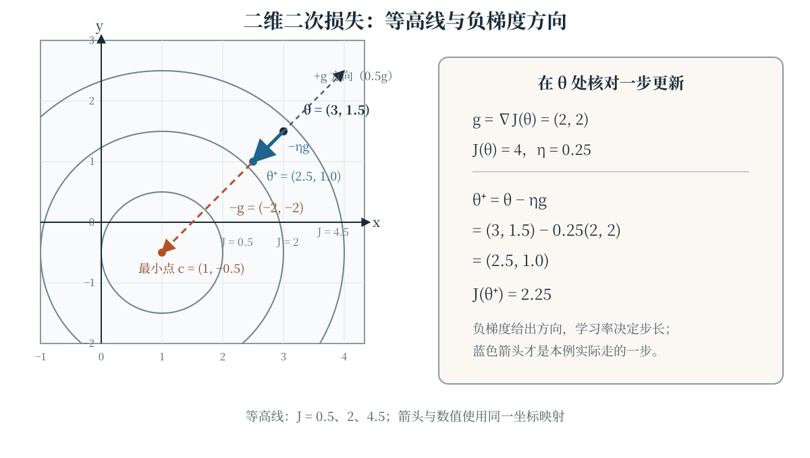
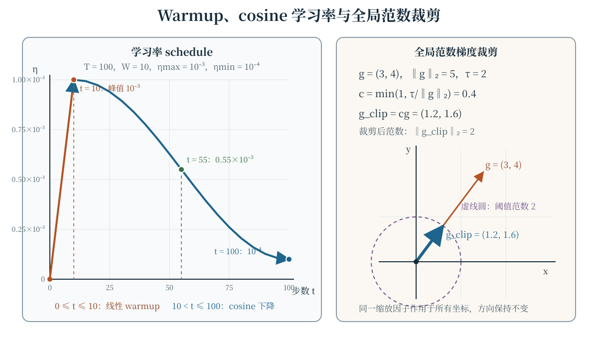
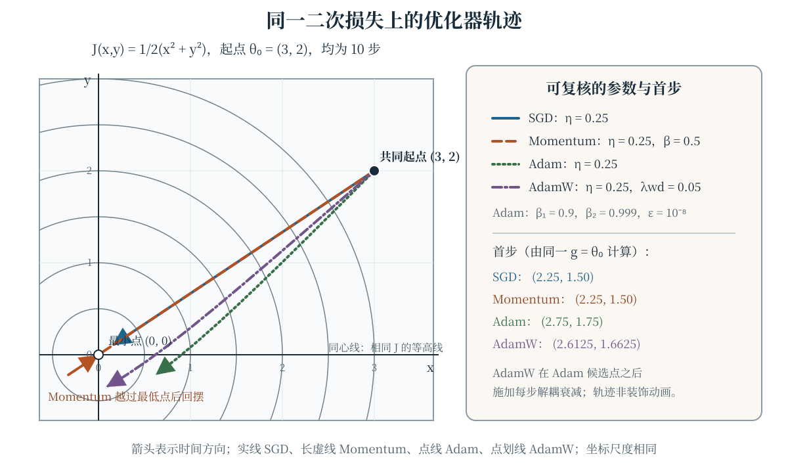

训练大语言模型并不只是“选一个优化器”。首先要说明用什么样本损失近似真正关心的目标，然后才能讨论梯度、更新方向、学习率和正则化。本章从经验风险出发，依次比较梯度下降、SGD、Momentum、Adam 与 AdamW，并补上学习率调度、全局范数梯度裁剪和混合精度中容易被略过的数值细节。深度学习中的损失、优化与正则化背景可参阅 Goodfellow 等人的教材 [@goodfellow2016deep]。

## 学习目标与记号约定

学完本章，你应当能够：

- 区分经验风险、单样本损失与期望风险，并解释 mini-batch 梯度在估计什么；
- 写出并手算梯度下降、Momentum、Adam 和 AdamW 的一步更新；
- 解释 Adam 的一阶/二阶矩估计及偏差校正，而不是只背诵更新公式；
- 推导 warmup+cosine 学习率和全局范数梯度裁剪的数值结果；
- 说明 L2 正则化与 decoupled weight decay 在自适应优化器中为何不能混用概念；
- 识别混合精度、损失缩放、溢出和除零带来的数值风险。

本章用 $\theta\in\mathbb{R}^d$ 表示全部可训练参数，用 $g_t$ 表示第 $t$ 步损失对参数的梯度。向量逐分量运算会在文字中特别说明；学习率 $\eta_t\geq0$、Momentum 系数 $\beta\in[0,1)$，Adam 的系数满足 $\beta_1,\beta_2\in[0,1)$，且 $\epsilon>0$。

## 经验风险与损失函数 {#sec-empirical-risk}

给定训练集 $\mathcal{D}=\{(x_i,y_i)\}_{i=1}^n$，模型 $f_\theta$ 对第 $i$ 个样本的损失记为

$$
\ell_i(\theta)=\ell(f_\theta(x_i),y_i).
$$

经验风险（empirical risk）是这些单样本损失的平均：

$$
\widehat{\mathcal{R}}_n(\theta)
=\frac{1}{n}\sum_{i=1}^n\ell_i(\theta).
$$

经验风险最小化寻找 $\hat\theta\in\arg\min_\theta\widehat{\mathcal{R}}_n(\theta)$。若样本来自联合分布 $P$，真正希望较小的通常是期望风险

$$
\mathcal{R}(\theta)=\mathbb{E}_{(x,y)\sim P}[\ell(f_\theta(x),y)].
$$

有限训练集上的 $\widehat{\mathcal{R}}_n$ 只是可计算的代理；训练损失下降不自动推出未见数据上的期望风险同样下降，二者之间还有泛化问题。语言模型中，单 Token 的负对数似然可以作为 $\ell_i$，再在 Token 或序列维度上按明确的口径求和或平均。优化器负责寻找较低的经验风险，并不替代损失函数、数据分布或评测集的定义。

## 梯度下降、SGD 与 mini-batch {#sec-sgd}

在可微点，经验风险的全批量梯度为 $g_t=\nabla_\theta\widehat{\mathcal{R}}_n(\theta_t)$。最基础的梯度下降更新是

$$
\theta_{t+1}=\theta_t-\eta_t g_t,
$$

用伪代码写就是 `θ <- θ - ηg`。负梯度是局部最速下降方向，但有限步长下的实际变化还取决于学习率、曲率和浮点误差；不能把“沿着负梯度”理解成任意步长都必然降低损失。

深度学习中直接计算全批量梯度往往太贵。第 $t$ 步抽取 mini-batch $B_t$，用

$$
\begin{aligned}
\hat g_t
&=\frac{1}{|B_t|}\sum_{i\in B_t}\nabla_\theta\ell_i(\theta_t),\\
\theta_{t+1}
&=\theta_t-\eta_t\hat g_t
\end{aligned}
$$

近似更新。$|B_t|=1$ 时通常称为 SGD，$1<|B_t|<n$ 时是 mini-batch SGD；在均匀抽样等明确条件下，mini-batch 梯度可以是全批量梯度的无偏估计，但单步方向仍带有抽样噪声。增大 batch 通常会降低梯度估计的方差并改变计算并行度，却不保证相同步数下一定更好，也不把经验风险变成期望风险。

@fig-loss-surface 用一个可手算的二维二次损失把“梯度方向”和“实际更新”分开。设

$$
J(x,y)=\frac12\left[(x-1)^2+(y+0.5)^2\right],
$$

在 $\theta=(3,1.5)$ 处有 $g=\nabla J(\theta)=(2,2)$，且 $J(\theta)=4$。取 $\eta=0.25$，更新后 $\theta^+=\theta-\eta g=(2.5,1.0)$，损失降为 $J(\theta^+)=2.25$。这个二次例子用于核对符号和尺度，不代表一般神经网络损失必然是凸的或一步必然下降。

{data-external="1" #fig-loss-surface fig-alt="二维损失曲面教学图：损失 J(x,y) 等于二分之一乘以 (x−1)²+(y+0.5)²，同心等高线的中心是 (1,−0.5)。在 θ=(3,1.5) 处标出梯度 g=(2,2)，虚线箭头表示正梯度方向，橙色箭头表示负梯度 (−2,−2)，蓝色短箭头表示学习率 0.25 下的实际更新到 θ⁺=(2.5,1.0)。右侧列出更新前损失 4、更新后损失 2.25，说明负梯度方向与实际步长的区别。"}

## Momentum：累积速度 {#sec-momentum}

Momentum 不只使用当前梯度，还维护一个速度状态。本书采用与数值内核一致的约定：$v_{-1}=0$，对 $t=0,1,\ldots$

$$
\begin{aligned}
v_t&=\beta v_{t-1}+g_t,\\
\theta_{t+1}&=\theta_t-\eta_t v_t,
\end{aligned}
$$

其中 $0\leq\beta<1$。展开速度可得

$$
v_t=\sum_{j=0}^{t}\beta^{t-j}g_j,
$$

所以近期梯度权重较大，历史方向仍以指数衰减的方式保留。与 `θ <- θ - ηg` 相比，Momentum 的步长由累积速度决定；持续同向的梯度会累积，方向快速翻转的梯度会部分抵消。它可能加速穿过浅谷，也可能因惯性越过最低点，并不是“动量越大越好”。有些文献把更新写成 $v_t=\beta v_{t-1}+(1-\beta)g_t$，那是对速度和有效学习率的另一种归一化约定，不能与上式的数值直接混用。

## Adam：矩估计与偏差校正 {#sec-adam}

Adam 为每个参数分量维护梯度的一阶矩 $m_t$ 和二阶原始矩 $v_t$ [@kingma2014adam]。令 $g_t^2$ 表示 $g_t$ 的逐分量平方（不是内积），从 $m_{-1}=v_{-1}=0$ 开始，本书的更新写成

$$
\begin{aligned}
m_t&=\beta_1m_{t-1}+(1-\beta_1)g_t,\\
v_t&=\beta_2v_{t-1}+(1-\beta_2)g_t^2.
\end{aligned}
$$

零初始化使早期的矩估计偏向零，因此第 $t$ 步（从 $t=0$ 起算）使用偏差校正量

$$
\hat m_t=\frac{m_t}{1-\beta_1^{t+1}},
\qquad
\hat v_t=\frac{v_t}{1-\beta_2^{t+1}}.
$$

这里的 $\hat m_t$ 和 $\hat v_t$ 也常在代码注释中称为 mhat/vhat；它们不是另外两套矩，而是对 $m_t,v_t$ 的校正。Adam 的参数更新为

$$
\theta_{t+1}=\theta_t-\eta_t
\frac{\hat m_t}{\sqrt{\hat v_t}+\epsilon},
$$

除法和平方根均逐分量进行。分母使不同坐标具有自适应的有效步长，$\epsilon$ 主要用于避免除零和改善数值稳定性，不是用来替代偏差校正的“极小学习率”。

**首步核对。** 取 $\theta=(1,1)$、$g=(2,-1)$、$\eta=0.1$、$\beta_1=0.9$、$\beta_2=0.999$、$\epsilon=10^{-8}$，初始矩和时间步均为零。第一步后

$$
\begin{aligned}
m&=(0.2,-0.1),\\
v&=(0.004,0.001),
\end{aligned}
$$

而 $\hat m=(2,-1)$、$\hat v=(4,1)$，所以参数约变为 $(0.9,1.1)$。本例若漏掉偏差校正，$m/\sqrt v$ 的两个分量约为 $\pm3.162$，步长会错误放大；若把 $v$ 当作梯度而不是梯度平方的指数平均，也会得到不同更新。

## 学习率 warmup 与 cosine schedule {#sec-schedule}

学习率可以随步数变化。设总步数为 $T$，warmup 步数为 $W$（$0<W<T$），最大和最小学习率分别为 $\eta_{\max}$ 与 $\eta_{\min}$。一个明确的分段 warmup+cosine schedule 是

$$
\begin{aligned}
\eta(t)&=\eta_{\max}\dfrac{t}{W},\qquad 0\leq t\leq W,\\
\eta(t)&=\eta_{\min}+\dfrac{\eta_{\max}-\eta_{\min}}{2}\\
&\quad\times\left[1+\cos\left(\pi\dfrac{t-W}{T-W}\right)\right],\\
&\qquad W<t\leq T.
\end{aligned}
$$

前 $W$ 步线性升到 $\eta_{\max}$，随后余弦下降到 $\eta_{\min}$。Warmup 常用于避免训练初期矩估计尚未稳定时的过大更新；cosine 段则让后期步长平滑减小。它们改变的是优化步长，不会改变损失函数或梯度定义。实现时必须说明端点和步数索引：例如 $t=W$ 已达到峰值，$t=T$ 才达到下限。

@fig-lr-schedule 左侧取 $T=100$、$W=10$、$\eta_{\max}=10^{-3}$、$\eta_{\min}=10^{-4}$，因此 $\eta(0)=0$、$\eta(10)=10^{-3}$、$\eta(55)=0.55\times10^{-3}$、$\eta(100)=10^{-4}$。这些点可以直接代入上式复核。

## 全局范数梯度裁剪 {#sec-gradient-clipping}

梯度裁剪（gradient clipping）不是把每个坐标分别截到固定区间，而是先把所有相关参数的梯度视为一个整体向量 $g$，计算全局范数 $\|g\|_2$，再统一缩放。阈值 $\tau\geq0$ 时，定义

$$
c=
\begin{cases}
1, & \|g\|_2\leq\tau,\\
\dfrac{\tau}{\|g\|_2}, & \|g\|_2>\tau,
\end{cases}
\qquad
\widetilde g=cg.
$$

非零梯度时也可写成 $c=\min(1,\tau/\|g\|_2)$；零向量的裁剪结果仍为零，不能机械计算 $0/0$。当 $c>0$ 时全局缩放保持梯度方向，只在范数超过阈值时把范数压到 $\tau$（$\tau=0$ 时得到零向量），并且通常在送入 Momentum 或 Adam 之前完成。对每个参数张量分别裁剪会得到不同的整体更新，不能称为同一个全局范数规则。

@fig-lr-schedule 右侧的例子取 $g=(3,4)$、$\tau=2$：$\|g\|_2=5$，所以 $c=0.4$，$\widetilde g=(1.2,1.6)$ 且 $\|\widetilde g\|_2=2$。若 $\tau=5$，则不发生缩放。实际计算范数还要注意有限大数的平方和可能溢出，可采用先按最大绝对分量归一化再计算范数的方式；这与改变数学定义不是一回事。

:::: {.content-visible when-format="html"}
```{=html}
<div class="interactive-mount">
<llm-lr-schedule data-figure-id="fig-lr-schedule" threshold="2"></llm-lr-schedule>
</div>
```

<noscript markdown="1">

{data-external="1" #fig-lr-schedule fig-alt="学习率与梯度裁剪教学图：左侧参数为总步数 100、warmup 10 步、最大学习率 0.001、最小学习率 0.0001，曲线从原点线性升至第 10 步峰值，再按 cosine 平滑降到第 100 步下限，并标出第 55 步为 0.00055。右侧从同一原点画出梯度 g=(3,4)，其范数为 5；以阈值 2 画圆，蓝色箭头表示乘以 0.4 后的裁剪梯度 (1.2,1.6)，范数恰好为 2，说明这是全局统一缩放而非逐坐标截断。"}

</noscript>
:::

:::: {.content-visible unless-format="html"}
{data-external="1" #fig-lr-schedule fig-alt="学习率与梯度裁剪教学图：左侧参数为总步数 100、warmup 10 步、最大学习率 0.001、最小学习率 0.0001，曲线从原点线性升至第 10 步峰值，再按 cosine 平滑降到第 100 步下限，并标出第 55 步为 0.00055。右侧从同一原点画出梯度 g=(3,4)，其范数为 5；以阈值 2 画圆，蓝色箭头表示乘以 0.4 后的裁剪梯度 (1.2,1.6)，范数恰好为 2，说明这是全局统一缩放而非逐坐标截断。"}
:::

## L2、权重衰减与 AdamW {#sec-adamw}

**L2 正则化**把惩罚项写进目标函数：

$$
\begin{aligned}
\mathcal{J}_{\mathrm{L2}}(\theta)
&=\widehat{\mathcal{R}}_n(\theta)+\frac{\lambda_{\mathrm{L2}}}{2}\|\theta\|_2^2,\\
\nabla_\theta\mathcal{J}_{\mathrm{L2}}
&=g+\lambda_{\mathrm{L2}}\theta.
\end{aligned}
$$

对普通 SGD，在固定学习率下，

$$
\theta-\eta(g+\lambda_{\mathrm{L2}}\theta)
=(1-\eta\lambda_{\mathrm{L2}})\theta-\eta g,
$$

所以 L2 与一种权重衰减写法可以对应。但对 Adam，若把 $\lambda_{\mathrm{L2}}\theta$ 加进梯度，它会同时进入 $m_t$ 和 $v_t$，并被自适应分母重新缩放；这不再等同于在 Adam 更新之外施加一个独立衰减。Loshchilov 与 Hutter 正是针对这一区别提出 decoupled weight decay（解耦权重衰减）和 AdamW [@loshchilov2017decoupled]。

本书与配套数值内核采用“先算 Adam 候选点，再做每步衰减”的明确约定。令

$$
\begin{aligned}
a_t&=\theta_t-\eta_t\frac{\hat m_t}{\sqrt{\hat v_t}+\epsilon},\\
\theta_{t+1}&=(1-\lambda_{\mathrm{wd}})a_t,
\end{aligned}
$$

其中 $\lambda_{\mathrm{wd}}\geq0$ 是每一步的衰减系数。关键在于衰减项不进入 $m_t,v_t$ 的更新；它与损失梯度驱动自适应矩估计的路径分开。不同框架也可能把衰减写成 $-\eta_t\lambda\theta_t$ 或使用更新前参数，比较超参数前必须换算并核对接口定义，不能只比较一个叫作 weight decay 的数字。

**AdamW 一步核对。** 沿用 Adam 小节的首步参数，Adam 候选点是 $a=(0.9,1.1)$。若 $\lambda_{\mathrm{wd}}=0.01$，则

$$
\theta^+=(1-0.01)a=(0.891,1.089).
$$

如果把同样的衰减系数误当作 L2 梯度加进 Adam 的 $m/v$，结果和后续状态都会不同。因此“Adam 加 L2”与“AdamW”不是同义词；$\lambda_{\mathrm{wd}}=0$ 时才退化为本章定义的 Adam 更新。

@fig-optimizer-trajectory 比较四种更新规则的真实轨迹：静态图展示同一二次损失上的十步轨迹，HTML 交互则允许逐步查看并切换算法。静态图以实线、长虚线、点线和点划线依次区分 SGD、Momentum、Adam 与 AdamW，而非仅依赖颜色。两种呈现中的所有点都由相应更新公式计算，SGD 与 Momentum 的首步相同是因为速度从零初始化，而 AdamW 与 Adam 的差异来自显式的解耦衰减。

:::: {.content-visible when-format="html"}
```{=html}
<div class="interactive-mount">
<llm-optimizer-trajectory data-figure-id="fig-optimizer-trajectory" algorithm="sgd" learning-rate="0.1" momentum="0.9" weight-decay="0.01"></llm-optimizer-trajectory>
</div>
```

<noscript markdown="1">

{data-external="1" #fig-optimizer-trajectory fig-alt="优化器轨迹对比图：损失为 J(x,y) 等于二分之一 (x²+y²)，初始点为 (3,2)，学习率均为 0.25。实线 SGD 轨迹沿直线逐步接近原点；长虚线 Momentum（β=0.5）轨迹因速度累积越过原点后回摆；点线 Adam（β1=0.9、β2=0.999、ε=10⁻⁸）轨迹前期每坐标约走 0.25 并逐步转向；点划线 AdamW 在相同 Adam 参数外使用每步 0.05 的解耦衰减，轨迹更快收缩。右侧面板列出首步坐标，SGD 和 Momentum 为 (2.25,1.50)，Adam 为 (2.75,1.75)，AdamW 为 (2.6125,1.6625)。"}

</noscript>
:::

:::: {.content-visible unless-format="html"}
{data-external="1" #fig-optimizer-trajectory fig-alt="优化器轨迹对比图：损失为 J(x,y) 等于二分之一 (x²+y²)，初始点为 (3,2)，学习率均为 0.25。实线 SGD 轨迹沿直线逐步接近原点；长虚线 Momentum（β=0.5）轨迹因速度累积越过原点后回摆；点线 Adam（β1=0.9、β2=0.999、ε=10⁻⁸）轨迹前期每坐标约走 0.25 并逐步转向；点划线 AdamW 在相同 Adam 参数外使用每步 0.05 的解耦衰减，轨迹更快收缩。右侧面板列出首步坐标，SGD 和 Momentum 为 (2.25,1.50)，Adam 为 (2.75,1.75)，AdamW 为 (2.6125,1.6625)。"}
:::

## 混合精度与数值稳定性 {#sec-numerical-stability}

混合精度训练通常让部分前向和反向计算使用 FP16 或 BF16，同时保留 FP32 主权重和优化器状态；具体 dtype 分工由框架和硬件决定。FP16 的表示范围较小，BF16 通常有更大的指数范围但有效精度更低，二者都不能被当成“免费的无损加速”。混合精度改变的是舍入和溢出行为，不改变经验风险的数学定义。

使用损失缩放时，若反向传播得到的是缩放损失的梯度 $g_{\mathrm{scaled}}=Sg$，必须在裁剪和矩估计之前用 $g=g_{\mathrm{scaled}}/S$ 反缩放，并检查结果为有限值。否则，阈值 $\tau$、Adam 的 $v_t$ 以及由梯度驱动的参数更新都会处于错误的尺度；本章定义的解耦权重衰减直接作用于参数，不消费缩放梯度，不在此列。计算 $\|g\|_2$、$g_t^2$ 以及 $\sqrt{\hat v_t}+\epsilon$ 时也要考虑上溢、下溢和除零；稳定的范数实现可以先除以最大绝对分量，再对归一化向量求范数。出现 NaN 或 Infinity 时应停止并定位来源，而不是默默把非有限值继续传入下一步。

这些防护守护的是更新公式的数值不变量：有限输入应产生可解释的有限状态，零梯度本身不应凭空产生梯度驱动的参数增量，裁剪后的全局范数不应超过阈值。它们不保证非凸训练一定收敛，也不能替代合适的学习率和数据检查。

## 常见误解

- **“经验风险很小，期望风险就一定很小。”** 经验风险只衡量训练样本；泛化还取决于数据、模型容量、正则化和训练过程。
- **“SGD 的梯度是随机方向，所以没有确定含义。”** 随机性来自样本估计；在明确抽样条件下它可以是全批量梯度的无偏估计，更新公式仍是 $\theta-\eta\hat g$。
- **“Momentum 的速度就是当前梯度。”** 速度按 $v_t=\beta v_{t-1}+g_t$ 累积历史梯度，且不同文献的归一化约定可能不同。
- **“Adam 的 $m/v$ 公式不需要偏差校正。”** 零初始化会使早期矩估计偏小，$\hat m,\hat v$ 的校正是首步更新的重要部分。
- **“warmup 或 cosine schedule 会改变损失函数。”** 调度只改变学习率；目标函数和梯度定义不变。
- **“逐张量截断就是全局范数梯度裁剪。”** 全局规则先合并范数再统一缩放，保持整个梯度的相对坐标比例。
- **“Adam 中加 L2 就等于 AdamW。”** 对自适应优化器，L2 项会进入矩估计；AdamW 将权重衰减与损失梯度更新解耦。
- **“所有框架的 weight decay 数值都可直接比较。”** 有的约定乘以学习率，有的使用每步乘子或不同的更新顺序，必须先读公式。
- **“混合精度只是把所有数都换成 FP16。”** 常见实现保留 FP32 主权重/状态并配合损失缩放；反缩放、有限值检查和稳定范数仍不可省略。

## 总结

经验风险把单样本损失汇成可优化的训练目标，SGD 用 mini-batch 估计其梯度，Momentum 在此基础上累积速度。Adam 进一步维护逐坐标的一阶/二阶矩，分别由 $m,v$ 得到校正后的 $\hat m,\hat v$，并用 $\hat m/(\sqrt{\hat v}+\epsilon)$ 更新；AdamW 则把权重衰减从损失梯度及其矩估计中解耦，不能与 Adam 加 L2 混为一谈。学习率 warmup/cosine 调度控制步长的时间形状，全局范数裁剪控制梯度的整体尺度。最后，损失缩放、稳定范数和有限值检查决定这些公式能否在低精度计算中保持可解释的数值行为。

## 练习

1. **计算经验风险。** 三个样本的损失分别为 $0.2$、$0.5$、$1.1$。计算经验风险；若第三个样本被复制一次，新的经验风险是多少？说明为什么平均口径会改变优化目标。
2. **手算 SGD。** 对 $\theta=(1,-2)$、$g=(0.5,4)$、$\eta=0.2$，计算一步 $\theta-\eta g$。若 $g$ 是由两个样本梯度 $(1,2)$ 与 $(0,6)$ 平均得到，验证它与先分别更新再平均的结果在什么条件下相同。
3. **展开 Momentum。** 取 $v_{-1}=0$、$\beta=0.5$，连续两步梯度为 $g_0=(2,0)$、$g_1=(0,2)$，学习率恒为 $0.1$。计算 $v_0,v_1$ 和两步参数更新，并说明第二步为何同时含有 $g_0$ 的影响。
4. **核对 Adam 偏差校正。** 使用正文首步的 $g=(2,-1)$、$\beta_1=0.9$、$\beta_2=0.999$，从 $m/v$ 计算 $\hat m,\hat v$，再分别计算省略偏差校正和保留偏差校正时的第一步参数。哪一步体现了校正的作用？
5. **代入学习率 schedule。** 使用正文图 @fig-lr-schedule 的 $T=100$、$W=10$、$\eta_{\max}=10^{-3}$、$\eta_{\min}=10^{-4}$，计算 $\eta(0)$、$\eta(10)$、$\eta(55)$ 与 $\eta(100)$。如果把总步数改为 200 而 warmup 仍为 10，峰值和终点的位置如何变化？
6. **执行全局裁剪。** 对 $g=(3,4)$，分别取 $\tau=2$、$\tau=5$ 和 $\tau=0$，求缩放因子、裁剪后梯度及其范数。再把它与把每个坐标分别限制到 $[-2,2]$ 的结果比较，指出两种规则的差别。
7. **区分 L2 与 AdamW。** 对普通 SGD 写出目标 $\mathcal{R}+\frac{\lambda}{2}\|\theta\|^2$ 的一步更新，并整理成参数衰减加梯度步的形式。随后说明在 Adam 中把 $\lambda\theta$ 加入 $g$ 为什么会改变 $m/v$，以及正文 AdamW 的哪一步避免了这个耦合。
8. **检查混合精度尺度。** 若损失缩放因子为 $S=128$，反传得到缩放梯度 $g_{\mathrm{scaled}}=(256,-64)$，求反缩放梯度。若阈值 $\tau=2$，应在反缩放前还是后做全局范数裁剪？计算正确顺序下的裁剪结果。
9. **设计数值检查。** 为一个 AdamW 训练步列出至少四项有限性或尺度检查，覆盖反缩放梯度、全局范数、二阶矩和更新后参数。说明每项检查对应正文中的哪个数值不变量，而不要只写“防止 NaN”。

:::: {.content-visible when-format="html"}
<script type="module">import './assets/js/book.js';</script>
:::
