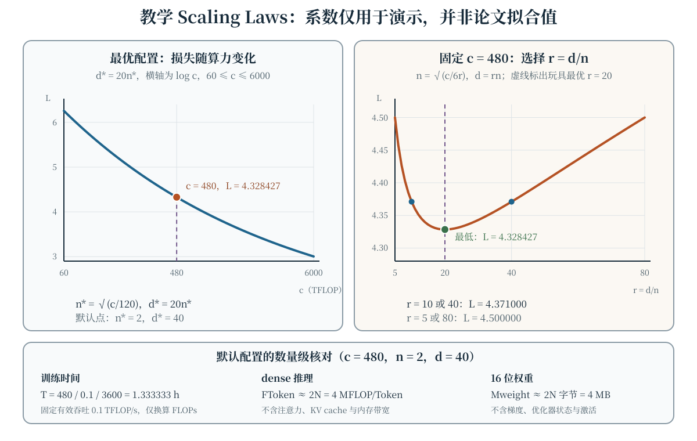

预训练把一个参数很多的模型放在大量 Token 上优化，但“数据更多、参数更大”并不是完整的训练方案。目标函数决定模型学习什么条件分布，数据管线决定模型实际看到什么，算力分配决定参数与训练 Token 如何组合；部署时还要重新计算推理延迟、显存和服务量。本章把这些环节放在同一套记号下，并用可手算的小例子说明 Scaling Laws 能回答什么、不能回答什么。

## 学习目标

学完本章，你应当能够：

- 写出自回归、掩码与序列到序列预训练目标，并说明可见上下文和生成方式的区别；
- 从来源、去重、去污、混合比例和 Token 化等方面检查一条可复现的数据管线；
- 区分训练 Token 数、唯一 Token 数与重复 epoch，解释数据受限时为什么不能照搬无限新鲜数据的结论；
- 写出 Kaplan 式幂律观察与 Chinchilla 常用的参数—数据损失形式，并在固定算力下推导最优分配；
- 区分 MoE 的总参数、每 Token 激活参数、路由开销和负载均衡问题；
- 用统一的 FLOPs 约定估算预训练与推理成本，并说明这些估算遗漏了哪些系统因素。

## 预训练目标：学习哪个条件分布 {#sec-pretraining-objectives}

设 Token 序列为 $x_{1:T}=(x_1,\ldots,x_T)$，词表大小为 $V$，模型参数为 $\theta$。预训练样本可以来自连续文本，也可以由文档、代码或图文等多种来源构造；以下先只讨论文本 Token。

### 自回归语言建模

Decoder-only 语言模型把序列概率分解为

$$
p_\theta(x_{1:T})=\prod_{t=1}^{T}p_\theta(x_t\mid x_{<t}),
$$

并最小化平均负对数似然

$$
\mathcal L_{\mathrm{AR}}(\theta)
=-\frac{1}{T}\sum_{t=1}^{T}\log p_\theta(x_t\mid x_{<t}).
$$

训练时可以用 Teacher Forcing 并行计算各位置：位置 $t$ 的输入含真实前缀，因果掩码阻止读取 $x_t$ 之后的信息。平均口径要写明是按 Token、按序列还是按文档；长度差异很大时，这些口径对应不同的样本权重。

一个只需心算的例子是：给定前缀后，正确 Token 的概率为 $0.25$，该位置的损失为 $-\ln0.25=1.386294$ nat。单个数值既不表示整句损失，也不表示下游任务准确率。指数化平均损失得到的困惑度适合比较同一 Token 化、同一验证分布下的模型，跨 Token 器直接比较通常没有相同口径。

### 掩码与去噪目标

掩码语言建模先得到损坏序列 $\widetilde x$，只在被遮盖位置集合 $\mathcal M$ 上计算

$$
\mathcal L_{\mathrm{MLM}}(\theta)
=-\frac{1}{|\mathcal M|}\sum_{i\in\mathcal M}
\log p_\theta(x_i\mid\widetilde x).
$$

被掩位置的预测可以利用左右两侧可见上下文，因此它与严格从左到右生成的条件分解不同。Span corruption、乱序或删除重建等去噪目标也可写成“给定损坏输入，恢复被删内容”的条件似然。Encoder–decoder 模型则进一步优化

$$
\mathcal L_{\mathrm{S2S}}(\theta)
=-\sum_{t=1}^{T_y}\log p_\theta(y_t\mid y_{<t},x),
$$

其中 $x$ 是输入、$y$ 是目标。这里没有哪个目标在所有用途上绝对最优：双向表示、条件生成和自由自回归生成对应的训练—推理接口不同，比较时必须同时说明架构、数据、微调和评测方式。

## 数据质量与混合：分布也是超参数 {#sec-data-quality}

### 从来源清单到可审计数据

“预训练语料”不是天然同质的整体。网页、书籍、代码、论文、对话和人工标注数据在格式、事实密度、版权许可、个人信息与噪声上都有差异。一条可审计的数据清单至少应记录来源、许可或授权范围、抓取时间、语言、解析方式、过滤规则和版本。对个人信息、恶意代码、违法内容和版权的处理应遵循具体法律与机构政策，而不能用“公开可下载”替代合规判断。

常见处理包括：

- **解析与语言识别。** 去除导航、脚本和乱码时保留正文；错误解码或错误语言标签会直接影响 Token 分布。
- **精确与近似去重。** 哈希适合完全相同文档，MinHash、SimHash 或嵌入检索可辅助发现近重复；阈值过松会误删合理复述，过紧则留下模板页。
- **质量与安全过滤。** 可用规则、分类器或人工抽查，但过滤器的偏见和错误率会进入训练集，不能只报告“过滤了多少”而不报告留下了什么。
- **评测去污。** 用测试题及其近变体检查训练集，既看精确命中，也保留人工复核；只删除完全相同的字符串不足以证明没有泄漏。

### 混合比例与重复采样

若有 $K$ 个数据源，第 $k$ 个来源的条件分布为 $q_k$，一种明确的混合是

$$
\begin{aligned}
q(x)&=\sum_{k=1}^{K}w_kq_k(x),\\
w_k&\geq0,\qquad \sum_{k=1}^{K}w_k=1.
\end{aligned}
$$

在一个含 $D$ 个训练 Token 的批次计划中，第 $k$ 个来源的目标量约为 $D_k=w_kD$。例如一个 $10^7$ Token 的教学预算可取通用文本、代码、数学文本的权重 $(0.5,0.3,0.2)$，对应 $(5,3,2)\times10^6$ Token。若数学来源只有 $10^6$ 个唯一 Token，为达到目标量就要平均读取两遍；这增加的是**处理 Token 数**，不是唯一信息量。

混合权重可按文档数、字节数或 Token 数定义，三者不能混用。高质量领域数据上采样可能改善目标领域验证损失，却也可能损害通用覆盖；重复采样还可能带来记忆与过拟合。合理做法是保留独立的新鲜验证集，按来源切片报告损失和下游评测，再调整权重，而不是仅凭训练集总损失判断“质量”。

## Token 化与数据管线 {#sec-tokenization-pipeline}

### Token 化改变序列长度与成本口径

Tokenizer 把字节或字符序列映射为词表 $\{1,\ldots,V\}$ 中的 ID。BPE 类方法从基础符号开始，迭代合并高频相邻符号；Unigram 类方法则学习用一元语言模型切分文本。词表更大常能缩短部分文本的 Token 序列，却会增加 Embedding 和输出层参数；低资源语言、代码、数字与罕见字符串的切分效率还可能很不均衡。因此“多少词”“多少字符”和“多少 Token”不是同一个数据量单位。

一个刻意缩小的 BPE 例子是：对字符串 `abab`，初始符号为 `(a,b,a,b)`，若学习合并 `(a,b) → z`，则变为 `(z,z)`。这个例子只说明一次合并如何减少长度，不表示真实语料上总能减半，也不说明任意规范化都安全。大小写折叠、空白统一和 Unicode 规范化应在对齐原始文本后评估；代码缩进、表格、公式和多语言文本尤其需要保留边界信息。

### 从原始文档到 mini-batch

一条可复现管线可以明确写成以下阶段：

1. 解码与结构化解析，保存原始文档 ID 和来源；
2. 划分训练、验证与测试范围，随后执行去重和评测去污；
3. 过滤、混合并固定 Tokenizer 版本，把文本编码为 ID；
4. 按文档边界拼接或 packing，并插入明确的结束标记；
5. 预分片、shuffle 和按 batch 读取，记录随机种子、样本顺序及检查点位置；
6. 对唯一 Token 数、处理 Token 数、各来源占比、空文档率和异常长度做持续统计。

Packing 把多个短文档装入定长序列以提高有效 Token 比例，但不能让模型无提示地把前一文档当作后一文档的自然上文。常见办法是加入文档结束 Token，或在实现支持时使用文档级注意力掩码和重置位置编号；这些策略的行为不同，应按目标定义选择。若一个 epoch 完整遍历 $D_u$ 个唯一 Token 并重复 $R$ 次，则处理量近似为

$$
D=R D_u.
$$

流式采样、过滤和变长 packing 会使实际量略有偏差，所以日志中应同时记录唯一数据估算、已消费 Token 和每个来源的重复程度。

## Scaling Laws：经验拟合，不是守恒定律 {#sec-scaling-laws}

[Kaplan 等（2020）](https://arxiv.org/abs/2001.08361)报告了神经语言模型损失随模型规模、数据量和算力变化的多段幂律趋势。其重要方法论贡献是用平滑经验关系外推训练配置，而不是证明任意架构、任意数据上都存在同一个指数。若不可约损失下界近似为零，单变量形式可写成

$$
L(N)\approx A N^{-\alpha},
\qquad
L(D)\approx B D^{-\beta},
$$

其中一次只改变一个因素，其余训练条件必须说明。若存在非零下界 $E$，应对 $L-E$ 而不是直接对 $L$ 做简单的对数线性解释。

[Hoffmann 等（2022）的 Chinchilla 工作](https://arxiv.org/abs/2203.15556)进一步联合拟合参数量 $N$ 与训练 Token 数 $D$，常用形式为

$$
\begin{aligned}
L(N,D)&=E+\frac{A}{N^\alpha}+\frac{B}{D^\beta},\\
A,B,\alpha,\beta&>0.
\end{aligned}
$$

这里 $E$ 表示拟合的不可约项，第二、三项分别描述有限参数与有限数据的贡献。系数依赖 Token 化、数据分布、模型架构、训练过程和拟合区间；它们不是跨项目通用的物理常数。Chinchilla 的代表性配置使用约 700 亿参数和 1.4 万亿 Token，即约 20 Token/参数，但这个比例不应被当成所有预算和数据质量下的固定配额。

两项研究的差别也不宜简化成“一个只看参数、另一个给出永恒正确答案”。实验范围、训练是否充分、算力测量、模型与数据配置都会改变拟合。Scaling Law 的可靠用法是：在目标分布附近做多组受控实验，报告拟合区间与残差，再用区间外的小步验证检验外推；它不保证下游能力平滑，也不预测所有涌现现象或安全风险。

## 固定算力下的参数—数据分配 {#sec-compute-optimal}

对忽略长序列注意力、激活、通信和路由等项的 dense Transformer，常用近似是每 Token 前向约 $2N$ FLOPs，反向约 $4N$ FLOPs，因此处理 $D$ 个 Token 的训练量近似为

$$
C\approx6ND.
$$

这里采用“一次乘加记为两次浮点运算”的常见约定，且 $N$ 的计数口径要与推导一致。给定 $C$ 并令 $D=C/(6N)$，损失变为单变量函数

$$
L(N)=E+AN^{-\alpha}
+B\left(\frac{6N}{C}\right)^\beta.
$$

在光滑幂律模型内部求驻点：

$$
-\alpha A N^{-\alpha-1}
+\beta B6^\beta C^{-\beta}N^{\beta-1}=0,
$$

得到

$$
\begin{aligned}
N^*&=
\left[
\frac{\alpha A}{\beta B}
\left(\frac{C}{6}\right)^\beta
\right]^{\frac{1}{\alpha+\beta}},\\
D^*&=\frac{C}{6N^*}.
\end{aligned}
$$

因此

$$
N^*\propto C^{\beta/(\alpha+\beta)},
\qquad
D^*\propto C^{\alpha/(\alpha+\beta)},
$$

且最优点满足 $\alpha A(N^*)^{-\alpha}=\beta B(D^*)^{-\beta}$。当 $\alpha=\beta$ 时，$N^*$ 与 $D^*$ 都随 $\sqrt C$ 增长，$D^*/N^*$ 为常数；指数不相等时不能直接套用“各按平方根增长”。这个驻点是理想化拟合内的最优解，不是对真实训练稳定性的证明，实际还要受显存、并行效率、数据供给和部署成本约束。

## 数据受限时的 Scaling {#sec-data-constrained}

前面的 $D$ 是模型实际处理的 Token 数，不保证它们都是新鲜的。若只有 $D_u$ 个唯一 Token，重复 $R$ 个 epoch 得到 $D=RD_u$，把 $D$ 直接代入由新鲜数据拟合的幂律，会高估重复数据的有效贡献。[Muennighoff 等（2023）](https://arxiv.org/abs/2305.16264)系统研究了这种数据受限设置：少量重复仍可带来收益，但重复 Token 与新鲜 Token 不等价，边际收益会下降，继续增加重复还可能出现记忆和过拟合。

数据受限并不意味着“只能把模型无限缩小”或“重复完全无用”。可操作的比较包括：

- 在相同唯一数据上扫描参数量、epoch 和正则化，使用未见验证集选择停止点；
- 优先检查近重复和混合失衡，避免把同一份模板误当成更多独立信息；
- 若允许引入新数据，比较新增唯一 Token 与继续重复的边际验证收益；
- 报告 $D_u$、$D$、$R$ 及每个来源的重复次数，而不只报告训练步数。

例如唯一数据只有 $2\times10^6$ Token，训练 $3$ 个 epoch 的处理量是 $6\times10^6$ Token。它可以作为算力估算中的 $D$，却不能在数据规模分析中改写成 $6\times10^6$ 个唯一 Token。

## Mixture of Experts：扩大总参数而非每 Token 全激活 {#sec-moe}

Mixture of Experts（MoE）把部分共享层替换为多个专家网络，并由路由器为每个 Token 选择少数专家。设 router Logit 为 $g=W_rx$，选中集合为 $S=\operatorname{TopK}(g,k)$。一种清晰的 top-$k$ 归一化约定是

$$
\begin{aligned}
\widetilde g_i&=
\begin{cases}
\dfrac{\exp(g_i)}{\sum_{j\in S}\exp(g_j)},&i\in S,\\
0,&i\notin S,
\end{cases}\\
y&=\sum_{i\in S}\widetilde g_iE_i(x),
\end{aligned}
$$

其中 $E_i$ 是第 $i$ 个专家。也有先完整 Softmax 再取 top-$k$、不同归一化和共享专家等变体，不能把上式当作所有实现的唯一细节。早期稀疏门控 MoE 与 Switch Transformer 分别可见[Shazeer 等（2017）](https://arxiv.org/abs/1701.06538)和[Fedus 等（2021）](https://arxiv.org/abs/2101.03961)。

若总参数量为 $N_{\mathrm{total}}$，每个 Token 实际经过的共享参数与选中专家参数合计为 $N_{\mathrm{active}}$，通常有 $N_{\mathrm{active}}<N_{\mathrm{total}}$。在同样的粗略近似下，训练量更接近 $6N_{\mathrm{active}}D$，而不是 $6N_{\mathrm{total}}D$；但 $N_{\mathrm{active}}$ 不能简单用总参数乘以 $k/\text{专家数}$，因为注意力和其他共享层始终激活，Embedding、专家粒度和路由实现也会影响成本。

MoE 还引入 dense 模型没有的约束：router 需要让负载大致均衡，专家容量有限时可能溢出或丢弃 Token，跨设备 all-to-all 通信会消耗时间，所有专家权重又必须存放或调度。训练目标可写成

$$
\mathcal L=\mathcal L_{\mathrm{LM}}
+\lambda_{\mathrm{bal}}\mathcal L_{\mathrm{bal}},
$$

但负载均衡项的具体形式和系数需要按实现核对。MoE 的价值是用稀疏激活改变参数量与每 Token 计算的关系，而不是宣称通信、显存和推理成本都消失。

## 从训练算力到推理成本 {#sec-cost}

### 预训练时间和存储

若有 $m$ 个工作者，每个工作者的**有效**吞吐为 $P_{\mathrm{eff}}$ FLOP/s，理想化训练时间为

$$
T_{\mathrm{train}}\approx\frac{C}{mP_{\mathrm{eff}}}.
$$

$P_{\mathrm{eff}}$ 应来自包含实际利用率的测量，而不是只拿硬件峰值代入；数据加载、重计算、流水线气泡、故障恢复和通信仍可能使上式失真。权重本身的存储约为 $bN$ 字节（每参数 $b$ 字节），训练还需梯度、优化器状态、激活和临时缓冲区，MoE 则通常要保存 $N_{\mathrm{total}}$ 而非只保存 $N_{\mathrm{active}}$ 的权重。

### Prefill、decode 与 KV cache

对 dense 自回归模型，提示词长度为 $P$、后续生成 $G$ 个 Token 时，沿用每 Token 前向约 $2N$ FLOPs 的近似，可写

$$
F_{\mathrm{infer}}\approx2N(P+G)+F_{\mathrm{attn}}.
$$

Prefill 并行处理提示词，decode 在 KV cache 存在时逐 Token 读取权重并写入新缓存；$F_{\mathrm{attn}}$ 随上下文和实现变化，长上下文下不能忽略。对多层、每序列缓存长度为 $S$ 的标准 MHA，KV cache 字节约为

$$
M_{\mathrm{KV}}\approx
2Bn_{\mathrm{layer}}Sn_{\mathrm{KV}}d_{\mathrm{head}}b,
$$

其中 $B$ 是 batch 大小，系数 2 对应 K 与 V；MHA 中 $n_{\mathrm{KV}}d_{\mathrm{head}}=d_{\mathrm{model}}$，GQA/MQA 会减少 KV 头数。权重读取、KV cache 带宽和 Kernel 效率常决定实际 decode 速度，所以仅比较 FLOPs 不能推出延迟。

训练算力最优也不等于全生命周期成本最优。若模型要服务大量请求，稍小但训练更久的模型可能用额外预训练换取更低推理成本；反之，低请求量或严格离线批处理会有不同权衡。应把预期 $P+G$、请求量、时延目标、量化、权重与 KV 显存一起纳入，而不能只比较参数排行榜。

## 教学交互：Scaling、分配与成本核对 {#sec-scaling-demo}

@fig-pretraining-scaling 使用一组**刻意构造、并非论文拟合值**的无量纲参数。令

$$
\begin{aligned}
n&=\frac{N}{10^6},\qquad d=\frac{D}{10^6},\\
c&=\frac{C}{10^{12}\ \mathrm{FLOP}},
\end{aligned}
$$

则 $c=6nd$，并定义玩具损失

$$
L(n,d)=1.5+\frac{2}{\sqrt n}+
\frac{2\sqrt{20}}{\sqrt d}.
$$

由于两个指数相同且 $B/A=\sqrt{20}$，上一节的驻点条件给出 $d/n=20$，所以 $n^*=\sqrt{c/120}$、$d^*=20n^*$。默认 $c=480$ 时有 $n=2$、$d=40$，即 $N=2\times10^6$、$D=4\times10^7$，训练量 $C=4.8\times10^{14}$ FLOPs，玩具损失为 $1.5+2\sqrt2=4.328427$。HTML 交互可改变算力和 Token/参数比，同时查看成本换算；无脚本与 PDF 保留同一默认状态的静态图。

::: {.content-visible when-format="html"}
```{=html}
<div class="interactive-mount">
<llm-scaling-laws data-figure-id="fig-pretraining-scaling" compute="480" ratio="20"></llm-scaling-laws>
</div>
```

<noscript markdown="1">

{data-external="1" #fig-pretraining-scaling fig-alt="教学 Scaling 图，所有系数均为演示值而非论文拟合值。定义 n=N/一百万、d=D/一百万、c=C/一万亿 FLOP，c=6nd，玩具损失 L=1.5+2/√n+2√20/√d。左图在最优 d=20n 时画 c=60 到 6000 的损失曲线；c=480 时 n=2、d=40、L=4.328427。右图固定 c=480，损失随 r=d/n 呈 U 形，r=20 最小；r=10 和 40 时均约为 4.371000。底部列出仅按 FLOPs 换算的训练时间 1.333333 小时（有效吞吐 0.1 TFLOP/s）、dense 推理约 4 MFLOP/Token、16 位权重约 4 MB；均不含注意力、KV cache、优化器状态和通信等成本。"}

</noscript>
:::

::: {.content-visible unless-format="html"}
{data-external="1" #fig-pretraining-scaling fig-alt="教学 Scaling 图，所有系数均为演示值而非论文拟合值。定义 n=N/一百万、d=D/一百万、c=C/一万亿 FLOP，c=6nd，玩具损失 L=1.5+2/√n+2√20/√d。左图在最优 d=20n 时画 c=60 到 6000 的损失曲线；c=480 时 n=2、d=40、L=4.328427。右图固定 c=480，损失随 r=d/n 呈 U 形，r=20 最小；r=10 和 40 时均约为 4.371000。底部列出仅按 FLOPs 换算的训练时间 1.333333 小时（有效吞吐 0.1 TFLOP/s）、dense 推理约 4 MFLOP/Token、16 位权重约 4 MB；均不含注意力、KV cache、优化器状态和通信等成本。"}
:::

交互中的训练时间只按固定有效吞吐 $0.1$ TFLOP/s 换算，推理只计算 $2N$，存储只计算每参数两字节的 dense 权重。它们是检查数量级的教学估算，不是对任何具体硬件的延迟承诺；改变 $r$ 时，$N$、$D$ 和推理估算随当前配置变化，而 $c=6nd$ 保持不变。

## 常见误解

- **“预训练损失更低，所有下游能力就按比例提高。”** 损失与能力相关但不是同一指标，数据覆盖、评测构造和训练目标都会改变结论。
- **“去重只是节省存储。”** 去重还改变重复采样、记忆风险和评测泄漏；近重复阈值也会改变有效数据分布。
- **“20 Token/参数是普适常数。”** 它是 Chinchilla 代表性配置对应的著名比例，不是跨架构、数据和训练设置的固定配方。
- **“Scaling Law 能精确预测区间外损失。”** 它是经验拟合，外推需要区间、残差和后续实验共同检验。
- **“训练了三个 epoch 就有三倍唯一数据。”** 处理 Token 变为三倍，唯一 Token 不变，重复数据的有效收益也不能按新鲜数据外推。
- **“MoE 的总参数等于每 Token 的计算量。”** 每 Token 只激活部分专家，但总权重存储、路由和通信仍真实存在。
- **“FLOPs 估算就是实际训练或生成时间。”** 吞吐、带宽、并行效率、注意力和 KV cache 都会影响真实系统。
- **“训练算力最优配置一定也是服务最优配置。”** 部署还要把推理请求量和时延成本摊入全生命周期目标。

## 总结

预训练目标规定模型学习的条件分布，数据质量、混合和 Token 化规定实际训练分布，管线日志则让 $D$、$D_u$ 与重复次数可审计。Kaplan 与 Chinchilla 的 Scaling Laws 提供了经验外推语言；在 $C\approx6ND$ 和联合幂律损失的明确假设下，可以推导参数与数据的最优分配，但不能把拟合系数当成普适常数。数据受限时，重复 Token 不等价于新鲜 Token；MoE 则把总参数与每 Token 激活计算解耦，同时增加路由、通信和存储权衡。最后，预训练与推理应使用一致的 FLOPs、字节和时间单位分别估算，并用真实吞吐与评测校准。

## 练习 {#sec-exercises}

1. **比较预训练目标。** 对序列 $(x_1,x_2,x_3)$ 写出自回归目标的三个条件项。若第二位置被掩码，说明 MLM 在预测 $x_2$ 时与自回归模型可见信息的差别；再计算正确 Token 概率从 $0.25$ 提高到 $0.5$ 时，该位置损失减少多少 nat。
2. **审计数据与 Token 管线。** 一个 $10^7$ Token 预算使用正文中的混合权重 $(0.5,0.3,0.2)$，但代码来源只有 $2\times10^6$ 个唯一 Token。计算各来源目标 Token 数、代码来源所需重复次数，并指出 packing、近重复和评测去污各应在日志中记录什么，才能复现实验并检查泄漏。
3. **推导算力最优分配。** 从 $L=E+AN^{-\alpha}+BD^{-\beta}$ 和 $C=6ND$ 出发，独立推导 $N^*$、$D^*$ 的指数及 $\alpha A(N^*)^{-\alpha}=\beta B(D^*)^{-\beta}$。当 $\alpha=2\beta$ 时，$N^*$ 和 $D^*$ 分别随 $C$ 的多少次幂增长？为什么不能再写成两者都正比于 $\sqrt C$？
4. **分析数据受限训练。** 某实验有 $D_u=5\times10^6$ 个唯一 Token，分别训练 $R=1,2,8$ 个 epoch。计算三种处理 Token 数，并设计一组比较小模型大 epoch 与大模型小 epoch 的实验：至少列出两个需要固定的变量、一个新鲜验证指标和一种不能由训练损失排除的风险。
5. **核对 MoE 成本口径。** 一个教学 MoE 有 8 个相同专家，每个专家含 $10^6$ 参数，另有 $2\times10^6$ 个每 Token 都激活的共享参数；每 Token 选择 1 个专家。忽略其他层，计算 $N_{\mathrm{total}}$ 与 $N_{\mathrm{active}}$。处理 $4\times10^7$ Token 时，用 $6N_{\mathrm{active}}D$ 估算训练 FLOPs，并说明为何权重存储应按总参数而路由通信不能被该公式覆盖。
6. **估算预训练与推理。** 使用正文默认配置 $N=2\times10^6$、$D=4\times10^7$，验证 $C=480$ TFLOP。若单工作者有效吞吐为 $0.1$ TFLOP/s，计算仅按 FLOPs 换算的训练小时数；若提示词 $P=100$、生成 $G=20$，用 $2N(P+G)$ 估算忽略注意力的推理 FLOPs，并列出至少三项实际延迟还需要测量的因素。

:::: {.content-visible when-format="html"}
<script type="module">import { defineScalingLawsElement } from './assets/js/components/scaling-laws.js'; defineScalingLawsElement();</script>
::::
