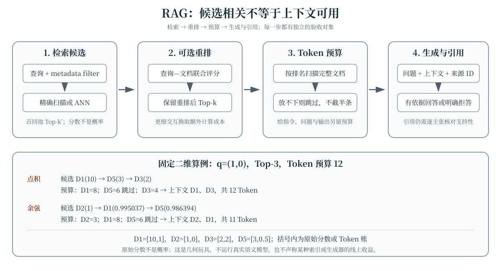

用户问“这条新规定何时生效”，模型参数里没有刚发布的文档，并不意味着只能猜测。检索增强生成（Retrieval-Augmented Generation，RAG）把外部文档作为非参数记忆：先找到候选，再把可用证据放入上下文，最后要求生成模型依据证据回答并给出来源。Retrieval-Augmented Generation 原始论文 [@lewis2020rag] 给出了这种参数记忆与非参数记忆结合的代表性框架。真正的难点却不是接上向量数据库，而是分别验收**找得到、排得前、放得下、用得上、引证得对**。

## 学习目标

学完本章，你应当能够：

- 说明文档切分（chunking）、向量检索、metadata filter、Top-k 与重排分别改变什么；
- 用真实数值区分点积和余弦排名，并解释检索分数为什么不是概率；
- 从召回率、索引成本和查询时延分析近似最近邻（Approximate Nearest Neighbor，ANN）的权衡；
- 按排名和 Token 预算组装完整文档，保留来源标识并处理预算不足；
- 区分答案正确性、groundedness（证据支持性）与引用质量，设计分层 RAG 评测；
- 解释“扩大上下文不等于有效利用上下文”，并把位置、干扰项和推理成本纳入实验。

本章沿用 Embedding 几何章的内积与余弦定义，以及推理系统章的 prefill、KV cache 和上下文成本口径，不重复其基本推导。文中的二维坐标与 Token 数全部是固定教学数据，不来自真实语义模型。

## RAG 是一条多阶段证据流水线 {#sec-rag-pipeline}

一个可核查的 RAG 系统至少要保留以下中间对象：

1. **文档块**：稳定 `id`、正文 `text`、向量 `vector`、Token 数 `tokens` 与元数据；
2. **候选集**：检索器给出的有序结果及原始分数；
3. **重排结果**：可选的第二阶段排序，不能与第一阶段分数混为一谈；
4. **最终上下文**：在预算内实际装入的完整文档及来源 ID；
5. **答案与引用**：哪些主张由哪些来源支持，或为何证据不足而拒答。

这些对象使错误可以定位。答案错误可能来自文档缺失、检索漏召回、重排误排、预算截断、模型没有使用证据，或引用指向了不支持该主张的段落。只检查最后一个答案，无法知道该修哪一层。

## Chunking：检索单元与上下文单元 {#sec-chunking}

**Chunking** 把长文档切成可嵌入、可检索、可引用的块。块太小，定义可能与条件、例外或表头分离；块太大，无关句子会稀释嵌入并占用更多上下文 Token。常见边界包括标题层级、段落、列表、函数或固定 Token 窗口；重叠窗口可以缓解跨边界问题，却会改变索引大小和重复证据比例，不是免费收益。

切分时至少要同时记录：

- **来源与定位**：文档 ID、块 ID、标题路径、页码或字符区间；
- **检索表示**：实际送入嵌入模型的文本与向量，可能包含上下文化标题；
- **生成内容**：最终交给语言模型的原文，不能拿摘要去冒充满原文；
- **Token 账**：用生成端同一 tokenizer 统计，而不是用字符数猜测；
- **元数据**：时间、作者、租户、权限、文档版本与语言等可过滤字段。

检索输入和生成输入可以不同。例如检索时使用“标题路径 + 正文”增强语义，组装时仍保留可读的标题路径和原始正文。评测必须记录这两种表示及切分版本，否则更换 chunking 后的结果无法复现。语料级近重复去重属于数据治理问题，本章不把它当作已经由 RAG 解决；上下文里的重复证据仍需单独测量和处理。

## 向量检索：分数只用于排序 {#sec-vector-retrieval}

双编码器分别把查询 $q$ 和文档块 $d_i$ 映射到同一向量空间，再用内积或余弦得到检索分数。Dense Passage Retrieval [@karpukhin2020dpr] 是开放域问答中 dense dual-encoder 检索的原始代表性工作。本章直接沿用前章定义：

$$
\begin{aligned}
s_{\mathrm{dot}}(q,d_i)&=q^{\mathsf T}d_i,\\
s_{\mathrm{cos}}(q,d_i)&=
\frac{q^{\mathsf T}d_i}{\|q\|_2\|d_i\|_2}.
\end{aligned}
$$

取 $q=(1,0)$，长偏离文档 $D_1=(10,1)$，短对齐文档 $D_2=(1,0)$，则

$$
\begin{aligned}
s_{\mathrm{dot}}(q,D_1)&=10,\\
s_{\mathrm{dot}}(q,D_2)&=1,\\
s_{\mathrm{cos}}(q,D_1)&=\frac{10}{\sqrt{101}}
\approx0.995037,\\
s_{\mathrm{cos}}(q,D_2)&=1.
\end{aligned}
$$

因此点积把 $D_1$ 排在前面，余弦把 $D_2$ 排在前面。**原始分数不是概率**：点积可以大于 1 或为负，余弦也可以为负；不能把 Top-k 分数直接 Softmax 后称作“文档为真的概率”，更不能把它当作答案置信度。是否需要向量归一化、选择哪种分数，应与嵌入模型训练和索引约定一致。

Top-k 是在当前排序上保留前 $k$ 条，与 Token 预算是两个串联而非互相替代的决策：先选候选，再决定其中哪些完整块能进入上下文。$k$ 增大可能提高相关文档被覆盖的机会，也会增加重排和上下文成本。

## Metadata filter：先约束合法候选 {#sec-metadata-filter}

**Metadata filter** 按时间、语言、来源、租户或访问权限限制候选集合。它和语义分数回答不同问题：过滤决定“哪些文档有资格参与”，分数决定“合格文档如何排序”。权限过滤必须在证据进入上下文前生效，不能寄希望于生成模型忽略无权内容。

过滤可以发生在索引查询前、查询中或查询后。后置过滤最简单，却可能在过滤后不足 $k$ 条，即使语料中仍有其他合格结果；前置或索引内过滤缩小搜索集合，又可能改变 ANN 图遍历或倒排候选的召回与成本。验收时应分别报告过滤前后的候选数、合格集合上的召回率和尾部时延，不能只看未过滤全集上的一个平均值。

## ANN：用可测召回换取查询成本 {#sec-ann}

对 $N$ 个 $d$ 维向量，朴素精确扫描需要逐一计算分数，主要比较成本随 $N$ 增长。ANN 通过图、聚类、量化或其他索引结构减少查询时访问的候选数，但引入索引构建、内存、更新和近似误差。HNSW [@malkov2020hnsw] 使用分层可导航小世界图；FAISS 原始论文 [@johnson2021faiss] 则给出了精确、近似和压缩域相似度搜索的 GPU 实现方法。

ANN 的“召回”应先约定比较对象。若以同一度量下精确搜索的 Top-$k$ 集合 $E_k$ 为参照，ANN 返回 $A_k$，一种常见的邻居一致率为

$$
\operatorname{Recall@k}_{\mathrm{ANN}}
=\frac{|A_k\cap E_k|}{k}.
$$

若有人工标注的相关文档集合 $R$，则面向任务的召回是 $|A_k\cap R|/|R|$；二者不能混写。图搜索的探测范围、聚类索引的 `nprobe`、量化位宽和候选列表大小通常会影响召回、时延与内存，但不存在脱离数据和硬件仍固定的最佳参数。应画出**召回—时延—内存**曲线，并在真实过滤条件、向量维度和更新频率下复测。

## 重排：把候选质量与候选数量分开 {#sec-reranking}

第一阶段检索强调从大规模集合快速得到 $k'$ 个候选；第二阶段**重排**（reranking）可以用更丰富的查询—文档交互重新排序，再取前 $k$ 个进入组装。交叉编码器同时读取查询与文档，表达能力强但每对都要计算；晚交互方法保留更细粒度表示。ColBERT 原始论文 [@khattab2020colbert] 提出了 contextualized late interaction，以可预计算的文档表示和较晚的细粒度交互平衡效果与效率。

通常 $k'\geq k$。增大 $k'$ 给重排器更多挽回漏排文档的机会，也增加第二阶段计算；若第一阶段已经漏掉关键证据，重排无法凭空找回。实验应分别记录第一阶段 Recall@$k'$、重排后的 Recall@$k$ 或 nDCG、每查询重排对数和尾时延。重排分数同样是排序量，不与向量分数或概率直接相加。

## 上下文组装：Top-k 之后还有 Token 预算 {#sec-context-assembly}

设总窗口还要容纳系统指令、用户问题、输出和余量，则文档可用预算可写成

$$
\begin{aligned}
B_{\mathrm{doc}}={}&B_{\mathrm{window}}
-B_{\mathrm{instruction}}\\
&-B_{\mathrm{question}}-B_{\mathrm{output}}
-B_{\mathrm{margin}}.
\end{aligned}
$$

本章采用一个明确、可复算的贪心规则：按排名扫描 Top-k 候选；若当前完整文档能放入剩余预算就保留，否则跳过它并继续看后续文档，不截取半条上下文。令已选集合为 $C$，则

$$
\begin{aligned}
&\sum_{d_i\in C}\operatorname{tokens}(d_i)
\leq B_{\mathrm{doc}},\\
&C\ \text{保持原排名相对顺序}.
\end{aligned}
$$

```python
def select_context(ranked_documents, token_budget):
    selected = []
    used = 0
    for document in ranked_documents:
        tokens = document["tokens"]
        if used + tokens <= token_budget:
            selected.append(document)
            used += tokens
    return selected

# 排名顺序的 Token 数为 [8, 6, 4]，预算为 12：
# 保留 8，跳过 6，再保留 4；最终恰好使用 12。
```

这不是唯一的装箱策略，也不保证所选 Token 的信息价值最大；它只是一个稳定、低成本的基线。真实系统还可压缩、结构化摘录或按块重新切分，但必须另行评价信息损失，不能悄悄改变“完整文档”的口径。组装时应给每块附上稳定来源 ID，并保留最终实际送入模型的文本快照。

## 教学交互：排名反转与整文档预算 {#sec-retrieval-demo}

@fig-retrieval-rag 的网页交互固定五条二维文档。默认使用点积、Top-3 和 12 Token：候选为 D1、D5、D3，D5 的 6 Token 放不下 D1 后的剩余预算，于是最终保留 D1、D3，共 12 Token。切换余弦后，候选前三变为 D2、D1、D5，最终保留 D2、D1，共 11 Token。控件只改变度量、Top-k 和预算，不模拟 ANN、重排器或生成器。

::: {.content-visible when-format="html"}
```{=html}
<div class="interactive-mount">
<llm-retrieval-rag data-figure-id="fig-retrieval-rag" metric="dot" top-k="3" token-budget="12"></llm-retrieval-rag>
</div>
```

<noscript markdown="1">

{data-external="1" #fig-retrieval-rag fig-alt="检索到重排、Token 预算、生成与引用的静态流程图。查询先经过 metadata filter 与精确或 ANN 向量检索，再经可选重排得到 Top-k；上下文组装按顺序装入完整文档，超剩余预算者跳过，生成器依据带来源 ID 的上下文回答或拒答。固定二维算例中，点积 Top-3 为 D1、D5、D3，预算 12 时最终为 D1、D3，共 12 Token；余弦 Top-3 为 D2、D1、D5，最终为 D2、D1，共 11 Token。原始分数不是概率，且不运行真实语义模型。"}

| 文档（向量） | Token | 点积：分数 / 排名 | 余弦：分数 / 排名 |
|:--|--:|--:|--:|
| D1（10, 1） | 8 | 10 / 1 | 0.995037 / 2 |
| D2（1, 0） | 3 | 1 / 4 | 1.000000 / 1 |
| D3（2, 2） | 4 | 2 / 3 | 0.707107 / 4 |
| D4（0, 1） | 2 | 0 / 5 | 0.000000 / 5 |
| D5（3, 0.5） | 6 | 3 / 2 | 0.986394 / 3 |
| 点积 Top-3、预算 12：D1、D3，共 12 Token | — | — | — |
| 余弦 Top-3、预算 12：D2、D1，共 11 Token | — | — | — |

: 静态排名与预算结果 {#tbl-retrieval-rag-static}

静态结果与交互默认值一致；原始分数不是概率，预算跳过的文档不生成半条上下文。

</noscript>
:::

::: {.content-visible unless-format="html"}
{data-external="1" #fig-retrieval-rag fig-alt="检索到重排、Token 预算、生成与引用的静态流程图。查询先经过 metadata filter 与精确或 ANN 向量检索，再经可选重排得到 Top-k；上下文组装按顺序装入完整文档，超剩余预算者跳过，生成器依据带来源 ID 的上下文回答或拒答。固定二维算例中，点积 Top-3 为 D1、D5、D3，预算 12 时最终为 D1、D3，共 12 Token；余弦 Top-3 为 D2、D1、D5，最终为 D2、D1，共 11 Token。原始分数不是概率，且不运行真实语义模型。"}

| 文档（向量） | Token | 点积：分数 / 排名 | 余弦：分数 / 排名 |
|:--|--:|--:|--:|
| D1（10, 1） | 8 | 10 / 1 | 0.995037 / 2 |
| D2（1, 0） | 3 | 1 / 4 | 1.000000 / 1 |
| D3（2, 2） | 4 | 2 / 3 | 0.707107 / 4 |
| D4（0, 1） | 2 | 0 / 5 | 0.000000 / 5 |
| D5（3, 0.5） | 6 | 3 / 2 | 0.986394 / 3 |
| 点积 Top-3、预算 12：D1、D3，共 12 Token | — | — | — |
| 余弦 Top-3、预算 12：D2、D1，共 11 Token | — | — | — |

: 静态排名与预算结果 {#tbl-retrieval-rag-static}

静态结果与交互默认值一致；原始分数不是概率，预算跳过的文档不生成半条上下文。
:::

## 引用与 groundedness：有出处不等于有支持 {#sec-groundedness}

**Groundedness** 关注答案主张是否能由给定证据推出。答案与参数记忆中的一般事实一致，不代表它被当前上下文支持；反过来，一个答案可以忠实复述错误来源，在“相对来源的 groundedness”上成立，却在事实正确性上失败。评测必须说明参照对象是检索证据、可信外部事实，还是两者。

引用至少有三个独立问题：

- **定位是否正确**：来源 ID、页码或区间是否指向实际使用的块；
- **引用是否支持主张**：被引段落是否蕴含对应主张，而非只与主题相似；
- **覆盖是否充分**：需要证据的关键主张是否都有引用，是否遗漏相反条件或例外。

因此“答案末尾附几个链接”不是充分验收。可按主张检查 citation precision（被引来源中真正支持的比例）与 citation recall（需引用主张中获得支持引用的比例），并保留人工复核。证据不足时，系统应能回答“不知道”或请求补充，而不是利用流畅表达掩盖空缺。

## RAG 评测：分层指标加端到端验收 {#sec-rag-evaluation}

RAG 评测不能把单一答案分数当作整条流水线的诊断。至少应同时保留三层：

| 层级 | 代表问题 | 可选指标或记录 |
|:--|:--|:--|
| 检索与重排 | 相关块是否进入候选并排到前面？ | Recall@k、MRR、nDCG、ANN 对照精确召回、时延与内存 |
| 上下文与生成 | 证据是否进入上下文并被正确使用？ | 最终块 ID、Token 数、groundedness、答案相关性、正确性、拒答质量 |
| 引用与系统 | 主张是否有可核查支持，线上约束是否满足？ | 引用精确率/召回率、人工抽查、p95/p99 时延、成本与失败类型 |

MRR 关注首个相关结果的倒数排名，nDCG 允许分级相关性并惩罚相关结果靠后；它们都要求明确标注口径。端到端问答还可使用 EM、F1 或人工评分，但答案匹配不必然等于证据支持。ARES 原始工作 [@saadfalcon2024ares] 从 context relevance、answer faithfulness 与 answer relevance 等维度自动化 RAG 评价，说明语言模型评审可以辅助分层验收；自动评审仍需少量人工标注校准，不能免除测试集和误判分析。

测试集应覆盖无答案问题、多跳证据、时间或版本冲突、权限过滤、长文档和不同查询类型。对比 chunking、ANN、重排或预算策略时，要固定文档版本、嵌入模型、生成配置与标注集合，并同时报告质量、尾部时延和成本。

## 扩大上下文不等于有效利用上下文 {#sec-long-context}

长窗口允许放入更多块，却不保证模型会同等关注所有位置。Lost in the Middle 原始研究 [@liu2024lost] 在多文档问答和键值检索任务中观察到：相关信息的位置会显著影响表现，一些设置下信息位于开头或结尾时优于位于中间。这是特定模型与任务上的实证结果，不应被夸大成所有模型的固定曲线；它足以反驳“窗口够大便无须检索和组装”的推断。

更长的输入还增加 prefill 工作、KV cache 占用和首 Token 时延，呼应推理系统章的成本账。有效上下文管理应比较：少量高相关块、较多但带干扰的块、不同证据位置，以及无检索的长文档输入。报告时同时固定输出预算和解码参数，避免把更长生成误认为更好利用上下文。

## 常见误解

- **“点积和余弦总会给出同一排名。”** 点积受模长影响；本章 $D_1=(10,1)$ 与 $D_2=(1,0)$ 就产生第一名反转。
- **“检索分数经过 Softmax 就是事实概率。”** 它只反映所选集合和变换下的相对权重，不是文档真实性或答案正确性的校准概率。
- **“Top-k 大就等于上下文一定更多。”** Token 预算可能跳过过大的候选；最终上下文还受文档长度与组装规则影响。
- **“metadata filter 只是后处理显示条件。”** 它改变合格候选集合，权限过滤还是安全边界，并可能改变 ANN 召回与成本。
- **“ANN 只要更快就值得。”** 需要同时衡量相对精确搜索的召回、任务指标、索引内存、更新和尾时延。
- **“重排能修复检索漏召回。”** 重排只能排列已有候选；第一阶段未返回的证据需要靠检索、过滤或索引改动找回。
- **“预算不够就截半段即可。”** 本章基线只保留完整文档；截断、摘要或压缩是另一种需要单独评价信息损失的策略。
- **“附了引用就证明 grounded。”** 引用可能指错位置或只与主题相近，必须逐主张核对支持性和覆盖。
- **“上下文越长，检索越不重要。”** 长上下文仍可能有位置敏感、干扰和推理成本，有效利用需要独立评测。

## 总结

RAG 不是“向量数据库加生成器”的单步技巧，而是可分层验收的证据流水线。Chunking 决定检索与引用单元；向量分数和 metadata filter 分别负责排序与合格约束；ANN 用可测召回换取索引和查询成本；重排只能改善已有候选的顺序。Top-k 之后仍需按 Token 预算组装，且本章基线只保留完整文档。最终答案要同时检查正确性、groundedness 和引用支持，长窗口也不能替代对位置、干扰和成本的分析。

## 练习 {#sec-exercises}

1. **复算排名反转。** 对 $q=(1,0)$、$D_1=(10,1)$、$D_2=(1,0)$，手算两种度量下的全部分数与排名。若把点积分数 $10$ 和 $1$ 经 Softmax 变换，得到的两个权重各是多少？为什么它们仍不能被解释为“文档为真的概率”？
2. **区分 ANN 召回。** 精确 Top-4 为 $\{D_1,D_2,D_3,D_4\}$，ANN Top-4 为 $\{D_1,D_3,D_5,D_6\}$。计算正文定义的 $\operatorname{Recall@4}_{\mathrm{ANN}}$。若人工相关集合是 $R=\{D_2,D_5\}$，面向任务的 Recall@4 又是多少？列出提高 ANN 探测范围可能改变的三项成本或质量指标。
3. **设计过滤与重排实验。** 第一阶段取 $k'=20$，目标 $k=5$。比较“只保留 Top-5 后过滤”和“保留 20 条候选、过滤后补位”两种实现：若 Top-5 过滤后只剩 3 条，后一种在什么条件下能从原候选池补到 5 条？说明为什么只有候选池耗尽或没有更多合格文档时才需重新查询，并给出前置过滤、第一阶段召回、重排质量和尾时延各自应记录的指标。
4. **执行完整文档预算。** 排名顺序的 Token 数为 $[8,6,4,3]$，按正文贪心规则分别计算预算 $12$、$5$、$0$ 时的最终文档与已用 Token。若总窗口为 1000 Token，指令、问题、输出和余量分别需要 80、20、200、50，先求 $B_{\mathrm{doc}}$ 再判断能否装入全部四条。
5. **核对引用与 groundedness。** 证据写着“若项目在 6 月前完成登记，则新规自 7 月生效”，答案却写“所有项目都从 7 月适用新规”，并附上这段引用。分别判断引用定位、主张支持、答案完整性与事实正确性应如何检查，并给出一个忠实于证据的改写。
6. **评价长上下文策略。** 设计一个固定证据与答案的实验：把关键块放在开头、中间和结尾，并分别加入 2、8、32 个干扰块。说明要固定哪些生成参数，记录哪些质量与系统指标，以及为什么不能只凭窗口长度或一次正确答案断言模型有效利用了上下文。

::: {.content-visible when-format="html"}
```{=html}
<script type="module">
import { defineRetrievalRagElement } from './assets/js/components/retrieval-rag.js';
defineRetrievalRagElement();
</script>
```
:::

原始论文与预印本链接核对日期：2026-10-16。文中只在其任务和设置范围内引用研究结论，不将厂商或作者自报结果写成跨场景保证。
