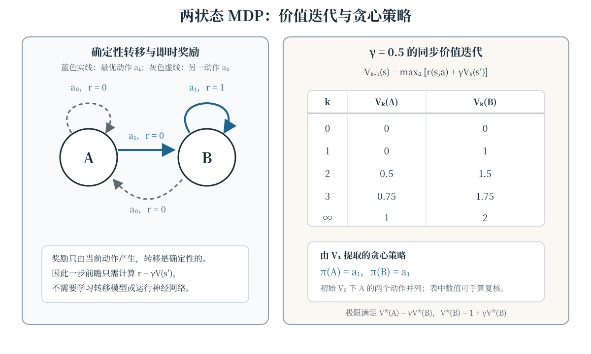
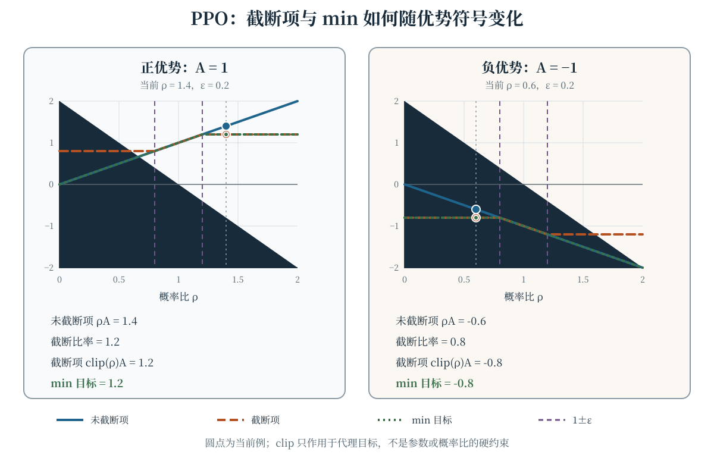

强化学习研究智能体如何在序列决策中通过行动改变后续状态，并依据奖励改进策略。与一次性的监督学习样本不同，当前动作既影响即时奖励，也可能影响未来能看到的状态与数据。本章在有限马尔可夫决策过程（Markov decision process，MDP）中统一回报、价值函数和 Bellman 方程，再由这两条主线引出 Monte Carlo、时序差分（temporal difference，TD）、策略梯度、Actor-Critic 与近端策略优化（Proximal Policy Optimization，PPO）。所有数值例子都只有少量状态和动作，可以手算复核。

## 学习目标与记号约定

学完本章，你应当能够：

- 用状态、动作、转移、奖励和折扣因子描述一个有限 MDP，并区分环境与策略产生的随机性；
- 计算折扣回报、状态价值、动作价值和优势，写出策略与最优价值函数的 Bellman 方程；
- 从同一条轨迹分别构造 Monte Carlo 与 TD(0) 目标，解释“是否自举”的差别；
- 推导 softmax 策略的对数梯度，并说明基线为何不改变策略梯度的期望；
- 解释 Actor-Critic 中两个模块各自的更新，以及 PPO 截断目标对正、负优势的不同作用；
- 区分探索与信用分配，避免把“更多随机性”当作长延迟奖励问题的完整解法。

本章用 $S_t,A_t,R_{t+1}$ 表示时刻 $t$ 的状态、动作以及动作之后收到的奖励，用 $\pi(a\mid s)$ 表示策略。折扣因子记为 $\gamma$；具体例子的价值从 $V_0(A)=V_0(B)=0$ 开始。上标 $\pi$ 和 $*$ 分别表示“遵循策略 $\pi$”与“最优”，不要把它们误读成指数。

## 马尔可夫决策过程 {#sec-mdp}

有限 MDP 由有限状态集 $\mathcal S$、动作集 $\mathcal A$、联合动力学 $p(s',r\mid s,a)$ 和折扣因子 $\gamma$ 构成。给定 $S_t=s,A_t=a$ 后，下一状态与奖励满足

$$
\begin{aligned}
&\Pr(S_{t+1}=s',R_{t+1}=r\mid S_t,A_t)\\
&\qquad=p(s',r\mid s,a).
\end{aligned}
$$

马尔可夫性的要点是：在当前 $(s,a)$ 已知的条件下，更早的历史不再提供关于 $(S_{t+1},R_{t+1})$ 的额外信息。它是对“状态表示是否足够”的要求，而不是声称真实世界天然没有历史依赖。若状态只保留部分观测，就需要重新检查这一假设。

由联合动力学可以得到状态转移概率和期望即时奖励：

$$
\begin{aligned}
\mathcal P(s'\mid s,a)&=\sum_r p(s',r\mid s,a),\\
r(s,a)&=\sum_{s',r}r\,p(s',r\mid s,a).
\end{aligned}
$$

策略 $\pi(a\mid s)$ 可以是确定性的，也可以是随机的。环境动力学与策略共同诱导轨迹

$$
S_0,A_0,R_1,S_1,A_1,R_2,\ldots.
$$

回合制任务在终止状态结束；持续任务没有自然终点。价值估计、采样目标和实现中的终止掩码都必须使用同一套时间索引，尤其不能把 $R_{t+1}$ 错配到 $S_{t+1}$ 的动作之前。

## 回报、价值函数与优势 {#sec-return-value}

从时刻 $t$ 开始的折扣回报（return）是未来奖励的加权和：

$$
G_t=\sum_{k=0}^{\infty}\gamma^kR_{t+k+1}.
$$

对长度为有限回合的任务，求和在终止处结束；终止后不再产生奖励。若奖励有界且 $0\leq\gamma<1$，无限折扣级数收敛。有限回合也常在能确保终止时取 $\gamma=1$。折扣既表达对未来奖励的偏好，也使许多持续问题的价值有界；不能把它简单解释成所有任务都必须具备的“利息率”。

遵循策略 $\pi$ 时，状态价值与动作价值分别是

$$
\begin{aligned}
v_\pi(s)&=\mathbb E_\pi[G_t\mid S_t=s],\\
q_\pi(s,a)&=\mathbb E_\pi[G_t\mid S_t=s,A_t=a].
\end{aligned}
$$

期望还对后续动作、转移和奖励取平均。优势函数衡量在状态 $s$ 先选定动作 $a$ 相比按策略平均选动作好多少：

$$
A_\pi(s,a)=q_\pi(s,a)-v_\pi(s).
$$

由定义可得 $v_\pi(s)=\sum_a\pi(a\mid s)q_\pi(s,a)$，因此同一状态下按 $\pi$ 平均的优势为零。优势适合用作策略更新的相对信号，但函数逼近得到的 $\hat A$ 只是估计，不能默认它等于真实的 $A_\pi$。

## Bellman 方程与价值迭代 {#sec-bellman}

回报具有递归形式 $G_t=R_{t+1}+\gamma G_{t+1}$。把它代入价值定义，可得策略 $\pi$ 的 Bellman 期望方程：

$$
\begin{aligned}
v_\pi(s)
&=\sum_a\pi(a\mid s)\sum_{s',r}p(s',r\mid s,a)\\
&\quad\times\left[r+\gamma v_\pi(s')\right],\\
q_\pi(s,a)
&=\sum_{s',r}p(s',r\mid s,a)\\
&\quad\times\left[r+\gamma v_\pi(s')\right].
\end{aligned}
$$

所有可能策略价值的最大值记为 $v_*(s)$ 与 $q_*(s,a)$。它们满足 Bellman 最优方程：

$$
\begin{aligned}
v_*(s)&=\max_a\sum_{s',r}p(s',r\mid s,a)\\
&\quad\times\left[r+\gamma v_*(s')\right],\\
q_*(s,a)&=\sum_{s',r}p(s',r\mid s,a)\\
&\quad\times\left[r+\gamma\max_{a'}q_*(s',a')\right].
\end{aligned}
$$

Bellman 期望方程对策略给出的动作分布求平均，最优方程则对当前状态的动作取最大；把二者混写会同时改变价值定义和后续算法。已知模型时，同步价值迭代从任意初始 $V_0$ 出发，反复计算

$$
\begin{aligned}
V_{k+1}(s)
&=\max_a\sum_{s',r}p(s',r\mid s,a)\\
&\quad\times\left[r+\gamma V_k(s')\right].
\end{aligned}
$$

“同步”表示整张 $V_{k+1}$ 都只读取 $V_k$，而不是让同一轮后面的状态提前使用刚更新的值。

### 一个可手算的两状态 MDP

考虑确定性状态 $A,B$ 和动作 $a_0,a_1$：在 $A$ 中，$a_0$ 留在 $A$、$a_1$ 转到 $B$；在 $B$ 中，$a_0$ 转到 $A$、$a_1$ 留在 $B$。前三条动作的奖励都是 0，只有 $B$ 中的 $a_1$ 得奖励 1。取 $\gamma=0.5$ 和零初始化，迭代结果如下；每行都由上一行完整计算，而不是沿表格顺序覆盖。

| $k$ | $V_k(A)$ | $V_k(B)$ |
|---:|---:|---:|
| 0 | 0 | 0 |
| 1 | 0 | 1 |
| 2 | 0.5 | 1.5 |
| 3 | 0.75 | 1.75 |
| $\infty$ | 1 | 2 |

: 两状态 MDP 的同步价值迭代数值（$\gamma=0.5$）。 {#tbl-rl-values}

例如 $V_2(A)=0.5V_1(B)=0.5$，而 $V_2(B)=1+0.5V_1(B)=1.5$。极限满足 $V_*(A)=0.5V_*(B)$ 和 $V_*(B)=1+0.5V_*(B)$。由 $V_1$ 做一步前瞻，$A$ 中选择 $a_1$ 得 $0.5$、选择 $a_0$ 得 $0$，$B$ 中选择 $a_1$ 的得分也更高，因此贪心策略为 $\pi(A)=a_1,\pi(B)=a_1$。在 $V_0$ 处，$A$ 的两个动作并列；实现不应把这种并列静默解释成唯一最优动作。@fig-rl-foundations 同时给出转移结构、数值表和贪心策略。

:::: {.content-visible when-format="html"}
```{=html}
<div class="interactive-mount">
<llm-rl-foundations data-figure-id="fig-rl-foundations" gamma="0.5"></llm-rl-foundations>
</div>
```

<noscript markdown="1">

{data-external="1" #fig-rl-foundations fig-alt="两状态 MDP 价值迭代图：状态 A 的 a₀ 留在 A 且奖励 0，a₁ 转到 B 且奖励 0；状态 B 的 a₀ 转到 A 且奖励 0，a₁ 留在 B 且奖励 1。折扣因子 0.5 时，同步价值从 (0,0) 依次变为 (0,1)、(0.5,1.5)、(0.75,1.75)，极限为 V*(A)=1、V*(B)=2；由第一步价值提取的贪心策略在两个状态都选择 a₁。"}

</noscript>
::::

:::: {.content-visible unless-format="html"}
{data-external="1" #fig-rl-foundations fig-alt="两状态 MDP 价值迭代图：状态 A 的 a₀ 留在 A 且奖励 0，a₁ 转到 B 且奖励 0；状态 B 的 a₀ 转到 A 且奖励 0，a₁ 留在 B 且奖励 1。折扣因子 0.5 时，同步价值从 (0,0) 依次变为 (0,1)、(0.5,1.5)、(0.75,1.75)，极限为 V*(A)=1、V*(B)=2；由第一步价值提取的贪心策略在两个状态都选择 a₁。"}
::::

## Monte Carlo：用完整回报做目标 {#sec-monte-carlo}

Monte Carlo（MC）预测在回合结束后，把某次访问状态 $s$ 后实际观察到的 $G_t$ 当作 $v_\pi(s)$ 的样本目标。首次访问 MC 只在一个回合中第一次遇到 $s$ 时记录回报，每次访问 MC 则记录每次遇到 $s$ 的回报。对收集到的目标取均值，可写成增量形式

$$
\begin{aligned}
N(s)&\leftarrow N(s)+1,\\
V(s)&\leftarrow V(s)+\frac{1}{N(s)}\left[G_t-V(s)\right].
\end{aligned}
$$

在固定策略和相应回合采样条件下，$G_t$ 是 $v_\pi(s)$ 的无偏样本；MC 不需要已知转移模型，也不读取其他状态的当前估计，因此称为“不自举”。这不等于 MC 没有误差：有限回合数带来采样方差，持续任务也不能直接等待一个无限回合结束。使用常数步长 $\alpha$ 代替 $1/N(s)$ 时，更新 $V(s)\leftarrow V(s)+\alpha[G_t-V(s)]$ 不再是普通样本均值，但能持续跟踪变化的目标。

沿用两状态例子，设一条从 $A$ 开始的有限轨迹奖励依次为 $0,1,1$，随后终止，且 $\gamma=0.5$，则

$$
\begin{aligned}
G_0&=0+0.5\times1+0.25\times1=0.75,\\
G_1&=1+0.5\times1=1.5.
\end{aligned}
$$

若更新前 $V(A)=0$ 并取 $\alpha=0.1$，以 $G_0$ 为目标的 MC 更新得到 $V^+(A)=0+0.1(0.75-0)=0.075$。

## 时序差分：用当前估计自举 {#sec-td}

TD(0) 不必等待回合结束。观察到 $(S_t,A_t,R_{t+1},S_{t+1})$ 后，定义 TD 误差与状态价值更新

$$
\begin{aligned}
\delta_t&=R_{t+1}+\gamma V(S_{t+1})-V(S_t),\\
V(S_t)&\leftarrow V(S_t)+\alpha\delta_t.
\end{aligned}
$$

终止状态的价值固定为 0，终止转移不能再给 $V(S_{t+1})$ 乘一个虚构的非零值。TD 目标 $R_{t+1}+\gamma V(S_{t+1})$ 使用当前价值估计，所以是自举目标；它也不显式需要转移模型。MC 用实际完整回报，TD(0) 用一步真实奖励加后继估计，两者的目标和误差性质不能混为一谈。

在上例中，若在 $A$ 执行 $a_1$ 后转到 $B$，奖励为 0，而当时 $V(A)=0,V(B)=1$，则

$$
\begin{aligned}
\delta&=0+0.5\times1-0=0.5,\\
V^+(A)&=0+0.1\times0.5=0.05.
\end{aligned}
$$

同一条轨迹的 MC 目标是 0.75，而这里的 TD 目标是 0.5；差异来自后继状态当前估计与实际后续回报并不相同。多步 TD 可以在两者之间折中，其 $n$ 步目标写成

$$
G_{t:t+n}=\sum_{k=0}^{n-1}\gamma^kR_{t+k+1}
+\gamma^nV(S_{t+n}),
$$

遇到终止时截断求和并省略终止后的自举项。$n=1$ 对应 TD(0)，回合内取到终点则对应 MC 目标。

## 策略梯度：直接优化随机策略 {#sec-policy-gradient}

价值方法可以间接得到贪心策略，策略梯度法则直接优化参数化策略 $\pi_\theta$。令 $\tau$ 为由初始分布、环境动力学和策略共同诱导的轨迹，目标为 $J(\theta)=\mathbb E_{\tau\sim\pi_\theta}[G_0]$。利用 $\nabla_\theta p_\theta(\tau)=p_\theta(\tau)\nabla_\theta\log p_\theta(\tau)$，并把环境转移中与 $\theta$ 无关的项消去，可得

$$
\begin{aligned}
\nabla_\theta J(\theta)
&=\mathbb E_{\tau\sim\pi_\theta}\left[R(\tau)\right.\\
&\qquad\left.\times\sum_t
\nabla_\theta\log\pi_\theta(A_t\mid S_t)\right].
\end{aligned}
$$

其中 $R(\tau)=G_0$ 是轨迹回报。更常用的按时刻形式使用动作之后的回报 $G_t$，并引入只依赖状态的基线 $b(S_t)$。注意 $G_t$ 的折扣指数是从 $t$ 重新起算的；回到 $G_0$ 的口径时，必须保留 $\gamma^t$：

$$
\begin{aligned}
\nabla_\theta J(\theta)
&=\mathbb E_\pi\left[\sum_t\gamma^t
\nabla_\theta\log\pi_\theta(A_t\mid S_t)\right.\\
&\qquad\left.\times\left(G_t-b(S_t)\right)\right].
\end{aligned}
$$

基线不改变期望的原因是

$$
\begin{aligned}
&\sum_a b(s)\nabla_\theta\pi_\theta(a\mid s)\\
&\quad=b(s)\nabla_\theta\sum_a\pi_\theta(a\mid s)=0.
\end{aligned}
$$

这只能说明期望不变；合适的基线可以降低梯度估计方差，任意基线并不保证效果更好。以优势 $A_\pi$ 代替 $G_t-b$ 是常见的理论写法，实际算法使用的是估计值。

对离散动作的 softmax 策略，令 logits 为 $z_j(\theta)$，则

$$
\begin{aligned}
&\pi_\theta(a_i\mid s)=\frac{e^{z_i}}{\sum_je^{z_j}},\\
&\frac{\partial\log\pi_\theta(a_i\mid s)}{\partial z_j}\\
&\quad=\mathbf 1[j=i]-\pi_\theta(a_j\mid s).
\end{aligned}
$$

例如 $z=(0,0)$ 时两个动作概率均为 0.5。若采样到 $a_1$ 且回报乘子为 2，则未含学习率的 logit 梯度为 $2(-0.5,0.5)=(-1,1)$。梯度上升会增加所选动作的相对 logit；若软件接口执行梯度下降，应对目标取负，而不是把上升方向写反。

## Actor-Critic：策略与价值联合学习 {#sec-actor-critic}

Actor-Critic 把两类对象分开：Actor 是参数化策略 $\pi_\theta(a\mid s)$，Critic 是价值估计 $V_w(s)$。一步 Actor-Critic 用 TD 误差

$$
\delta_t=R_{t+1}+\gamma V_w(S_{t+1})-V_w(S_t)
$$

近似动作相对基线的好坏。对于与上节相同的 episodic 折扣目标，令 $I_t=\gamma^t$，一种半梯度更新是

$$
\begin{aligned}
\theta&\leftarrow\theta+\alpha_\theta I_t\delta_t
\nabla_\theta\log\pi_\theta(A_t\mid S_t),\\
w&\leftarrow w+\alpha_w\delta_t\nabla_wV_w(S_t).
\end{aligned}
$$

$I_t$ 只作用于 Actor 的折扣目标权重，Critic 的回归更新不乘它；PPO 中的新旧策略概率比则是另一件事，不把 $I_t$ 塞进比率。Actor 沿“提高具有正 TD 误差动作的对数概率”的方向更新，Critic 则用同一 TD 误差改进价值预测。Critic 未训练完成时，$\delta_t$ 不是真实优势，Actor 的样本更新也不是完整期望策略梯度；自举降低了对完整回合回报的依赖，同时引入价值估计误差的影响。

用自动微分实现时，Actor 更新中的 $\delta_t$ 通常作为停止梯度的优势估计，不能让 Actor 损失通过 Critic 的计算图反向修改策略；Critic 的回归梯度则只用于 $w$。这条计算图边界对应上面两套参数更新，不是额外的数学假设。

## PPO：截断的重要性比率 {#sec-ppo}

PPO 用旧策略 $\pi_{\theta_{\mathrm{old}}}$ 收集一批数据，保存采样动作的旧概率和优势估计 $\hat A_t$。新策略与旧策略对同一动作的概率比为

$$
\rho_t(\theta)=
\frac{\pi_\theta(A_t\mid S_t)}
{\pi_{\theta_{\mathrm{old}}}(A_t\mid S_t)}.
$$

PPO 的截断代理目标（未含价值损失和可选熵项）是

$$
\begin{aligned}
c_t&=\operatorname{clip}(\rho_t,1-\epsilon_c,1+\epsilon_c),\\
L^{\mathrm{CLIP}}(\theta)
&=\mathbb E_t\left[\min\left(\rho_t\hat A_t,c_t\hat A_t\right)\right].
\end{aligned}
$$

这里 $\epsilon_c>0$ 是截断范围。取 $\min$ 时必须同时考虑 $\hat A_t$ 的符号。以 $\epsilon_c=0.2$ 为例：当 $\hat A_t=1,\rho_t=1.4$ 时，两项为 $1.4$ 和 $1.2$，目标取 $1.2$；当 $\hat A_t=-1,\rho_t=0.6$ 时，两项为 $-0.6$ 和 $-0.8$，目标取 $-0.8$。前者削弱“继续放大已经过大的正优势动作比率”的激励，后者削弱“继续缩小已经过小的负优势动作比率”的激励。@fig-ppo-clipping 可同时对照三条曲线和当前点的数值。

:::: {.content-visible when-format="html"}
```{=html}
<div class="interactive-mount">
<llm-ppo-clipping data-figure-id="fig-ppo-clipping" ratio="1.4" epsilon="0.2" advantage="1"></llm-ppo-clipping>
</div>
<script type="module">import { definePpoClippingElement } from './assets/js/components/ppo-clipping.js'; definePpoClippingElement();</script>
```

<noscript markdown="1">

{data-external="1" #fig-ppo-clipping fig-alt="PPO 截断目标曲线。固定 ε=0.2：正优势 A=1、ρ=1.4 时，未截断项 1.4、截断项 1.2、min 目标 1.2；负优势 A=-1、ρ=0.6 时，未截断项 -0.6、截断项 -0.8、min 目标 -0.8。横轴为概率比，紫色竖线为 1±ε，圆点标出当前例；clip 只定义代理目标，不是参数或概率比的硬约束。"}

</noscript>
::::

:::: {.content-visible unless-format="html"}
{data-external="1" #fig-ppo-clipping fig-alt="PPO 截断目标曲线。固定 ε=0.2：正优势 A=1、ρ=1.4 时，未截断项 1.4、截断项 1.2、min 目标 1.2；负优势 A=-1、ρ=0.6 时，未截断项 -0.6、截断项 -0.8、min 目标 -0.8。横轴为概率比，紫色竖线为 1±ε，圆点标出当前例；clip 只定义代理目标，不是参数或概率比的硬约束。"}
::::

截断只定义代理目标，不是把参数更新投影到硬信赖域，也不保证更新后的每个 $\rho_t$ 都落在 $[1-\epsilon_c,1+\epsilon_c]$。实际结果还受优势估计、学习率、批次数和优化轮数影响。典型 PPO 实现同时训练 Critic，并可能加入熵正则；这些附加项应与 $L^{\mathrm{CLIP}}$ 分开检查，而不能都归因于 clip。

## 探索与信用分配 {#sec-exploration-credit}

**探索**决定数据如何产生。离散动作的一种简单规则是 $\epsilon$-greedy：以 $1-\epsilon$ 的概率选当前贪心动作，以 $\epsilon$ 的概率在全部动作中均匀随机选择。等价地，若 $a_g$ 是贪心动作，

$$
\pi(a\mid s)=
\begin{cases}
1-\epsilon+\epsilon/|\mathcal A|, & a=a_g,\\
\epsilon/|\mathcal A|, & a\neq a_g.
\end{cases}
$$

softmax 策略本身也会探索；温度形式 $\pi(a_i\mid s)\propto e^{z_i/T}$ 中，$T>0$ 越小分布通常越集中。还可对策略熵

$$
\mathcal H(\pi(\cdot\mid s))=-\sum_a\pi(a\mid s)\log\pi(a\mid s)
$$

加入奖励或目标项，以延缓过早确定化。这些方法只改变动作分布，不保证找到稀疏奖励，也不替代对覆盖范围的评测。

**信用分配**决定一次更新应强化或削弱哪些先前动作。只有回合末奖励时，把同一个 $G_0$ 乘到整条轨迹每个动作的 log 梯度上，无法区分各动作的真实因果贡献；基线和优势提供相对比较，TD 与多步目标用后继价值传播信息，但函数估计误差也会进入信用信号。探索不足可能导致关键动作从未出现，信用分配再精确也无法学习不存在于数据中的行为；反过来，只有随机探索而没有合适的价值或优势估计，也不能解决长延迟归因。

若把语言模型已有上下文视为状态、下一个 Token 视为动作、生成序列视为轨迹，序列级奖励会带来长 horizon 的信用分配问题。这个对应不改变本章公式，但奖励定义、终止时机、上下文是否在状态中完整保留，都必须明确；不能仅凭“用了 PPO”就推断探索充分或信用分配已经解决。

## 常见误解

- **“马尔可夫性表示下一状态只由策略决定。”** 下一状态和奖励由环境动力学与当前动作共同决定；策略只给动作分布。
- **“回报就是当前奖励。”** $G_t$ 是从 $t$ 开始的折扣奖励和，当前奖励只是第一项。
- **“Bellman 期望方程和最优方程都有 max。”** 对固定策略求价值时对动作按 $\pi$ 平均，只有最优方程对动作取最大。
- **“MC 无偏所以任何情况下都比 TD 好。”** MC 的样本目标无偏不代表有限样本误差更小；TD 的自举带来不同的偏差—方差与数据依赖特性。
- **“基线会改变策略梯度的正确方向。”** 只依赖状态的基线在期望中贡献为零；它主要影响估计方差。
- **“Actor-Critic 的 Critic 就是环境真实价值。”** Critic 是待学习的近似器，其 TD 误差只是优势估计。
- **“PPO 的 clip 保证比率永不越界。”** clip 截断的是代理目标中的项，不是参数或概率比的硬约束。
- **“增大探索就能解决信用分配。”** 探索影响看到什么数据，信用分配影响如何使用数据，二者相关但不等价。

## 总结

MDP 用当前状态和动作刻画后续状态与奖励，折扣回报把整段未来汇总成学习信号。$v_\pi,q_\pi$ 和 $A_\pi$ 描述固定策略，Bellman 期望方程给出其自洽关系，Bellman 最优方程则引出价值迭代与贪心策略。MC 以完整回报为目标，TD 用后继价值自举；策略梯度直接优化动作分布，状态基线不改变梯度期望。Actor-Critic 用 Critic 的 TD 误差指导 Actor，PPO 又对基于新旧策略比率的优势目标进行截断。最后，探索决定数据覆盖，信用分配决定序列中各动作如何被更新，两者必须分别分析。

## 练习 {#sec-exercises}

1. **计算回报与优势。** 某有限回合从时刻 0 起的奖励为 $R_1=0,R_2=1,R_3=1$，随后终止。分别取 $\gamma=0.5$ 和 $\gamma=1$，计算 $G_0,G_1,G_2$。若某状态下 $q_\pi(s,a_0)=3,q_\pi(s,a_1)=1$，且 $\pi(a_0\mid s)=0.25,\pi(a_1\mid s)=0.75$，求 $v_\pi(s)$ 及两个动作的优势。
2. **执行 Bellman 更新。** 使用正文两状态 MDP 和 $\gamma=0.5$，从 $V_0=(0,0)$ 手算 $V_1,V_2,V_3$，说明为什么 $V_2(B)$ 不使用刚算出的 $V_2(A)$。再求解两个状态的极限价值，并检查它们确实满足 Bellman 最优方程。
3. **比较 MC 与 TD 目标。** 对正文中奖励 $0,1,1$ 后终止的轨迹，设 $V(A)=0,V(B)=1,\alpha=0.1$。分别写出状态 $A$ 的 MC(0.75) 与 TD(0) 更新，指出两个目标的组成差异。若第二步就终止，TD 更新中应如何处理终止状态价值？
4. **手算 softmax 策略梯度。** 两动作 logits 为 $z=(\ln3,0)$，动作概率因此为 $(3/4,1/4)$。采样动作 $a_0$ 且 $G_t=2$，求 $\nabla_z\log\pi(a_0\mid s)$ 和加权后的梯度。若基线 $b(s)=1$，梯度又为何值？解释基线为何没有改变期望更新方向。
5. **完成一步 Actor-Critic 更新。** 在 $t=0$ 时（因此 $I_0=1$），已知 $R_{t+1}=1$、$\gamma=0.9$，且 $V_w(S_t)=2$、$V_w(S_{t+1})=1$，先求 $\delta_t$。若该状态的标量 Critic 满足 $V_w(S_t)=w=2$ 且 $\nabla_wV_w(S_t)=1$，取 $\alpha_w=0.1$，求更新后的 $w$。若 Actor 的 $\nabla_\theta\log\pi_\theta=(0.5,-0.5)$ 且 $\alpha_\theta=0.2$，求 $\Delta\theta$。
6. **检查 PPO 截断并区分问题。** 令 $\epsilon_c=0.2,\hat A_t=-2$，分别计算 $\rho_t=0.6$ 和 $\rho_t=1.4$ 时 $\min$ 中的两项及最终目标值。再分别用一句话说明：为什么把动作采样得更随机不能代替信用分配，为什么 clip 也不能代替探索机制。

:::: {.content-visible when-format="html"}
<script type="module">import { defineRlFoundationsElement } from './assets/js/components/rl-foundations.js'; defineRlFoundationsElement();</script>
::::
