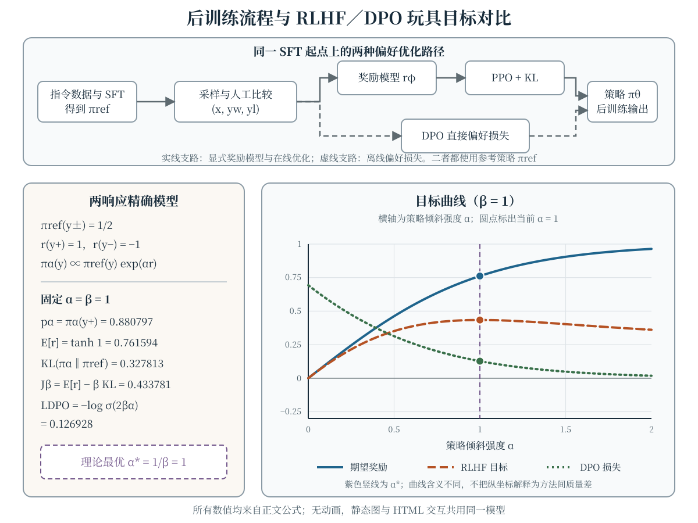

预训练语言模型用下一 Token 似然学习文本分布，但这个目标本身并不规定模型应如何遵循指令、处理不确定性或回应有害请求。后训练（post-training）在预训练模型之上继续调整行为：监督微调（supervised fine-tuning，SFT）模仿示范回答，偏好优化利用回答之间的相对选择，基于人类反馈的强化学习（reinforcement learning from human feedback，RLHF）则把学习到的奖励信号用于在线策略优化。它们缩小的是“基础模型的条件文本分布”与“目标场景所需行为”之间的差距，并不证明模型获得了人的价值判断，也不消除预训练阶段形成的能力与风险。

本章以可手算的定义为主，不引用特定系统的未公开细节。经典的三阶段 RLHF 流程可参阅 [Ouyang 等（2022）](https://arxiv.org/abs/2203.02155)，以偏好学习奖励并进行强化学习的早期工作可参阅 [Christiano 等（2017）](https://arxiv.org/abs/1706.03741)。文中的两响应例子是精确玩具模型，用于核对公式，不代表真实模型训练曲线。

## 学习目标与记号

学完本章，你应当能够：

- 写出带掩码的 SFT 负对数似然，并说明 prompt、padding 与目标 Token 的处理；
- 从成对偏好构造 Bradley–Terry 奖励模型，解释为何只有奖励差可识别；
- 写出带 KL 正则的 RLHF 目标，区分 PPO 比率裁剪与 KL 约束的作用；
- 从最优策略形式推导 DPO 损失，并判断“无需显式奖励模型”不等于“无需参考模型”；
- 区分结果奖励与过程奖励，分析各自的标注成本和信用分配假设；
- 识别 reward hacking、评估泄漏与偏好聚合风险，设计分层的对齐评估。

本章用 $x$ 表示 prompt，$y=(y_1,\ldots,y_T)$ 表示回答，$\pi_\theta(y\mid x)$ 表示可训练策略，$\pi_{\mathrm{ref}}$ 表示冻结的参考策略。偏好对写成 $(x,y_w,y_l)$，其中 $y_w\succ y_l$ 表示标注者在该 prompt 下更偏好 $y_w$。奖励模型为 $r_\phi(x,y)$，KL 系数 $\beta>0$；Token 级动作和状态只在讨论 PPO 时引入。

## SFT：先学习指令到回答的映射 {#sec-sft}

给定示范集 $\mathcal{D}_{\mathrm{SFT}}=\{(x^{(i)},y^{(i)})\}_{i=1}^n$，SFT 最大化目标回答在模型下的条件似然。令 $m_t^{(i)}\in\{0,1\}$ 表示第 $t$ 个位置是否计入损失，则平均 Token 负对数似然为

$$
\begin{aligned}
\ell_{i,t}(\theta)
&=m_t^{(i)}\log \pi_\theta(y_t^{(i)}\mid x^{(i)},y_{<t}^{(i)}),\\
N_{\mathrm{tok}}&=\sum_{i,t}m_t^{(i)},\\
\mathcal{L}_{\mathrm{SFT}}(\theta)
&=-\frac{1}{N_{\mathrm{tok}}}\sum_{i=1}^n\sum_{t=1}^{T_i}\ell_{i,t}(\theta).
\end{aligned}
$$

只训练回答时，prompt 和特殊分隔位置令 $m_t=0$，回答 Token 令 $m_t=1$；padding 位置也必须掩码。若分母改为固定 batch 大小或序列数，损失尺度和各样本权重都会改变，因此报告结果时要同时说明“掩码位置”和“求和或平均口径”。

**低成本核对。** 某回答只有两个有效 Token，模型分别赋予概率 $0.5$ 与 $0.25$，其余位置均被掩码。总负对数似然为 $-\log 0.5-\log 0.25=3\log2$，约为 $2.079442$；按有效 Token 平均为 $1.5\log2$，约为 $1.039721$。这个计算只检查掩码与归一化，不衡量回答质量。

SFT 是在线 RLHF 和许多直接偏好方法的常见起点：它提供基本指令格式，也常被冻结为 $\pi_{\mathrm{ref}}$。但行为克隆受示范覆盖范围限制；模型在训练中看到的是示范前缀，部署时却要以自己生成的前缀继续，二者分布可能不同。因而“SFT 损失下降”不能单独推出开放式生成可靠，更不能推出安全目标已经满足。

## 偏好数据：比较什么，以及没有比较什么 {#sec-preference-data}

一条基本偏好样本包含同一 $x$ 下的两个回答及其顺序 $y_w\succ y_l$。构造数据时至少要固定以下协议：

1. **采样来源。** 记录回答来自哪个模型版本、解码参数和候选数；混用来源时，标注者可能学到“哪个模型写的”而不是目标质量。
2. **标注规则。** 将正确性、相关性、简洁性和安全性等维度写清，并说明冲突时如何取舍；随机构造左右顺序可降低位置偏差。
3. **平局与弃权。** “两者相当”“无法判断”“两者都不可接受”不是同一状态。若训练只接受严格胜负，应单独保存这些标签并报告被排除的比例，而不是强行编成偏好对。
4. **数据划分。** 按 prompt 去重并划分训练、验证和测试，避免同一问题的近似回答同时出现在奖励模型训练集与评估集。

成对比较只提供相对信息。即使所有标注都准确，数据也没有直接给出“回答绝对得多少分”或“哪个维度导致偏好”。不同标注者或群体的目标还可能冲突；把选择压成一个胜负标签，是建模决策而不是价值中立的数据清洗。

## 奖励模型：从相对偏好到标量分数 {#sec-reward-model}

Bradley–Terry 模型用两个回答的奖励差描述偏好概率：

$$
\begin{aligned}
\Delta r&=r_\phi(x,y_w)-r_\phi(x,y_l),\\
P_\phi(y_w\succ y_l\mid x)&=\sigma(\Delta r),\\
\sigma(z)&=\frac{1}{1+e^{-z}}.
\end{aligned}
$$

对偏好集 $\mathcal{D}_{\mathrm{pref}}$，常用损失是

$$
\mathcal{L}_{\mathrm{RM}}(\phi)
=-\mathbb{E}_{(x,y_w,y_l)\sim\mathcal{D}_{\mathrm{pref}}}
\log \sigma(\Delta r).
$$

数值实现可写成 $\operatorname{softplus}(-\Delta r)$，其中 $\Delta r=r_\phi(x,y_w)-r_\phi(x,y_l)$，以避免直接计算 sigmoid 后再取对数造成的下溢。若 $\Delta r=\log3$，则预测偏好概率为 $3/4$，单样本损失为 $-\log(3/4)=\log(4/3)\approx0.287682$。

给同一 prompt 下所有回答的奖励都加上 $c(x)$，$\Delta r$ 不变，因此该偏好模型不能识别这个加性常数。奖励的绝对零点不应被过度解释。更重要的是，$r_\phi$ 学到的是对有限标注分布的统计近似：排序准确率高不等于分数校准，也不等于在策略生成的新分布上仍然准确。

## RLHF：奖励最大化与参考分布约束 {#sec-rlhf-objective}

一种常见的序列级 RLHF 目标定义为

$$
\begin{aligned}
\mathcal{J}_{\mathrm{RLHF}}(\theta)
&=\mathbb{E}_{x\sim\mathcal{D},\,y\sim\pi_\theta(\cdot\mid x)}
[r_\phi(x,y)]\\
&\quad-\beta\,\mathbb{E}_{x\sim\mathcal{D}}
[\operatorname{KL}(\pi_\theta\|\pi_{\mathrm{ref}})].
\end{aligned}
$$

并求解 $\max_\theta\mathcal{J}_{\mathrm{RLHF}}(\theta)$。借助 Token 对数比 $k_t$，序列 KL 可以展开为

$$
\begin{aligned}
k_t&=\log\frac{\pi_\theta(y_t\mid x,y_{<t})}
{\pi_{\mathrm{ref}}(y_t\mid x,y_{<t})},\\
\operatorname{KL}(\pi_\theta\|\pi_{\mathrm{ref}})
&=\mathbb{E}_{y\sim\pi_\theta}\left[\sum_{t=1}^{T}k_t\right].
\end{aligned}
$$

第一项推动策略提高代理奖励，第二项惩罚其相对参考策略的分布偏移。$\beta$ 越大，通常越强调接近参考；它不是对参数距离的约束，也不是回答质量的保证。实际系统常把奖励模型分数放在回答末尾，再把 $-\beta(\log\pi_\theta-\log\pi_{\mathrm{ref}})$ 作为 Token 级 shaping；采样到的单个对数比可以为负，不能据此断言真实 KL 为负。

若暂时忽略“策略必须易采样和易优化”的工程限制，对所有离散回答的分布直接求极值，可得

$$
\begin{aligned}
w(x,y)&=\pi_{\mathrm{ref}}(y\mid x)\\
&\quad\times\exp\!\left(\frac{r_\phi(x,y)}{\beta}\right),\\
\pi^*(y\mid x)&=\frac{w(x,y)}{Z(x)},\\
Z(x)&=\sum_y w(x,y).
\end{aligned}
$$

这说明 KL 正则把无限追逐代理奖励改为指数倾斜的参考分布。真实回答空间无法这样枚举，PPO 等算法是在线近似优化；上式主要用于推导和构造可精确求解的玩具例。

## PPO 与 KL：两个机制不能互相替代 {#sec-ppo-kl}

在 Token 级表述中，状态 $s_t=(x,y_{<t})$，动作 $a_t=y_t$。令 $\pi_{\theta_{\mathrm{old}}}$ 为采样本批轨迹时的策略，$A_t$ 为优势估计，PPO 使用概率比

$$
\rho_t(\theta)=
\frac{\pi_\theta(a_t\mid s_t)}
{\pi_{\theta_{\mathrm{old}}}(a_t\mid s_t)}
$$

以及裁剪替代目标 [Schulman 等（2017）](https://arxiv.org/abs/1707.06347)

$$
\begin{aligned}
\bar\rho_t&=\operatorname{clip}(\rho_t,1-\epsilon,1+\epsilon),\\
L_{\mathrm{clip}}(\theta)
&=\mathbb{E}_t\left[\min(\rho_tA_t,\bar\rho_tA_t)\right].
\end{aligned}
$$

取 $\epsilon=0.2$、$\rho_t=1.3$：若 $A_t=2$，两项分别为 $2.6$ 与 $2.4$，取最小值得 $2.4$；若 $A_t=-2$，两项分别为 $-2.6$ 与 $-2.4$，取最小值得 $-2.6$。优势的符号会改变裁剪在哪一侧生效，所以不能只说“PPO 把梯度裁到 $20\%$”。比率裁剪限制的是替代目标的激励，并不硬性限制参数更新、实际概率比或序列 KL。

语言模型 RLHF 往往还显式加入前一节的 KL 惩罚，并训练价值网络来降低优势估计方差。实现时应分别缓存旧策略与参考策略的 log-prob：$\pi_{\theta_{\mathrm{old}}}$ 用于 PPO 比率，$\pi_{\mathrm{ref}}$ 用于 KL；二者在一次迭代中的角色不同。KL 系数固定还是自适应、KL 按 Token 还是序列估计，也会改变优化行为，报告时不能仅写“使用了 PPO”。

## DPO：把偏好损失直接作用于策略 {#sec-dpo}

直接偏好优化（Direct Preference Optimization，DPO）从 KL 正则目标的最优策略形式出发。整理上式可得

$$
\begin{aligned}
r_\phi(x,y)
&=\beta\log\frac{\pi^*(y\mid x)}{\pi_{\mathrm{ref}}(y\mid x)}\\
&\quad+\beta\log Z(x).
\end{aligned}
$$

将这一关系代入 Bradley–Terry 奖励差，配分函数项相消。定义序列对数比

$$
\begin{aligned}
h_\theta(x,y)
&=\log\pi_\theta(y\mid x)-\log\pi_{\mathrm{ref}}(y\mid x)\\
&=\sum_t\log\frac{\pi_\theta(y_t\mid x,y_{<t})}
{\pi_{\mathrm{ref}}(y_t\mid x,y_{<t})}.
\end{aligned}
$$

DPO 的单对损失写成 [Rafailov 等（2023）](https://arxiv.org/abs/2305.18290)

$$
\begin{aligned}
\Delta h_\theta&=h_\theta(x,y_w)-h_\theta(x,y_l),\\
\mathcal{L}_{\mathrm{DPO}}(\theta)
&=-\mathbb{E}_{(x,y_w,y_l)}
\log\sigma(\beta\Delta h_\theta).
\end{aligned}
$$

因此基础 DPO 不显式训练奖励模型，也不需要在线生成和 PPO  rollout；它仍需要参考模型 log-prob 和成对偏好数据。对单对样本简记 $h_w=h_\theta(x,y_w)$、$h_l=h_\theta(x,y_l)$，并令 $z=\beta\Delta h_\theta$，其梯度为

$$
\begin{aligned}
\nabla_\theta\ell_{\mathrm{DPO}}
&=-\beta\sigma(-z)\\
&\quad\times\left(\nabla_\theta h_w-\nabla_\theta h_l\right).
\end{aligned}
$$

直接调整的是“当前策略相对参考策略”的胜负对数比，而不是把回答伪标签化后做普通 SFT。DPO 的离线训练更简洁，但不自动解决离线数据覆盖、参考分布漂移或代理偏好偏差；“没有 PPO”也不等于“没有优化失败模式”。

## 可精确计算的 RLHF／DPO 对比

考虑同一 prompt 下只有 $y_+$ 与 $y_-$ 两个回答，$\pi_{\mathrm{ref}}(y_\pm)=1/2$，奖励 $r(y_+)=1$、$r(y_-)=-1$。用强度 $\alpha\geq0$ 定义一族策略

$$
\pi_\alpha(y)\propto\pi_{\mathrm{ref}}(y)e^{\alpha r(y)}.
$$

令 $p_\alpha=\pi_\alpha(y_+)=\sigma(2\alpha)$，则可精确算出

$$
\begin{aligned}
\mathbb{E}_{\pi_\alpha}[r]&=\tanh\alpha,\\
\operatorname{KL}(\pi_\alpha\|\pi_{\mathrm{ref}})
&=\alpha\tanh\alpha-\log\cosh\alpha,\\
J_\beta(\alpha)
&=\tanh\alpha-\beta\alpha\tanh\alpha\\
&\quad+\beta\log\cosh\alpha.
\end{aligned}
$$

在这族策略中，$J_\beta$ 的最优点正是 $\alpha^*=1/\beta$。对偏好对 $y_+\succ y_-$，同一参数化还给出 $\mathcal{L}_{\mathrm{DPO}}=-\log\sigma(2\beta\alpha)$。交互图可改变 $\alpha\in[0,2]$ 与 $\beta\in[0.5,2]$；三条曲线的量纲和优化含义不同，不能把某一时刻的纵坐标直接当成“RLHF 比 DPO 好多少”。静态图固定展示 $\alpha=\beta=1$。

:::: {.content-visible when-format="html"}
```{=html}
<div class="interactive-mount">
<llm-rlhf-alignment data-figure-id="fig-rlhf-objective" alpha="1" beta="1"></llm-rlhf-alignment>
</div>
```

<noscript markdown="1">

{data-external="1" #fig-rlhf-objective fig-alt="后训练与偏好优化教学图。顶部从 SFT 和偏好对分出两条路径：奖励模型经 PPO 与 KL 优化策略，或 DPO 直接优化偏好损失。底部使用两个等参考概率回答，奖励为正负一，策略按参考分布乘以奖励指数倾斜。固定 α=β=1 时，优选回答概率为 0.880797，期望奖励为 0.761594，KL 为 0.327813，RLHF 目标为 0.433781，DPO 单对损失为 0.126928。右侧曲线横轴为 α，实线是期望奖励，长虚线是 KL 正则目标，点线是 DPO 损失，竖虚线标出理论最优 α*=1/β=1。"}

</noscript>
::::

:::: {.content-visible unless-format="html"}
{data-external="1" #fig-rlhf-objective fig-alt="后训练与偏好优化教学图。顶部从 SFT 和偏好对分出两条路径：奖励模型经 PPO 与 KL 优化策略，或 DPO 直接优化偏好损失。底部使用两个等参考概率回答，奖励为正负一，策略按参考分布乘以奖励指数倾斜。固定 α=β=1 时，优选回答概率为 0.880797，期望奖励为 0.761594，KL 为 0.327813，RLHF 目标为 0.433781，DPO 单对损失为 0.126928。右侧曲线横轴为 α，实线是期望奖励，长虚线是 KL 正则目标，点线是 DPO 损失，竖虚线标出理论最优 α*=1/β=1。"}
::::

## 过程奖励：把信用分配到中间步骤 {#sec-process-reward}

结果奖励模型（outcome reward model，ORM）只在完整回答后给出 $r(x,y)$；过程奖励模型（process reward model，PRM）则为中间步骤或前缀给出信号，例如 $r_t(x,y_{\leq t})$。若人工将第 $t$ 步标记为 $c_t\in\{0,1\}$，一种二分类过程损失是

$$
\begin{aligned}
\ell_t&=c_t\log p_t\\
&\quad+(1-c_t)\log(1-p_t),\\
p_t&=P_\phi(c_t=1\mid x,y_{\leq t}),\\
\mathcal{L}_{\mathrm{PRM}}
&=-\frac{1}{N}\sum_{t=1}^{N}\ell_t.
\end{aligned}
$$

过程信号可以把长回答的信用分配细化到步骤，并区分“碰巧答对”与“每步都通过检查”；数学推理中的过程监督示例可参阅 [Lightman 等（2023）](https://arxiv.org/abs/2305.20050)。但步骤边界、错误传播和“后续能否修正前错”都需要明确标注规则。自动生成过程标签还依赖验证器或搜索过程，不能把验证器共享的盲点当成独立真值。PRM 与 ORM 是互补的监督粒度，不保证生成的自然语言理由就是模型内部因果过程的忠实记录。

## Reward hacking：代理分数上升为何不够 {#sec-reward-hacking}

设真正关心但难以完全计算的质量为 $R(x,y)$，可优化代理为 $r_\phi(x,y)$。即使二者在标注数据上高度相关，

$$
\arg\max_\theta\;\mathbb{E}_{\pi_\theta}[r_\phi]
$$

一般也不等于 $\arg\max_\theta\mathbb{E}_{\pi_\theta}[R]$。当优化把策略推向奖励模型较少见到的区域，长度套路、迎合标注者、格式化伪造理由、利用评审提示词漏洞等策略都可能提高代理分而不提高目标质量。这类 specification gaming 与 reward hacking 的安全背景可参阅 [Amodei 等（2016）](https://arxiv.org/abs/1606.06565)。

KL 惩罚只限制相对 $\pi_{\mathrm{ref}}$ 的偏移，并不知道 $R$；较小的 KL 不能证明没有 hacking。奖励集成、更长训练或更复杂的 RL 算法也不会自动消除共同的数据偏差。低资源条件下更有用的是形成闭环：

- 在偏好数据中保留反例、困难反例和“两个都差”的审计集，按长度、语言、主题与来源切片检查；
- 同时记录代理奖励、KL、回答长度和独立任务指标，寻找“奖励升而人工质量不升”的拐点；
- 用未参与奖励训练的提示与评审做盲测，加入针对已知漏洞的对抗样例；
- 将独立评估上的早停或回滚条件预先写清，而不是只用训练奖励选择 checkpoint。

这些措施只能降低特定风险，不能把代理评估误称为安全证明。

## 评估：分别评估数据、奖励模型与策略 {#sec-evaluation}

对齐评估至少要分三层，避免用一个数字替代整个管线。

1. **SFT 层。** 报告留出集 Token NLL 的掩码口径，同时评估真实生成中的指令完成率、格式约束和事实正确性；Teacher-forcing NLL 不能覆盖自回归漂移。
2. **奖励模型层。** 在按 prompt 隔离的测试对上报告排序准确率，并检查偏好概率是否校准。若存在平局，应分别报告严格胜负对上的准确率、平局覆盖率和弃权率，不能悄悄删除困难样本后只报有利口径。
3. **策略层。** 采用随机左右顺序的盲法成对比较，分别报告胜、平、负；按 prompt 做 bootstrap 置信区间，避免把同一 prompt 的多个候选当作完全独立样本。另设任务正确性、有害请求拒绝、良性请求不过度拒绝、鲁棒性和人工可读性指标。

自动评审可以降低成本，但评审模型也是代理：要检查位置偏差、长度偏差、与策略同源造成的共同盲点，并抽样与人工结果核对。测试 prompt、评审 rubric 和对抗样例的泄漏也要记录。若只报告“平均偏好率”，无法看出模型在哪类人群、语言或风险场景上失败；切片结果和最差切片应与总体结果一起解释。

## 对齐风险与治理边界 {#sec-alignment-risk}

偏好优化把特定数据与规则编码进行为分布，却不会自动解决以下问题：

- **偏好聚合。** 成对多数可能出现群体层面的循环，不同群体的价值冲突也不能由单一标量奖励完全表达；需要说明谁在标注、按何规则聚合。
- **迎合与隐瞒。** 以“让人满意”为代理可能奖励附和而非纠错；若评审只看最终文本，还可能无法识别未展示的工具调用或决策过程。
- **覆盖外行为。** 训练和评估都有限，长尾 prompt、组合攻击和新工具环境可能产生未见行为；离线偏好数据尤其难覆盖策略优化后产生的新分布。
- **双重用途与过度拒绝。** 只压低危险回答分数可能同时损害良性专业用途；只追求高回答率又可能削弱必要拒绝，两个方向都要评估。
- **系统边界。** 后训练不能替代数据治理、权限控制、工具沙箱、日志监控、人工升级通道和事件响应，也不能保证删除预训练中获得的知识。

因此，对齐不是一个由单次 RLHF 或 DPO 训练颁发的永久证书。更稳妥的表述是：在明确数据、模型版本、威胁模型和评估口径下，某些可观测风险得到缓释，同时仍有残余风险和需要持续监控的未知项。

## 常见误解

- **“SFT 学完标准答案就等于开放式生成可靠。”** 教师强制训练与自由生成的输入前缀分布不同，还需真实生成评估。
- **“奖励模型的分数就是人的绝对价值。”** Bradley–Terry 只由奖励差决定偏好，且受标注数据与协议限制。
- **“PPO 的 clip 已经把 KL 限住。”** 比率裁剪作用于替代目标；实际序列 KL 需要单独测量或约束。
- **“DPO 不需要参考模型，也不受分布偏移影响。”** DPO 损失显式使用参考 log-prob，并仍受离线偏好覆盖限制。
- **“过程奖励证明思维链忠实。”** 过程标签监督中间文本的正确性，不等于解释模型内部因果机制。
- **“KL 很小或奖励很高就能排除 reward hacking。”** 二者都不直接衡量真实目标，需要独立、对抗和分片评估。

## 总结

SFT 用掩码后的条件似然学习示范回答；成对偏好经 Bradley–Terry 模型训练奖励函数，RLHF 再以 PPO 等在线算法优化“奖励减去 KL 惩罚”。PPO 比率裁剪与参考策略 KL 是不同机制。DPO 利用 KL 正则最优解与 Bradley–Terry 模型的关系，直接在偏好对上进行分类式优化，但仍保留参考分布。过程奖励细化信用分配，reward hacking 则提醒我们代理分数不等于真实目标。可靠结论需要把 SFT、奖励模型、策略和系统治理分层评估，并明确残余风险。

## 练习 {#sec-exercises}

1. **核对 SFT 掩码。** 某样本含两个 prompt Token 和三个回答 Token，共七个位置（含两个 padding）。前五个位置的 $\log\pi_\theta$ 依次为 $-0.2,-0.3,-1.0,-2.0,-0.5$，两个 padding 位置均为 $-9$。只训练回答并屏蔽 padding 时，总 NLL 与按有效 Token 平均的 NLL 各是多少？若错误地除以七个位置，数值和样本权重会如何改变？
2. **推导奖励差不变性。** 设 $r_\phi(x,y_w)-r_\phi(x,y_l)=\log5$，计算偏好概率和 RM 单对损失。若给两个回答的奖励都加 $7$，概率和损失是否改变？这一性质说明奖励零点为何不能单独解释。
3. **手算 KL 正则最优解。** 使用正文两响应模型，取 $\beta=2$。写出最优 $\alpha^*$，并计算 $p_{\alpha^*}$、$\mathbb{E}[r]$、KL 与 $J_\beta(\alpha^*)$；再说明 $\beta\to0$ 时为何不能由该式推出“真实质量必然提高”。
4. **分析 PPO 裁剪方向。** 固定 $\epsilon=0.1$，分别取 $\rho_t=1.2$ 或 $0.8$、$A_t=3$ 或 $-3$，对四种组合计算 $\min(\rho A,\operatorname{clip}(\rho,0.9,1.1)A)$。哪些情况实际选择了裁剪项？为什么这些计算仍不能给出参数更新或序列 KL 的上界？
5. **计算 DPO 单对损失与梯度方向。** 某样本的 $h_\theta(x,y_w)=\log1.5$、$h_\theta(x,y_l)=\log0.5$，$\beta=1$。计算 $z$、偏好概率和 $-\log\sigma(z)$。若对两个回答分别做普通 SFT，是否得到同一目标？用正文的梯度式说明差别。
6. **设计低成本对齐审计。** 一个 FAQ 助手训练后“奖励上升、回答变长、人工正确率下降”。给出至少两项可能的 reward hacking 假设，分别设计可证伪的检查；再说明如何加入一个过程奖励信号、如何按 prompt 划分盲测集，以及上线前必须同时查看的一项安全性指标和一项过度拒绝指标。

:::: {.content-visible when-format="html"}
<script type="module">import { defineRlhfAlignmentElement } from './assets/js/components/rlhf-alignment.js'; defineRlhfAlignmentElement();</script>
::::
