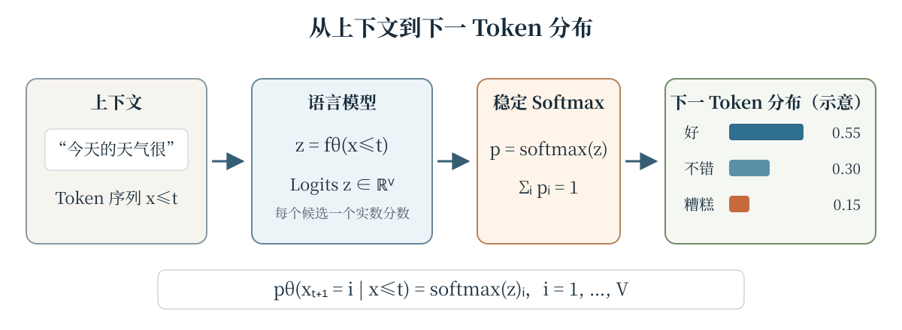
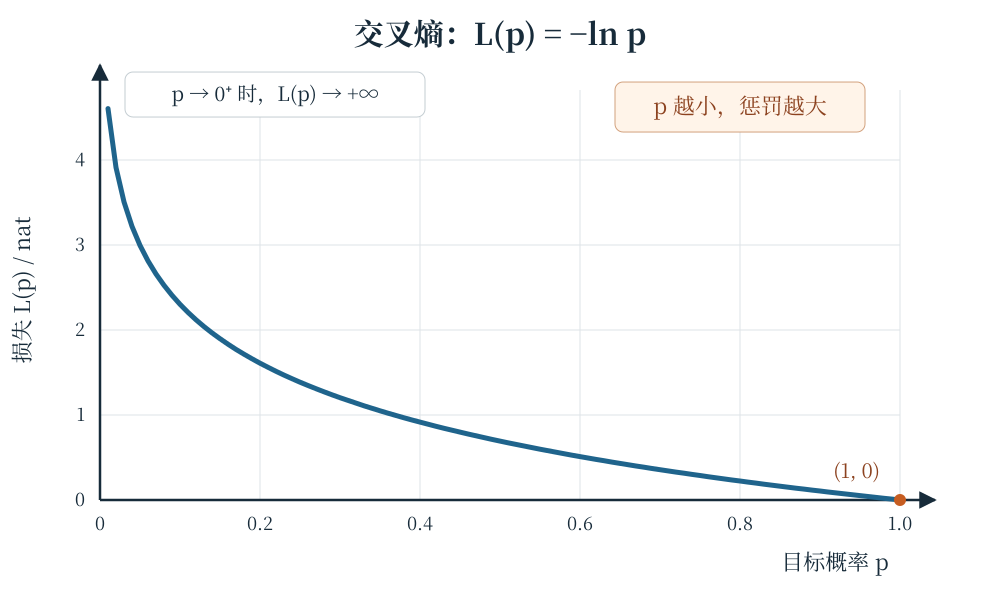
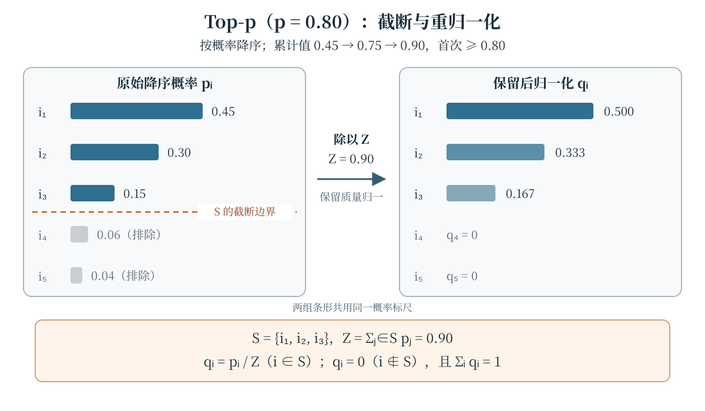

语言模型把离散 Token 序列的联合概率分解为一串条件概率的乘积，并通过预测下一个 Token 学习文本的统计结构。这一建模范式是神经语言模型的重要基础 [@bengio2003neural]。本章从一个已经给出的上下文出发，依次连接 Logits、稳定 Softmax、负对数似然、困惑度与解码策略；重点不是记忆名词，而是弄清每个量的定义域、归一化位置和训练—推理差异。

## 学习目标与先修知识

学完本章，你应当能够：

- 解释模型输出的 Logits 如何变成词表上的概率分布，并写出数值稳定的 Softmax；
- 从最大似然估计推导下一 Token 的负对数似然与交叉熵，辨认公式中的负号和求和范围；
- 区分单 Token 困惑度与整个语料的平均 NLL，避免以错误顺序平均；
- 说明 Teacher Forcing 在训练时提供什么，以及它为何不同于自回归推理；
- 手算温度变换与 Top-p 截断后的概率，并说明重归一化的必要性。

先修知识包括条件概率、期望、指数与自然对数、向量记号，以及阅读基础 Python 函数的能力。本章不要求训练过神经网络，也不要求使用 GPU 或模型权重。

## 从上下文到 Logits {#sec-logits}

设词表为 $\mathcal{V}=\{1,\ldots,V\}$，已经观察到的前缀为 $x_{\leq t}=(x_1,\ldots,x_t)$。参数为 $\theta$ 的模型读取该前缀，为每个候选下一 Token 给出一个实数分数：

$$
z^{(t)}=f_\theta(x_{\leq t})\in\mathbb{R}^{V}.
$$

第 $i$ 个分量 $z_i^{(t)}$ 称为候选 Token $i$ 的 **Logit**。Logits 可以取任意实数，既不是概率，也不要求和为一；它们只在与同一词表中的其他 Logits 比较并归一化后，才定义下一 Token 分布。@fig-next-token 用一个三候选的简化词表展示这条计算链路。

{data-external="1" #fig-next-token fig-alt="流水线示意图：上下文“今天的天气很”依次经过语言模型和 Softmax；语言模型输出词表 Logits，Softmax 输出好 0.55、不错 0.30、糟糕 0.15 的简化下一 Token 分布，三者之和为一。"}

## 稳定 Softmax {#sec-softmax}

省略位置上标后，Softmax 将 Logit 向量 $z\in\mathbb{R}^{V}$ 映射为概率向量 $p$：

$$
\begin{aligned}
p_i
&=\operatorname{softmax}(z)_i
=\frac{\exp(z_i)}{\sum_{j=1}^{V}\exp(z_j)},\\
&\qquad i=1,\ldots,V.
\end{aligned}
$$

分母对**整个词表**求和，因此 $p_i>0$ 且 $\sum_i p_i=1$。只在一组 Top-k 候选上归一化，得到的是截断后的另一个分布，不能与原式混为一谈。

直接计算 $\exp(z_i)$ 可能在正 Logit 很大时溢出。令 $m=\max_j z_j$，实际计算使用恒等式

$$
p_i=\frac{\exp(z_i-m)}{\sum_{j=1}^{V}\exp(z_j-m)}.
$$

分子、分母中的公共因子 $\exp(-m)$ 会约去，所以这不是近似，而是与原式数学等价的重排。最大 Logit 对应 $\exp(0)=1$，其余指数至多为 $1$，从而避免由大的正 Logit 直接导致的指数溢出。更一般地，对所有 Logits 同时加上常数 $c$ 不改变 Softmax 结果。

## NLL、MLE 与交叉熵 {#sec-cross-entropy}

设真实下一 Token 为 $y=x_{t+1}$，其 one-hot 向量为 $\mathbf{y}$。模型分布 $p_\theta(\cdot\mid x_{\leq t})$ 对这一观察给出的**负对数似然**（Negative Log-Likelihood，NLL）是

$$
\mathcal{L}_t(\theta)=-\log p_\theta(y\mid x_{\leq t}).
$$

在训练样本上最大化对数似然，与最小化 NLL 之和等价：

$$
\begin{aligned}
\hat{\theta}
&=\arg\max_\theta\sum_t\log p_\theta(x_{t+1}\mid x_{\leq t})\\
&=\arg\min_\theta\sum_t\mathcal{L}_t(\theta).
\end{aligned}
$$

这就是最大似然估计（Maximum Likelihood Estimation，MLE）在下一 Token 预测中的形式；深度学习教材通常也从这一视角讨论输出分布与损失函数 [@goodfellow2016deep]。对 one-hot 目标，交叉熵与 NLL 是同一个量：

$$
H(\mathbf{y},p)=-\sum_{i=1}^{V}y_i\log p_i=-\log p_y.
$$

求和看似覆盖整个词表，但只有真实类别对应的分量为一，其余项均为零。负号把小于一的概率的对数转为非负损失：当 $p_y=1$ 时损失为零；当 $p_y\to0^+$ 时，$-\log p_y\to+\infty$，如 @fig-cross-entropy 所示。本章使用自然对数，因此损失单位是 nat；若改用 $\log_2$，单位则是 bit。

::: {.content-visible when-format="html"}
```{=html}
<div class="interactive-mount">
<llm-cross-entropy data-figure-id="fig-cross-entropy" probability="0.5"></llm-cross-entropy>
</div>
```

<noscript markdown="1">

{data-external="1" #fig-cross-entropy fig-alt="交叉熵曲线图：横轴是目标 Token 概率 p，纵轴是损失 L(p) 等于负自然对数 p。曲线从 p 接近零时的高损失单调下降，在 p 等于一处到达零。"}

</noscript>
:::

::: {.content-visible unless-format="html"}
{data-external="1" #fig-cross-entropy fig-alt="交叉熵曲线图：横轴是目标 Token 概率 p，纵轴是损失 L(p) 等于负自然对数 p。曲线从 p 接近零时的高损失单调下降，在 p 等于一处到达零。"}
:::

## 单 Token 困惑度与语料平均 NLL

对单个目标 Token，困惑度（Perplexity）定义为其 NLL 的指数：

$$
\begin{aligned}
\operatorname{PPL}_t
&=\exp(\mathcal{L}_t)
=\exp(-\log p_y)\\
&=\frac{1}{p_y}.
\end{aligned}
$$

它是“这一目标概率”的单调变换，而不是对整个语料质量的独立测量。若语料中共有 $N$ 个目标 Token，第 $n$ 个目标及其上下文为 $(y_n,c_n)$，则先计算**平均 NLL**：

$$
\begin{aligned}
\overline{\mathcal{L}}
&=-\frac{1}{N}\sum_{n=1}^{N}\log p_\theta(y_n\mid c_n),\\
\operatorname{PPL}_{\text{corpus}}
&=\exp(\overline{\mathcal{L}}).
\end{aligned}
$$

顺序不能交换：记 $p_n=p_\theta(y_n\mid c_n)$，语料困惑度不是 $\frac{1}{N}\sum_n(1/p_n)$，也不是单 Token 困惑度的算术平均。困惑度还依赖语料和 Tokenization；比较不同模型时，必须确认评测数据与计数口径一致，不能把数值差异直接解释为普遍的语言能力差异。

### 最小 Python 实现

下面直接复用本书的 `examples/softmax_cross_entropy.py`。其中 `softmax` 先减去最大 Logit，`cross_entropy` 接收已经归一化的目标 Token 概率，`perplexity` 对应上文的单 Token 定义；它们不替代语料级求和与平均。

```python

```

## Teacher Forcing：训练时的真实前缀

对完整序列 $x_{1:T}$，自回归分解给出

$$
\mathcal{L}(x_{1:T})
=-\sum_{t=1}^{T}\log p_\theta(x_t\mid x_{<t}),
$$

其中第一个位置可使用约定的起始符作为上下文。训练时，预测位置 $t$ 的输入前缀来自数据中的真实 Token $x_{<t}$，而不是模型先前采样出的 Token；这称为 **Teacher Forcing**。因果掩码保证位置 $t$ 不能看到当前目标及未来 Token，因此许多位置可以在一次前向计算中并行训练，而不会发生标签泄漏。

推理时没有真实后续文本可供条件化，模型只能把自己已经生成的前缀重新作为输入，逐步产生后续 Token。于是，训练时“给定真实前缀计算所有位置的损失”和推理时“给定生成前缀滚动解码”必须区分开来。Teacher Forcing 并不是把当前答案喂给模型，也不是让序列中的所有位置互相可见。

## 温度与 Top-p 解码 {#sec-decoding}

训练目标定义条件分布，解码规则决定如何从这个分布选 Token。温度（Temperature）$T>0$ 先改变分布形状。用原始概率 $p$ 表示，温度为 $T$ 的分布为

$$
p_i^{(T)}
=\frac{p_i^{1/T}}{\sum_{j=1}^{V}p_j^{1/T}}
=\frac{\exp(z_i/T)}{\sum_{j=1}^{V}\exp(z_j/T)}.
$$

注意指数是 $1/T$，不是 $T$。$0<T<1$ 使分布更尖锐，高概率候选的相对优势增大；$T>1$ 使分布更平坦；$T=1$ 保持原分布。温度只重加权，不会删除任何正概率候选。

Nucleus Sampling，即 **Top-p 采样**，改为从累计概率达到阈值的动态候选集中采样 [@holtzman2019curious]。将概率按降序排列为 $p_{\pi(1)}\geq\cdots\geq p_{\pi(V)}$，对阈值 $p\in(0,1]$，取最小集合

$$
\begin{aligned}
S_p&=\{\pi(1),\ldots,\pi(K)\},\\
K&=\min\left\{k:\sum_{r=1}^{k}p_{\pi(r)}\geq p\right\}.
\end{aligned}
$$

累计和首次达到或越过阈值的那个候选也必须保留。随后令 $Z_p=\sum_{i\in S_p}p_i$，重新定义

$$
q_i=
\begin{cases}
p_i/Z_p,&i\in S_p,\\
0,&i\notin S_p.
\end{cases}
$$

最后从 $q$ 中采样。除以 $Z_p$ 使保留质量重新归一；若截去了正概率质量却不做这一步，保留概率之和小于一，$q$ 就不是概率分布。Top-p 的候选数量随分布形状变化，并不等同于固定数量的 Top-k；它也不同于始终取最大概率候选的贪婪解码。@fig-top-p 展示了阈值、跨界候选和重归一化的完整过程。

::: {.content-visible when-format="html"}
```{=html}
<div class="interactive-mount">
<llm-decoding-explorer data-figure-id="fig-top-p" tokens="的,模型,学习" probabilities="0.2,0.5,0.3" temperature="1" top-p="1"></llm-decoding-explorer>
</div>
```

<noscript markdown="1">

{data-external="1" #fig-top-p fig-alt="Top-p 等于 0.80 的示例：五个降序候选概率依次为 0.45、0.30、0.15、0.06、0.04。累计概率在第三项达到 0.90，因此保留前三项并排除后两项；前三项除以 Z 等于 0.90 后变为 0.500、0.333、0.167。"}

</noscript>
:::

::: {.content-visible unless-format="html"}
{data-external="1" #fig-top-p fig-alt="Top-p 等于 0.80 的示例：五个降序候选概率依次为 0.45、0.30、0.15、0.06、0.04。累计概率在第三项达到 0.90，因此保留前三项并排除后两项；前三项除以 Z 等于 0.90 后变为 0.500、0.333、0.167。"}
:::

## 常见误解

- **“Logit 就是概率。”** Logit 未归一化且可为负；Softmax 之后才得到词表上的分布。
- **“稳定 Softmax 会改变原有数值结果。”** 减去同一个最大值在实数数学中完全等价，改变的是浮点计算路径。
- **“交叉熵就是没有负号的对数概率。”** NLL 与交叉熵使用 $-\log p_y$；漏掉负号会把应当最小化的目标方向反转。
- **“语料困惑度等于各 Token 困惑度的算术平均。”** 正确顺序是先平均 NLL，再取指数。
- **“Teacher Forcing 会把当前目标直接输入模型。”** 它提供的是真实的历史前缀，当前目标和未来 Token 仍被因果掩码隔离。
- **“Top-p 截取后可以直接采样，或每次都保留固定数量候选。”** 截取后必须除以保留质量 $Z_p$，且集合大小由累计概率阈值动态决定。

## 总结

下一 Token 训练可以浓缩为一条链路：模型对上下文输出 Logits，稳定 Softmax 在整个词表上归一化，交叉熵以 $-\log p_y$ 惩罚真实 Token 的低概率。单 Token 困惑度是 $1/p_y$，语料困惑度则是平均 NLL 的指数。Teacher Forcing 描述训练时使用真实历史前缀，温度与 Top-p 则属于训练之后的解码选择；其中温度使用 $1/T$ 指数，Top-p 必须在动态截断后重归一化。

## 练习

1. **手算稳定 Softmax。** 对 $z=(1,2,3)$，先写出 $z-\max(z)$，再用含 $e$ 的表达式计算三个概率并验证其和为一。直接计算与减去最大值后的结果应满足什么关系？
2. **证明平移不变性。** 证明对任意常数 $c$，$\operatorname{softmax}(z+c\mathbf{1})=\operatorname{softmax}(z)$。这一性质为何允许选择 $c=-\max_j z_j$ 来改善数值计算？
3. **计算损失与单 Token 困惑度。** 分别对 $p_y=0.8$、$0.2$、$0.01$ 计算 $-\ln p_y$ 与 $1/p_y$，并说明二者随目标概率变化的趋势。
4. **辨认平均顺序。** 两个目标 Token 的概率分别为 $0.5$ 和 $0.25$。计算二者的平均 NLL 及语料困惑度，再计算两个单 Token 困惑度的算术平均，比较结果并解释差异。
5. **推导 Logit 梯度。** 对 one-hot 目标 $\mathbf{y}$ 与 $p=\operatorname{softmax}(z)$，证明 $\partial H(\mathbf{y},p)/\partial z_i=p_i-y_i$。这个式子如何体现“提高真实类别、压低其他类别”并不等于只更新真实类别？
6. **区分训练与推理。** 预测 $x_{t+1}$ 时，Teacher Forcing 向模型提供哪些 Token？如果把 $x_{t+1}$ 本身也放入输入，会破坏什么训练性质？自回归推理为何不能照搬真实前缀？
7. **应用温度。** 已知 $p=(0.5,0.25,0.25)$ 且 $T=2$，使用 $p_i^{1/T}$ 计算温度变换后的分布，并判断它更尖锐还是更平坦。
8. **执行 Top-p。** 原顺序中的四个概率为 $(0.15,0.50,0.05,0.30)$，阈值为 $0.75$。先降序排列并确定最小保留集合，再把结果映射回原顺序，写出重归一化后的 $q$；说明累计和越过阈值的候选为何不能丢弃。

::: {.content-visible when-format="html"}
<script type="module">import './assets/js/book.js';</script>
:::
