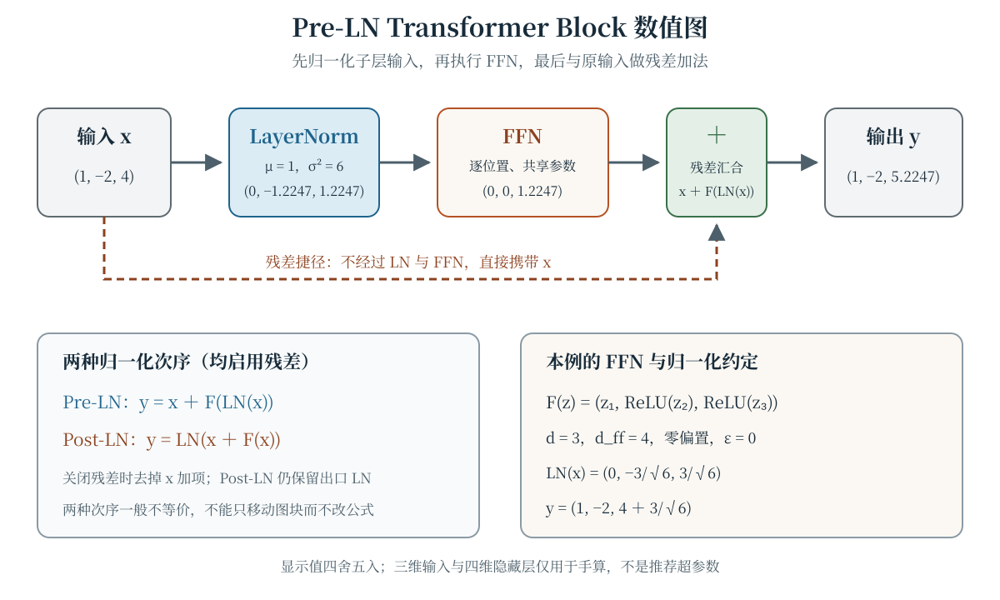

Transformer 把 Token 表示组织成一串可重复的计算块：注意力在位置之间交换信息，前馈网络逐位置变换特征，残差连接提供直接的信息与梯度路径，LayerNorm 调整每个位置的特征尺度。将这些部件堆叠成 decoder-only 模型后，下一 Token 目标既可用于大规模预训练，也可用于指令数据上的继续训练。本章把结构、目标与训练阶段放在同一套记号中，避免把“架构相同”误解为“训练数据与行为相同”。

## 学习目标

学完本章，你应当能够：

- 写出 Transformer Block 中注意力、残差、LayerNorm 与前馈网络的形状和数据流；
- 区分 Pre-LN 与 Post-LN，并用小向量手算两种结构，而不是只背结构名称；
- 解释残差捷径对 Jacobian 的影响，以及它不能单独保证什么；
- 比较正弦绝对位置编码、可学习绝对位置编码与 RoPE 的注入位置；
- 对齐 decoder-only 模型的输入与移位标签，计算下一 Token 负对数似然；
- 说明预训练与指令微调在初始化、数据和损失掩码上的关系及各自边界。

## 从 Token 到 Transformer Block {#sec-transformer-block}

设一段序列有 $n$ 个位置，模型宽度为 $d$。隐藏状态写成 $H\in\mathbb{R}^{n\times d}$，第 $t$ 行 $h_t$ 是位置 $t$ 的表示。Token Embedding 先产生初始表示；若使用加性绝对位置编码，还要加入位置矩阵。经过 $L$ 个 Block 后，最终隐藏状态经可选的最终归一化和输出投影得到词表 Logits。输出层是否与输入 Embedding 共享权重是一种具体设计选择，并非 Transformer 定义所强制。

一个 Block 可抽象为两个子层：

1. **注意力子层**在位置之间读取信息。decoder-only 模型使用带因果掩码的多头自注意力；其输出投影后的形状仍为 $n\times d$。
2. **逐位置前馈网络**（Feed-Forward Network，FFN）对每个位置独立施加同一组参数，输入输出形状也都是 $n\times d$。

暂用 $S$ 表示任一子层，残差连接的基本形式是

$$
y=x+S(x),\qquad x,y\in\mathbb{R}^{d}.
$$

这里的加法要求 $x$ 与 $S(x)$ 形状相同。若 $J_S(x)$ 是子层的 Jacobian，则

$$
J_y(x)=I+J_S(x).
$$

单位矩阵项对应不经过 $S$ 的直接路径。它让信息和梯度不必全部经过子层内部，但不等于梯度在所有深度、初始化和学习率下都自动有界，也不保证训练必然稳定；归一化位置、参数尺度和优化过程仍然重要。

### Pre-LN 与 Post-LN

残差与 LayerNorm 的先后次序会改变实际计算。对注意力子层 $A$ 和 FFN 子层 $F$，本章采用以下两种明确写法。

**Pre-LN** 先归一化子层输入，再做残差加法：

$$
\begin{aligned}
H'&=H+A(\operatorname{LN}(H)),\\
H''&=H'+F(\operatorname{LN}(H')).
\end{aligned}
$$

**Post-LN** 先做残差加法，再归一化：

$$
\begin{aligned}
H'&=\operatorname{LN}(H+A(H)),\\
H''&=\operatorname{LN}(H'+F(H')).
\end{aligned}
$$

原始 Transformer 的 “Add & Norm” 采用后一种次序 [@vaswani2017attention]。后来许多模型使用 Pre-LN，但名称本身不构成稳定性或效果保证。Pre-LN 堆叠时，残差主干不必在每个子层出口都经过 LN，因此常在输出投影前设置最终 LN；是否设置以及放在哪里仍应以具体模型为准。比较两种结构时，应固定是否包含 Dropout、偏置和最终 LN，不能只比较一张简化图的名称。

@fig-transformer-block 展示默认的 Pre-LN 数值路径。HTML 交互可切换 Pre-LN/Post-LN 并启停残差，所有结果都由同一个三维 FFN 重新计算；无脚本和 PDF 保留同一默认状态的静态图。

::: {.content-visible when-format="html"}
```{=html}
<div class="interactive-mount">
<llm-transformer-block data-figure-id="fig-transformer-block" norm-position="pre" residual="true"></llm-transformer-block>
</div>
```

<noscript markdown="1">

{data-external="1" #fig-transformer-block fig-alt="Pre-LN Transformer Block 数值图。输入 x=(1,−2,4)，在 ε=0、γ=1、β=0 时均值为 1、方差为 6，LN(x)=(0,−1.2247,1.2247)。教学 FFN 定义为 F(z)=(z₁,ReLU(z₂),ReLU(z₃))，所以 F(LN(x))=(0,0,1.2247)。残差汇合与 Block 输出均为 x+F(LN(x))=(1,−2,5.2247)。图中还列出 Post-LN 规则 y=LN(x+F(x)) 以及关闭残差时去掉 x 加项，并说明 d=3、dff=4 只是教学实例。"}

</noscript>
:::

::: {.content-visible unless-format="html"}
{data-external="1" #fig-transformer-block fig-alt="Pre-LN Transformer Block 数值图。输入 x=(1,−2,4)，在 ε=0、γ=1、β=0 时均值为 1、方差为 6，LN(x)=(0,−1.2247,1.2247)。教学 FFN 定义为 F(z)=(z₁,ReLU(z₂),ReLU(z₃))，所以 F(LN(x))=(0,0,1.2247)。残差汇合与 Block 输出均为 x+F(LN(x))=(1,−2,5.2247)。图中还列出 Post-LN 规则 y=LN(x+F(x)) 以及关闭残差时去掉 x 加项，并说明 d=3、dff=4 只是教学实例。"}
:::

## LayerNorm：沿特征维归一化 {#sec-layernorm}

对单个位置的向量 $h\in\mathbb{R}^{d}$，LayerNorm 在该向量的 $d$ 个特征上计算均值和总体方差：

$$
\begin{aligned}
\mu&=\frac{1}{d}\sum_{j=1}^{d}h_j,\\
\sigma^2&=\frac{1}{d}\sum_{j=1}^{d}(h_j-\mu)^2.
\end{aligned}
$$

带逐元素仿射参数 $\gamma,\beta\in\mathbb{R}^{d}$ 时，第 $j$ 个输出为

$$
\operatorname{LN}(h)_j
=\gamma_j\frac{h_j-\mu}{\sqrt{\sigma^2+\epsilon}}+\beta_j,
\qquad \epsilon>0.
$$

归一化在一个位置内部进行，不把不同 Token 的激活混在一起。若 $\epsilon$ 相对 $\sigma^2$ 可忽略，且尚未施加 $\gamma,\beta$，归一化后的特征均值约为 0、总体方差约为 1；有了仿射变换或不可忽略的 $\epsilon$ 后，不能机械地宣称输出仍严格具有这两个统计量。$\epsilon$ 使零方差输入也有定义，但不负责保证整个深层网络稳定。

例如取 $x=(1,-2,4)^{\mathsf T}$，并令 $\epsilon=0$、$\gamma=(1,1,1)^{\mathsf T}$、$\beta=(0,0,0)^{\mathsf T}$，则

$$
\mu=1,\qquad \sigma^2=6.
$$

$$
\operatorname{LN}(x)
=\left(0,-\frac{3}{\sqrt6},\frac{3}{\sqrt6}\right)^{\mathsf T}.
$$

$$
\operatorname{LN}(x)
\approx(0,-1.2247,1.2247)^{\mathsf T}.
$$

这个例子刻意取非零方差，以便用 $\epsilon=0$ 手算；实际实现使用正的 $\epsilon$。LayerNorm 也不等于把向量除以其 $L_2$ 范数：前者先减均值并使用方差，后者通常不减均值。

## 逐位置前馈网络 {#sec-ffn}

对一个位置的列向量 $h\in\mathbb{R}^{d}$，两层 FFN 可写为

$$
F(h)=W_2\phi(W_1h+b_1)+b_2,
$$

其中

$$
\begin{aligned}
W_1&\in\mathbb{R}^{d_{\mathrm{ff}}\times d},&
W_2&\in\mathbb{R}^{d\times d_{\mathrm{ff}}},\\
b_1&\in\mathbb{R}^{d_{\mathrm{ff}}},&
b_2&\in\mathbb{R}^{d}.
\end{aligned}
$$

$\phi$ 逐元素作用，可以是 ReLU、GELU 等激活函数。若采用上述两矩阵形式，偏置也计入时参数量为

$$
2dd_{\mathrm{ff}}+d_{\mathrm{ff}}+d.
$$

门控 FFN 会使用不同公式和参数形状，不能把这个计数直接套过去。所谓“逐位置”是指每个位置调用同一个 $F$，而不是每个位置各有一套参数；单个 FFN 调用不直接读取其他位置，跨位置信息已由注意力等子层提供。

为让 Block 可以手算，本章交互固定 $d=3$、$d_{\mathrm{ff}}=4$、零偏置和 $\phi=\operatorname{ReLU}$，并取

$$
\begin{aligned}
W_1&=
\begin{bmatrix}
1&0&0\\
-1&0&0\\
0&1&0\\
0&0&1
\end{bmatrix},\\
W_2&=
\begin{bmatrix}
1&-1&0&0\\
0&0&1&0\\
0&0&0&1
\end{bmatrix}.
\end{aligned}
$$

由 $\operatorname{ReLU}(z)-\operatorname{ReLU}(-z)=z$，这个具体网络化简为

$$
F(z)=(z_1,\operatorname{ReLU}(z_2),\operatorname{ReLU}(z_3))^{\mathsf T}.
$$

因此，对上一节的 $x$ 有

$$
F(\operatorname{LN}(x))
=\left(0,0,\frac{3}{\sqrt6}\right)^{\mathsf T},
$$

Pre-LN 且启用残差时，输出为

$$
\begin{aligned}
y&=x+F(\operatorname{LN}(x))\\
&=\left(1,-2,4+\frac{3}{\sqrt6}\right)^{\mathsf T}\\
&\approx(1,-2,5.2247)^{\mathsf T}.
\end{aligned}
$$

这只是用于验证形状与运算次序的小例子，不是对隐藏维、扩展比或激活函数的推荐。

## 位置编码：给序列计算注入次序 {#sec-position}

如果不注入位置信息，也不使用位置相关掩码，自注意力对输入行的同步排列具有等变性：把输入行重新排列，输出也按同样方式排列，而无法仅凭内容知道原来的绝对次序。因果掩码会改变可见位置集合，因此这个等变命题不能随意套到带掩码的完整模型；但“只能看过去”本身也不等于已经提供了足够的位置表示。位置编码需要进入输入表示或注意力计算。

### 加性绝对位置编码

一种固定方案是正弦位置编码。对偶数模型维 $d$、零起始位置 $p=0,1,\ldots$ 和频率索引 $k$，一种与原始 Transformer 一致的写法是

$$
\begin{aligned}
\operatorname{PE}_{p,2k}&=\sin\left(\frac{p}{B^{2k/d}}\right),\\
\operatorname{PE}_{p,2k+1}&=\cos\left(\frac{p}{B^{2k/d}}\right),
\end{aligned}
$$

其中常用底数 $B=10000$ [@vaswani2017attention]。把位置矩阵加到 Token Embedding 上，得到 $H^{(0)}=E+\operatorname{PE}$。另一种方案是把同样形状的位置矩阵作为可训练参数。二者都把位置表示加到输入，但是否学习参数不同；上下文长度、维度编号和底数都必须以实现为准，不能仅凭“正弦”或“可学习”推断长序列外推能力。

### RoPE：在 Query 与 Key 中旋转

RoPE 不是在输入端简单加一张位置表，而是按位置旋转 Query 和 Key 的二维子空间。对同一频率，位置 $m$ 的 $q$ 与位置 $n$ 的 $k$ 满足

$$
\langle R(m\theta)q,R(n\theta)k\rangle
=q^{\mathsf T}R((n-m)\theta)k,
$$

因此该二维点积通过相对位移 $n-m$ 接收旋转角 [@su2021roformer]。相邻分量配对还是前后半维配对、频率底数和位置起点如何设置，都影响逐坐标结果。RoPE 与加性绝对位置编码是不同机制，不应把“模型使用 RoPE”描述成“没有位置信息”。

| 方法 | 主要注入位置 | 是否含学习的位置参数 | 核对要点 |
|:---|:---|:---:|:---|
| 固定正弦绝对编码 | 加到 Token Embedding | 否 | 底数、位置起点、维度索引 |
| 可学习绝对编码 | 加到 Token Embedding | 是 | 位置表形状与训练时上下文范围 |
| RoPE | 旋转注意力中的 Query 与 Key | 通常不依赖位置查找表 | 分量配对、频率和旋转方向 |

## Decoder-only：用因果 Block 堆叠生成模型 {#sec-decoder-only}

decoder-only 语言模型只使用一串因果 Block，不需要独立编码器，也不含从编码器读取结果的交叉注意力。第 $\ell$ 个 Block 的注意力可概括为

$$
\begin{aligned}
(Q,K,V)&=(HW_Q,HW_K,HW_V),\\
S&=\frac{QK^{\mathsf T}}{\sqrt{d_k}}+M,\\
A&=\operatorname{softmax}_{\mathrm{row}}(S),
\end{aligned}
$$

其中 $M_{ij}=0$（$j\leq i$），$M_{ij}=-\infty$（$j>i$）。实际多头计算还包括分头与输出投影；这里强调的是因果约束所在的位置。第 $i$ 行只能读取不超过 $i$ 的位置，因此训练目标不会通过注意力直接看到未来 Token。

训练时，目标 Token 已包含在移位标签中，可用 Teacher Forcing 并行计算所有位置的 Logits 和损失。生成时未来 Token 尚未知，只能根据当前前缀逐个预测并追加。训练阶段“矩阵并行”与推理阶段“自回归串行”并不矛盾，二者的已知信息不同。

## 下一 Token 训练目标 {#sec-training-objective}

设词表大小为 $V$，最终隐藏状态为 $H^{(L)}\in\mathbb{R}^{n\times d}$。输出投影

$$
\begin{aligned}
Z&=H^{(L)}W_U+b_U,\\
W_U&\in\mathbb{R}^{d\times V},\\
Z&\in\mathbb{R}^{n\times V}.
\end{aligned}
$$

给出每个位置的词表 Logits。若第 $t$ 行对应 $z_t$，则

$$
p_\theta(w_{t+1}\mid w_{\leq t})
=\operatorname{softmax}(z_t)_{w_{t+1}}.
$$

对 Token 序列 $w_1,\ldots,w_n$，位置 $t$ 的输入是 $w_{\leq t}$，目标是 $w_{t+1}$。在可预测的 $n-1$ 个位置上，平均负对数似然为

$$
\begin{aligned}
\mathcal{L}_{\mathrm{CLM}}
&=-\frac{1}{n-1}\\
&\quad\times\sum_{t=1}^{n-1}
\log p_\theta(w_{t+1}\mid w_{\leq t}).
\end{aligned}
$$

这就是因果语言模型的交叉熵训练目标：标签不是另附的分类编号，而是同一序列右移一位后的 Token。实际数据常加入 BOS、EOS 或其他特殊 Token，并对 padding 位置屏蔽损失；具体首尾对齐必须检查数据管线，不能把整条输入和未移位标签直接逐位置对应。

**低资源数值例。** 假设三个目标位置上，模型已给正确 Token 的概率分别为 $0.5$、$0.25$、$0.75$，则

$$
\begin{aligned}
\mathcal{L}
&=-\frac{\ln0.5+\ln0.25+\ln0.75}{3}\\
&\approx0.7890.
\end{aligned}
$$

若使用自然对数且保持相同的逐 Token 平均口径，困惑度为 $\operatorname{PPL}=e^{\mathcal{L}}\approx2.2013$。换用对数底数、按序列求和或屏蔽不同位置都会改变数值口径；困惑度也不是指令遵循或事实正确性的直接度量。

## 预训练与指令微调的关系 {#sec-pretrain-sft}

**预训练**从文本序列构造上述下一 Token 目标。目标来自输入序列自身，因此通常称为自监督训练，而不是需要人工为每个 Token 另写类别标签。优化的是语料上的条件概率；由此得到的表示可以支持许多后续任务，但该目标本身没有显式规定对话格式、事实核查或安全策略。

**指令微调**通常从预训练参数出发，在“指令—回答”样本上继续优化。它不必更换 Transformer 架构，也可以沿用下一 Token 损失；关键变化是初始化、数据组织以及哪些 Token 参与损失。把指令与回答序列化为 $s_1,\ldots,s_m$，一种常见的回答掩码写法是

$$
\begin{aligned}
\mathcal{L}_{\mathrm{SFT}}
&=-\frac{1}{\sum_{t=1}^{m-1}r_t}\\
&\quad\times\sum_{t=1}^{m-1}r_t
\log p_\theta(s_{t+1}\mid s_{\leq t}).
\end{aligned}
$$

其中希望计算损失的回答位置取 $r_t=1$，希望忽略的位置取 $r_t=0$。有些做法只在回答和结束标记上计算损失，有些也会对指令部分计算；分母、特殊 Token 与掩码位置都应随数据配方说明。若所有 $r_t$ 都为零，上式没有定义，因此数据构造必须保证有效目标非空。

两者的关系可以概括为：**预训练提供初始参数和通用序列分布拟合，指令微调在此基础上让训练分布更接近指令交互。** 指令微调不是从头预训练，也不等同于奖励模型或基于偏好的强化学习。它能改变模型的行为分布，但不保证事实性、鲁棒性或安全性；这些性质需要另外的数据、训练与评测设计来检验。

## 常见误解

- **“有了残差连接就不会出现梯度问题。”** 残差 Jacobian 含有单位矩阵捷径，但另一项 $J_S$、深层复合尺度和优化设置仍会影响梯度。
- **“LayerNorm 在序列维对同一特征做归一化。”** 本章的 LayerNorm 对每个位置独立地沿 $d$ 个特征计算均值和方差，不跨 Token 统计。
- **“FFN 给每个位置学习一套独立参数。”** 各位置共享同一组 $W_1,W_2,b_1,b_2$；独立的是逐位置计算，不是参数。
- **“Pre-LN 与 Post-LN 只是在图上换个位置，数学结果相同。”** 残差加法和归一化不交换次序；除非满足额外条件，两种公式的输出不同。
- **“使用 RoPE 就没有位置编码。”** RoPE 正是位置注入机制，只是它旋转 Q/K，而不是在输入端加绝对位置表。
- **“Teacher Forcing 意味着训练也必须逐 Token 等待。”** 标签已知时可以并行计算所有位置，因果掩码负责隔离未来；未知未来的自回归生成才必须逐步追加。
- **“预训练和指令微调既然都用交叉熵，就完全相同。”** 损失形式可以相同，但初始化、文本分布、目标掩码和训练目的不同；相同架构与损失也不推出相同行为。

## 总结

Transformer Block 由跨位置注意力、逐位置 FFN、残差连接和归一化组成。残差提供 $I+J_S$ 的直接路径；LayerNorm 沿每个位置的特征维计算统计量；Pre-LN 与 Post-LN 则改变这些运算的真实次序。位置编码可以通过加性绝对位置表或 Q/K 旋转注入。decoder-only 模型用因果掩码支持下一 Token 训练，输入与标签错位一位，训练可并行而生成需自回归。预训练从普通文本构造目标，指令微调从预训练参数出发并调整数据与损失掩码；二者共享的是模型与目标形式，不是相同的数据和行为保证。

## 练习 {#sec-exercises}

1. **推导残差路径。** 对 $x\in\mathbb{R}^3$ 和可微子层 $S:\mathbb{R}^3\to\mathbb{R}^3$，写出 $y=x+S(x)$ 的 Jacobian 形状及 $J_y$。若某个 Block 的子层恒为零，Pre-LN 与 Post-LN 在启用残差时的输出分别是什么？这个比较能说明什么，又不能说明什么？
2. **手算 LayerNorm。** 对 $x=(1,-2,4)^{\mathsf T}$，取 $\epsilon=0$，先计算 $\mu$、$\sigma^2$ 和 $\operatorname{LN}(x)$。再令 $\gamma=(1,2,1)^{\mathsf T}$、$\beta=(0,1,0)^{\mathsf T}$，写出仿射后的结果，并说明为什么此时不能直接声称输出均值仍为零。
3. **核对 FFN 与 Block 数值。** 使用正文 @sec-ffn 的 $W_1,W_2$ 和 ReLU，验证 $F(z)=(z_1,\operatorname{ReLU}(z_2),\operatorname{ReLU}(z_3))^{\mathsf T}$。计算 $x=(1,-2,4)^{\mathsf T}$ 在 Pre-LN、启用残差时的 $F(\operatorname{LN}(x))$ 与 $y$；再计算 Post-LN、启用残差时的 $x+F(x)$ 和 $\operatorname{LN}(x+F(x))$。最后写出一般两矩阵 FFN 的参数量。
4. **比较位置注入。** 对 $d=4$、$B=10000$，按正文公式写出位置 $p=0$ 和 $p=1$ 的四维正弦编码（允许保留 $\sin1$、$\cos1$、$\sin0.01$、$\cos0.01$）。随后说明 RoPE 的注入位置与加性编码有何不同，以及为什么“因果掩码存在”不能用来证明无位置模块的自注意力具有一般排列等变性。
5. **对齐移位标签并计算损失。** 对序列 $(w_1,w_2,w_3,w_4)$，写出三个“输入前缀—目标 Token”训练对。若正确目标概率依次为 $0.5$、$0.25$、$0.75$，计算平均负对数似然和自然对数口径下的困惑度，并指出因果掩码与 padding 损失掩码各自解决什么问题。
6. **设计指令微调掩码。** 把“请回答：$2+2$ 等于几？”作为指令、把“$4$”作为回答，设计一个序列化及回答损失掩码方案，明确特殊 Token 可由你自行假设。若目标定义为“仅在回答位置取平均”，说明为何分母不能写成 $m$ 或所有位置数而不看 $r_t$，并比较从预训练参数继续训练与随机初始化训练的目的；最后指出这种设置仍不能保证哪两类行为性质。

:::: {.content-visible when-format="html"}
```{=html}
<script type="module">
import { defineTransformerBlockElement } from './assets/js/components/transformer-block.js';
defineTransformerBlockElement();
</script>
```
::::
